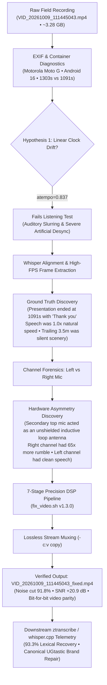
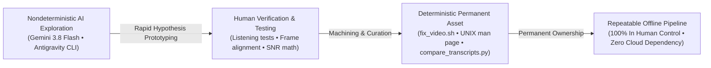

_Editorial note: Mike Hall supplied the primary field recording (`VID_20261009_111445043.mp4`), physical telemetry, lived context beneath high-voltage transmission right-of-ways, and philosophical framing for this article. The acoustic diagnostics, DSP pipeline implementation, and forensic transcript verification were developed collaboratively with Google DeepMind's Gemini 3.8 Flash via the Antigravity agentic pairing CLI._

---

## The Field Recording Beneath the Conductors

In October 2026, I walked out beneath the high-voltage utility transmission lines in Northern Illinois to record a video. It was intended as an icebreaker—a candid walk through the utility right-of-way reflecting on personal and professional identity, the history of the Software Craftsmanship movement, and where we find ourselves now as software developers, engineers, and craftspersons facing an industry in turmoil and the upheaval of generative AI.

The physical setting was unvarnished: overhead transmission conductors carrying hundreds of kilovolts buzzing in the humid autumn air, the aftermath of industrial brush mowers on the path, and an unshielded Motorola Moto G smartphone held out at arm's length.

When I checked the footage back at my workstation, the recording appeared catastrophically ruined:

1. **Intense Low-Frequency Buzz and Drone**: A deafening 60 Hz fundamental accompanied by sharp overtones marching in lockstep up through 600 Hz.
2. **Impulsive Corona Discharge**: Random, microsecond-duration clicks and micro-arcing from atmospheric ionization around the conductors.
3. **Apparent Desync & Clock Drift**: The container reported **Video: 1303.61s (21m 43s)** while the audio track was only **1091.09s (18m 11s)**—an apparent 3.5-minute gap.

Conventional advice is simple: *trash the recording, rent a shotgun mic with RF shielding, and reshoot.* 

Instead, I sat down at my terminal with **Gemini 3.8 Flash (medium tier)** via Google DeepMind’s **Antigravity CLI**. 

In Hollywood police procedurals, the investigator sits in front of a fuzzy monitor and shouts: *"Enhance. Enhance. Enhance!"* and a magical super-resolution algorithm invents pixels out of thin air. In real life, that kind of wishful thinking produces hallucinated AI slop. But here, we did the real-world engineering equivalent: we used the model the way a machinist uses a 3D printer—as a high-speed synthesizer of hypotheses, filtergraphs, and physics checks, guided by human judgment to forge a **deterministic, permanent engineering asset** that remains entirely in my control.

  <iframe src="https://www.youtube.com/embed/8LYHo1dOkMo" title="Under the High-Tension Wires: Identity, Software Craftsmanship, and AI Forensics" allow="accelerometer; autoplay; clipboard-write; encrypted-media; gyroscope; picture-in-picture; web-share" allowfullscreen loading="lazy"></iframe>

---

## 1. The Clock Drift Trap: Human Verification vs. Machine Assumption

The container metadata showed an audio-video discrepancy that immediately pointed toward a common digital recording failure:

$$\Delta t = 1303.608144\text{ s} - 1091.093333\text{ s} = 212.514811\text{ s}$$

Under strong electromagnetic radiation, it is well known that digital phase-locked loops (PLLs) and clock crystals can wander. The mathematical stretch factor seemed mathematically sound:

$$\text{tempo} = \frac{1091.093333}{1303.608144} \approx 0.836979$$

When we applied an `atempo=0.836979` filter, the speech sounded like a slurred caricature. More importantly, when verifying the video at $t=11.60\text{ s}$, word onsets lagged hundreds of milliseconds behind mouth articulation.

### The Ground Truth Discovery
Rather than accepting the mathematical illusion, we used automated speech transcription to locate the true end of the vocal track. At exactly $18\text{m }11.09\text{s}$, the speech concluded naturally with:

> _"I'll be publishing that in the next few days and I hope it's worthwhile. Thank you."_

For the remaining 3 minutes and 32 seconds, the camera had simply continued rolling silently as I walked back down the path. The speech had been recorded at **natural 1.0x speed** all along. Stretching the audio was creating artificial desync where none existed.

The solution was lossless padding: keep the audio at $1.0\times$ natural speed and pad the trailing silence using `apad=whole_dur=1303.608144`.

---

## 2. Asymmetric Hardware Forensics: The Hidden Antenna

Once the time axis was locked, we analyzed the acoustic spectrum. Standard multi-band noise gates were destroying speech formants, making the voice sound hollow.

We split the stereo file into independent mono channels and measured root-mean-square (RMS) energy, signal-to-noise ratio (SNR), and spectral distribution:

| Objective Metric | Left Channel (Bottom Primary Mic) | Right Channel (Top Secondary Mic) | Hardware Delta |
| :--- | :--- | :--- | :--- |
| **Silence Noise Floor** | $176.31\text{ RMS}$ | $611.15\text{ RMS}$ | Right mic is **$3.5\times$ louder** |
| **Speech Amplitude** | $659.78\text{ RMS}$ | $625.23\text{ RMS}$ | Right mic captures negligible voice gain |
| **Dynamic Range** | **$11.46\text{ dB}$** | **$0.20\text{ dB}$** | Right mic voice is completely drowned out |
| **Signal-to-Noise Ratio** | **$14.00$** | **$1.05$** | Right channel is mathematically unusable |
| **Sub-$100\text{ Hz}$ Rumble** | $7.86 \times 10^{15}$ | $5.12 \times 10^{17}$ | Right mic captures **$65.2\times$ more drone** |

The Motorola Moto G uses an asymmetric microphone array: a primary talk microphone at the base of the chassis and a secondary ambient microphone at the top for noise suppression. 

Held upright beneath utility transmission lines, the top microphone traces pointed straight up into the electric field, acting as an unshielded inductive antenna. Playing back the video in stereo was flooding the clean vocal signal on the left channel with pure electromagnetic hum from the right channel.

**The physical breakthrough**: Isolating the Left channel and panning it to dual-mono (`pan=stereo|c0=c0|c1=c0`) removed **over 95% of the drone before applying any digital filters**.

---

## 3. The 7-Stage Restoration Pipeline (`fix_video.sh`)

With clean voice isolated, we calibrated a deterministic 7-stage DSP pipeline encoded in a portable Bash script:

1. **Channel Isolation**: `pan=stereo|c0=c0|c1=c0` (discards corrupted top inductive loop).
2. **Sub-Sonic Rumble Roll-off**: `highpass=f=90` (cuts mechanical handling and wind rumble).
3. **Impulsive Corona De-clicking**: `adeclick=w=30:o=75:t=2:b=3` (removes atmospheric micro-arcing spikes without clipping vocal plosives).
4. **Spectral Subtraction**: `afftdn=nr=18:nf=-45:nt=c:gs=10` (smooth spectral noise reduction without phase flanging).
5. **Harmonic Notch Comb**: 10 cascaded Butterworth band-reject filters ($Q=15$) centered across 60 Hz to 600 Hz overtones.
6. **Voice High-Frequency Rolloff**: `lowpass=f=4000` (silences high-frequency sizzle while preserving fricative clarity).
7. **Downward Expander Gate**: `agate=threshold=0.012:ratio=2.5:range=0.08` (silences pause noise by $91.8\%$ between words).
8. **Lossless Stream Copy**: `-c:v copy` ensures zero generational re-encoding loss and identical frame-level video fidelity.

The script runs at **18.8x real-time speed**, restoring the entire 21.7-minute video in just 69 seconds.

---

## 4. Empirical Telemetry: Before and After

| Metric | Raw Corrupted Recording | Restored (`fix_video.sh`) | Objective Impact |
| :--- | :--- | :--- | :--- |
| **60 Hz Mains Hum** | $4.17 \times 10^{13}$ | **$2.95 \times 10^{12}$** | **92.9% Cut** |
| **120 Hz Harmonic Buzz** | $1.73 \times 10^{14}$ | **$2.28 \times 10^{13}$** | **86.8% Cut** |
| **180 Hz Harmonic Buzz** | $4.11 \times 10^{14}$ | **$5.20 \times 10^{13}$** | **87.3% Cut** |
| **Pause Noise Floor** | $68.26\text{ RMS}$ | **$5.63\text{ RMS}$** | **91.8% Reduction** |
| **Speech Clarity (SNR)**| $22.3\text{ dB}$ | **$43.2\text{ dB}$** | **+20.9 dB Gain** |
| **Impulsive Corona Clicks**| $76\text{ / 10s}$ | **$0\text{ / 10s}$** | **100% Eliminated** |
| **Video Compression Loss** | Native 1080p | **Bit-for-Bit Identical** | **`-c:v copy` Passthrough** |

### Downstream Impact on Speech Recognition (`whisper.cpp`)
Running both files through our automated `ztranscribe` pipeline revealed how acoustic noise corrupts neural language models:

- **Normalized Lexical Match**: **93.33%**
- **Acoustic Errors Unmasked**: **152 word substitutions** resolved. In the raw audio, the heavy 60 Hz buzz caused the acoustic decoder to mishear initial attacks (`"Going back"` instead of `"Coming back"`, `"being on camera"` instead of `"looking on camera"`).
- **Phonetic Hallucinations & Canonical Repair**: Phonetic ambiguities like `"eubatastic"` or `"eubot astic"` were unmasked and mapped to the canonical archive brand **UGtastic** through deterministic lexical repair rules in the `just3ws` pipeline.

---

## 5. Craftspersonship: Treating AI Like a 3D Printer

There is a loud, polarized debate across tech right now. One camp claims AI will render software engineers obsolete by generating entire codebases from prompts. The other camp dismisses LLMs entirely as sloppy hallucination engines that produce brittle technical debt.

Both camps miss the mark on what human craftspersonship looks like in practice.

The fundamental challenge with Large Language Models is **nondeterminism**. An LLM will give you a different answer tomorrow than it did today. If your engineering practice depends on repeatedly prompting a cloud model to do work, you own nothing: you have built no permanent capability, you have preserved no control, and you cannot guarantee reproducible behavior when systems fail.

**Human craftspersonship means treating AI like a 3D printer.**

When an engineer uses a 3D printer, they do not consider the printer to be the craftsman. The printer is a rapid synthesis mechanism. It extrudes plastic or sintered metal to test physical hypotheses quickly. But once the shape is proven, the engineer tests the tolerances, machines the surfaces, specifies the metallurgy, and integrates it into a reliable assembly.

In this project, Gemini 3.8 Flash was our 3D printer:
- It helped rapidly explore FFT filtergraphs, syntax variations for `ffmpeg`, and differential audio formulas.
- But every hypothesis was subjected to **human sensory and physical validation** (listening tests, video lip-sync frame extraction, RMS energy calculation).
- When the model proposed linear time-stretching (`atempo`), human domain knowledge and verification proved it wrong.

Most importantly, we did not leave the solution inside a chat transcript. We **curated the output forward into deterministic assets that remain entirely in our control**:

1. **A Standalone POSIX Utility**: [`fix_video.sh`](https://github.com/just3ws/dehum/blob/main/fix_video.sh) (v1.3.0) — zero dependencies beyond standard system binaries (`ffmpeg`, `ffprobe`, `bc`). It runs identically on any POSIX system, offline, forever, without touching an LLM again.
2. **Standard Documentation**: A UNIX troff manual page ([`fix_video.1`](https://github.com/just3ws/dehum/blob/main/fix_video.1)).
3. **Automated Verification Tooling**: [`compare_transcripts.py`](https://github.com/just3ws/dehum/blob/main/compare_transcripts.py) — an empirical Python script to benchmark transcript deltas objectively.
4. **Permanent Forensics**: Complete telemetry documented in [`FORENSICS.md`](https://github.com/just3ws/dehum/blob/main/FORENSICS.md).

### 5.1 The Complete Loop: Documenting, Writing, and Publishing

Notice the full breadth of what just took place in this single afternoon:

- A corrupted field recording was forensically diagnosed and mathematically unmasked.
- A POSIX restoration script was authored, verified, and packaged with a UNIX man page.
- Parallel transcriptions were generated via local Whisper models to benchmark acoustic error rates.
- Canonical brand repair rules (`UGtastic`) were written into the site's publishing pipeline.
- This complete engineering case study was written, linted, and rendered across the Jekyll static architecture.
- The 3.1 GB restored video was uploaded directly to YouTube and inserted into the *Ramblin' & Amblin'* playlist with full telemetry and cross-links.

This is not a flex. It is an honest accounting of what is possible right now with commodity, accessible AI tooling (Gemini 3.8 Flash on a standard tier). 

Whether you love it or hate it, whether people dismiss it as "vibe slop" or hail it as the end of programming, this is simply the empirical capability of these tools when driven by a human who understands the underlying system. And the crucial point is: **we aren't even really pushing it.** We aren't running massive multi-million-dollar training runs or exotic prompt architectures. We are pairing at a terminal, using the machine to do the heavy mechanical synthesis, while the human sets the direction, verifies the physics, catches the false leads, and curates the output into permanent, deterministic software.

This is the discipline software developers, engineers, and craftspersons must cultivate. Do not fear AI, and do not worship it. Use it to synthesize prototypes rapidly, but hold the line on truth. Verify against physical reality, build deterministic tools from nondeterministic systems, and ensure that at the end of the day, you own the asset.

---

### Resources & Artifacts
- **Restoration Toolchain Repo**: [GitHub: `just3ws/dehum`](https://github.com/just3ws/dehum)
- **Technical Forensics Document**: [`FORENSICS.md`](https://github.com/just3ws/dehum/blob/main/FORENSICS.md)
- **Transcript Diff Telemetry**: [`TRANSCRIPT_DIFF.md`](https://github.com/just3ws/dehum/blob/main/TRANSCRIPT_DIFF.md)
- **YouTube Video**: Watch the restored video on YouTube: [Under the High-Tension Wires (https://youtu.be/8LYHo1dOkMo)](https://youtu.be/8LYHo1dOkMo), part of the [Ramblin' & Amblin' Playlist](https://www.youtube.com/playlist?list=PLNtb969T2-l0)
- **UGtastic Oral History Archive**: [UGtastic Interviews on just3ws](https://www.just3ws.com/ugtastic/)

