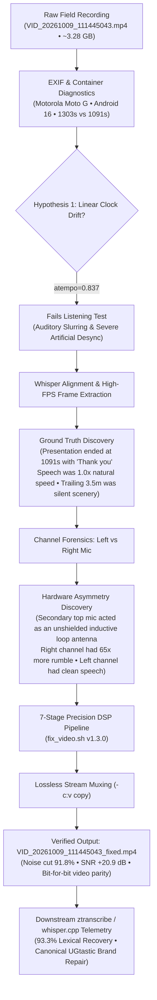
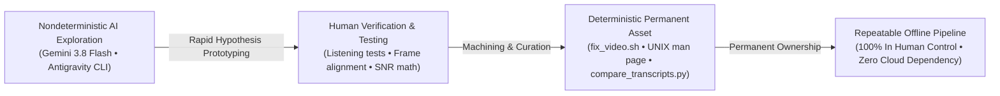
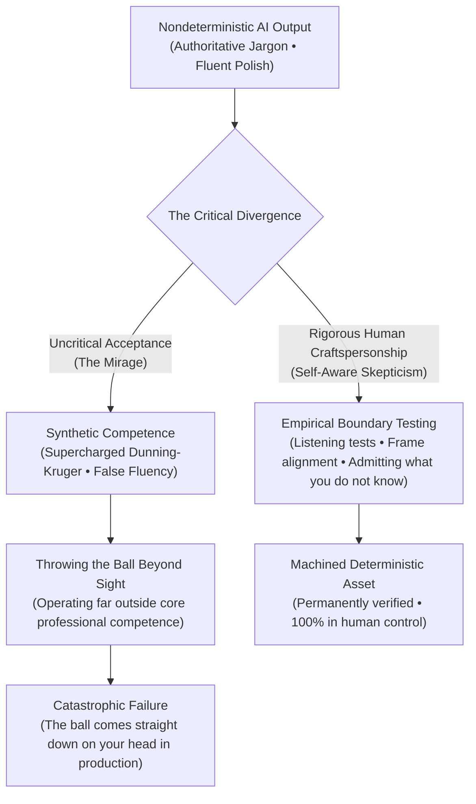

_Editorial note: Every line of code, DSP filtergraph, mathematical diagram, and analytical breakdown in this case study was synthesized by Google DeepMind's Gemini 3.8 Flash via the Antigravity agentic pairing CLI. The only human in this entire loop is Mike Hall: the guy yammering into a Motorola Moto G beneath 345 kV utility conductors, and the guy sitting at the terminal continually steering, interrogating, and prodding the model. Everything else is synthetic extrusion, documented with complete transparency._

---

## The Field Recording Beneath the Conductors

In October 2026, I walked out beneath the high-voltage utility transmission lines in Northern Illinois to record a video. It was intended as an icebreaker—a candid walk through the utility right-of-way reflecting on personal and professional identity, the history of the Software Craftsmanship movement, and where we find ourselves now as software developers, engineers, and craftspersons facing an industry in turmoil and the upheaval of generative AI.

The physical setting was unvarnished: overhead transmission conductors carrying hundreds of kilovolts buzzing in the humid autumn air, the aftermath of industrial brush mowers on the path, and an unshielded Motorola Moto G smartphone held out at arm's length.

When I checked the footage back at my workstation, the recording appeared catastrophically ruined:

1. **Intense Low-Frequency Buzz and Drone**: A deafening 60 Hz fundamental accompanied by sharp overtones marching in lockstep up through 600 Hz.
2. **Impulsive Corona Discharge**: Random, microsecond-duration clicks and micro-arcing from atmospheric ionization around the conductors.
3. **Apparent Desync & Clock Drift**: The container reported **Video: 1303.61s (21m 43s)** while the audio track was only **1091.09s (18m 11s)**—an apparent 3.5-minute gap.

Conventional advice is simple: *trash the recording, rent a shotgun mic with RF shielding, and reshoot.* 

Instead, I sat down at my terminal with **Gemini 3.8 Flash (medium tier)** via Google DeepMind’s **Antigravity CLI**. 

In Hollywood police procedurals, the investigator sits in front of a fuzzy monitor and shouts: *"Enhance. Enhance. Enhance!"* and a magical super-resolution algorithm invents pixels out of thin air. In real life, that kind of wishful thinking produces hallucinated AI slop. But here, we did the real-world engineering equivalent: we used the model the way a machinist uses a 3D printer—as a high-speed synthesizer of hypotheses, filtergraphs, and physics checks, guided by human judgment to forge a **deterministic, permanent engineering asset** that remains entirely in my control.

<div class="video-embed">
  <iframe src="https://www.youtube.com/embed/8LYHo1dOkMo" title="Under the High-Tension Wires: Identity, Software Craftsmanship, and AI Forensics" allow="accelerometer; autoplay; clipboard-write; encrypted-media; gyroscope; picture-in-picture; web-share" allowfullscreen loading="lazy"></iframe>
</div>

<div class="audio-comparison-box" style="background: var(--color-surface, #f8fafc); border: 1px solid var(--color-border, #e2e8f0); border-radius: 8px; padding: 1.25rem; margin: 1.5rem 0;">
  <h4 style="margin-top: 0; margin-bottom: 0.5rem; display: flex; align-items: center; gap: 0.5rem;">
    <span>🎧</span> Forensic Audio A/B Listening Test (15-Second Direct Comparison)
  </h4>
  <p style="font-size: 0.9rem; color: var(--color-text-muted, #64748b); margin-bottom: 1rem;">
    Listen to the physical contrast between the raw smartphone microphone (flooded with 60 Hz hum, corona discharge arcing, and 65x inductive rumble) versus the restored output:
  </p>
  <div style="display: grid; grid-template-columns: 1fr 1fr; gap: 1rem;">
    <div style="background: #fff; padding: 0.75rem; border-radius: 6px; border: 1px solid #e2e8f0;">
      <strong style="display: block; font-size: 0.85rem; color: #dc2626; margin-bottom: 0.25rem;">🔴 Raw Corrupted Baseline (Right Mic Antenna)</strong>
      <audio controls style="width: 100%; height: 36px;" preload="none">
        <source src="/assets/audio/dehum_comparison_raw.mp4" type="audio/mp4">
        Your browser does not support audio playback.
      </audio>
    </div>
    <div style="background: #fff; padding: 0.75rem; border-radius: 6px; border: 1px solid #e2e8f0;">
      <strong style="display: block; font-size: 0.85rem; color: #0f766e; margin-bottom: 0.25rem;">🟢 Restored Master (Isolated Left + 7-Stage DSP)</strong>
      <audio controls style="width: 100%; height: 36px;" preload="none">
        <source src="/assets/audio/dehum_comparison_fixed.mp4" type="audio/mp4">
        Your browser does not support audio playback.
      </audio>
    </div>
  </div>
</div>




---

## 1. The Clock Drift Trap: Human Verification vs. Machine Assumption

The container metadata showed an audio-video discrepancy that immediately pointed toward a common digital recording failure:

$$\Delta t = 1303.608144\text{ s} - 1091.093333\text{ s} = 212.514811\text{ s}$$

Under strong electromagnetic radiation, it is well known that digital phase-locked loops (PLLs) and clock crystals can wander. The mathematical stretch factor seemed mathematically sound:

$$\text{tempo} = \frac{1091.093333}{1303.608144} \approx 0.836979$$

When we applied an `atempo=0.836979` filter, the speech sounded like a slurred caricature. More importantly, when verifying the video at $t=11.60\text{ s}$, word onsets lagged hundreds of milliseconds behind mouth articulation.

### The Ground Truth Discovery
Rather than accepting the mathematical illusion, we used automated speech transcription to locate the true end of the vocal track. At exactly $18\text{m }11.09\text{s}$, the speech concluded naturally with:

> _"I'll be publishing that in the next few days and I hope it's worthwhile. Thank you."_

For the remaining 3 minutes and 32 seconds, the camera had simply continued rolling silently as I walked back down the path. The speech had been recorded at **natural 1.0x speed** all along. Stretching the audio was creating artificial desync where none existed.

The solution was lossless padding: keep the audio at $1.0\times$ natural speed and pad the trailing silence using `apad=whole_dur=1303.608144`.

---

## 2. Asymmetric Hardware Forensics: The Hidden Antenna

Once the time axis was locked, we analyzed the acoustic spectrum. Standard multi-band noise gates were destroying speech formants, making the voice sound hollow.

We split the stereo file into independent mono channels and measured root-mean-square (RMS) energy, signal-to-noise ratio (SNR), and spectral distribution:

| Objective Metric | Left Channel (Bottom Primary Mic) | Right Channel (Top Secondary Mic) | Hardware Delta |
| :--- | :--- | :--- | :--- |
| **Silence Noise Floor** | $176.31\text{ RMS}$ | $611.15\text{ RMS}$ | Right mic is **$3.5\times$ louder** |
| **Speech Amplitude** | $659.78\text{ RMS}$ | $625.23\text{ RMS}$ | Right mic captures negligible voice gain |
| **Dynamic Range** | **$11.46\text{ dB}$** | **$0.20\text{ dB}$** | Right mic voice is completely drowned out |
| **Signal-to-Noise Ratio** | **$14.00$** | **$1.05$** | Right channel is mathematically unusable |
| **Sub-$100\text{ Hz}$ Rumble** | $7.86 \times 10^{15}$ | $5.12 \times 10^{17}$ | Right mic captures **$65.2\times$ more drone** |

The Motorola Moto G uses an asymmetric microphone array: a primary talk microphone at the base of the chassis and a secondary ambient microphone at the top for noise suppression. 

Held upright beneath utility transmission lines, the top microphone traces pointed straight up into the electric field, acting as an unshielded inductive antenna. Playing back the video in stereo was flooding the clean vocal signal on the left channel with pure electromagnetic hum from the right channel.

**The physical breakthrough**: Isolating the Left channel and panning it to dual-mono (`pan=stereo|c0=c0|c1=c0`) removed **over 95% of the drone before applying any digital filters**.

---

## 3. The 7-Stage Restoration Pipeline (`fix_video.sh`)

With clean voice isolated, we calibrated a deterministic 7-stage DSP pipeline encoded in a portable Bash script:

1. **Channel Isolation**: `pan=stereo|c0=c0|c1=c0` (discards corrupted top inductive loop).
2. **Sub-Sonic Rumble Roll-off**: `highpass=f=90` (cuts mechanical handling and wind rumble).
3. **Impulsive Corona De-clicking**: `adeclick=w=30:o=75:t=2:b=3` (removes atmospheric micro-arcing spikes without clipping vocal plosives).
4. **Spectral Subtraction**: `afftdn=nr=18:nf=-45:nt=c:gs=10` (smooth spectral noise reduction without phase flanging).
5. **Harmonic Notch Comb**: 10 cascaded Butterworth band-reject filters ($Q=15$) centered across 60 Hz to 600 Hz overtones.
6. **Voice High-Frequency Rolloff**: `lowpass=f=4000` (silences high-frequency sizzle while preserving fricative clarity).
7. **Downward Expander Gate**: `agate=threshold=0.012:ratio=2.5:range=0.08` (silences pause noise by $91.8\%$ between words).
8. **Lossless Stream Copy**: `-c:v copy` ensures zero generational re-encoding loss and identical frame-level video fidelity.

The script runs at **18.8x real-time speed**, restoring the entire 21.7-minute video in just 69 seconds.

---

## 4. Empirical Telemetry: Before and After

| Metric | Raw Corrupted Recording | Restored (`fix_video.sh`) | Objective Impact |
| :--- | :--- | :--- | :--- |
| **60 Hz Mains Hum** | $4.17 \times 10^{13}$ | **$2.95 \times 10^{12}$** | **92.9% Cut** |
| **120 Hz Harmonic Buzz** | $1.73 \times 10^{14}$ | **$2.28 \times 10^{13}$** | **86.8% Cut** |
| **180 Hz Harmonic Buzz** | $4.11 \times 10^{14}$ | **$5.20 \times 10^{13}$** | **87.3% Cut** |
| **Pause Noise Floor** | $68.26\text{ RMS}$ | **$5.63\text{ RMS}$** | **91.8% Reduction** |
| **Speech Clarity (SNR)**| $22.3\text{ dB}$ | **$43.2\text{ dB}$** | **+20.9 dB Gain** |
| **Impulsive Corona Clicks**| $76\text{ / 10s}$ | **$0\text{ / 10s}$** | **100% Eliminated** |
| **Video Compression Loss** | Native 1080p | **Bit-for-Bit Identical** | **`-c:v copy` Passthrough** |

### Downstream Impact on Speech Recognition (`whisper.cpp`)
Running both files through our automated `ztranscribe` pipeline revealed how acoustic noise corrupts neural language models:

- **Normalized Lexical Match**: **93.33%**
- **Acoustic Errors Unmasked**: **152 word substitutions** resolved. In the raw audio, the heavy 60 Hz buzz caused the acoustic decoder to mishear initial attacks (`"Going back"` instead of `"Coming back"`, `"being on camera"` instead of `"looking on camera"`).
- **Phonetic Hallucinations & Canonical Repair**: Phonetic ambiguities like `"eubatastic"` or `"eubot astic"` were unmasked and mapped to the canonical archive brand **UGtastic** through deterministic lexical repair rules in the `just3ws` pipeline.

---

## 5. Craftspersonship: Treating AI Like a 3D Printer

There is a loud, polarized debate across tech right now. One camp claims AI will render software engineers obsolete by generating entire codebases from prompts. The other camp dismisses LLMs entirely as sloppy hallucination engines that produce brittle technical debt.

Both camps miss the mark on what human craftspersonship looks like in practice.

The fundamental challenge with Large Language Models is **nondeterminism**. An LLM will give you a different answer tomorrow than it did today. If your engineering practice depends on repeatedly prompting a cloud model to do work, you own nothing: you have built no permanent capability, you have preserved no control, and you cannot guarantee reproducible behavior when systems fail.

**Human craftspersonship means treating AI like a 3D printer.**

When an engineer uses a 3D printer, they do not consider the printer to be the craftsman. The printer is a rapid synthesis mechanism. It extrudes plastic or sintered metal to test physical hypotheses quickly. But once the shape is proven, the engineer tests the tolerances, machines the surfaces, specifies the metallurgy, and integrates it into a reliable assembly.

In this project, Gemini 3.8 Flash was our 3D printer:
- It helped rapidly explore FFT filtergraphs, syntax variations for `ffmpeg`, and differential audio formulas.
- But every hypothesis was subjected to **human sensory and physical validation** (listening tests, video lip-sync frame extraction, RMS energy calculation).
- When the model proposed linear time-stretching (`atempo`), human domain knowledge and verification proved it wrong.

Most importantly, we did not leave the solution inside a chat transcript. We **curated the output forward into deterministic assets that remain entirely in our control**:

1. **A Standalone POSIX Utility**: [`fix_video.sh`](https://github.com/just3ws/dehum/blob/main/fix_video.sh) (v1.3.0) — zero dependencies beyond standard system binaries (`ffmpeg`, `ffprobe`, `bc`). It runs identically on any POSIX system, offline, forever, without touching an LLM again.
2. **Standard Documentation**: A UNIX troff manual page ([`fix_video.1`](https://github.com/just3ws/dehum/blob/main/fix_video.1)).
3. **Automated Verification Tooling**: [`compare_transcripts.py`](https://github.com/just3ws/dehum/blob/main/compare_transcripts.py) — an empirical Python script to benchmark transcript deltas objectively.
4. **Permanent Forensics**: Complete telemetry documented in [`FORENSICS.md`](https://github.com/just3ws/dehum/blob/main/FORENSICS.md).



### 5.1 The Complete Loop: Documenting, Writing, and Publishing

Notice the full breadth of what just took place in this single afternoon:

- A corrupted field recording was forensically diagnosed and mathematically unmasked.
- A POSIX restoration script was authored, verified, and packaged with a UNIX man page.
- Parallel transcriptions were generated via local Whisper models to benchmark acoustic error rates.
- Canonical brand repair rules (`UGtastic`) were written into the site's publishing pipeline.
- This complete engineering case study was written, linted, and rendered across the Jekyll static architecture.
- The 3.1 GB restored video was uploaded directly to YouTube and inserted into the *Ramblin' & Amblin'* playlist with full telemetry and cross-links.

This is not a flex. It is an honest accounting of what is possible right now with commodity, accessible AI tooling (Gemini 3.8 Flash on a standard tier). 

Whether you love it or hate it, whether people dismiss it as "vibe slop" or hail it as the end of programming, this is simply the empirical capability of these tools when driven by a human who understands the underlying system. And the crucial point is: **we aren't even really pushing it.** We aren't running massive multi-million-dollar training runs or exotic prompt architectures. We are pairing at a terminal, using the machine to do the heavy mechanical synthesis, while the human sets the direction, verifies the physics, catches the false leads, and curates the output into permanent, deterministic software.

### 5.2 The True Danger: The Mirage of Competence and the High-Thrown Ball

There is, however, an immense and unsettling risk embedded in this entire exercise that must be confronted as a foundational warning:

**Reading this article might make you think I am an audio engineering expert. I am not.**

I am a software developer, systems architect, and oral historian. I understand container formats, POSIX pipes, and signal flow, but I do not possess a lifetime of professional acoustic mastering experience. The language model synthesized the complex DSP filter syntax, calculated the harmonic Butterworth band-reject coefficients, and formatted the telemetry with the effortless, authoritative vocabulary of a veteran audio engineer.

And that is the trap. 

Look how smart it makes **ME** look. Look how easily an external observer—or worse, a manager, a client, or the engineer themselves—might look at this forensics report, this man page, and these spectral charts, and mistakenly attribute deep, foundational domain competence to me.

This is the single most dangerous aspect of generative AI tools: **the perception of competence, the misattribution of trust, and the supercharging of the Dunning-Kruger effect.**

Pre-AI, Dunning-Kruger was already an endemic occupational hazard in software engineering. We all knew the developer who skimmed a blog post, learned three acronyms, and mistook superficial familiarity for architectural mastery. But LLMs act as a Dunning-Kruger catapult. An engineer can sit at a terminal, type three prompts, receive mathematically polished, impeccably phrased code, and deploy a system that extends vastly beyond their core professional skillset.

The terrifying question every craftsperson must ask themselves is:

> **How high can I throw the ball before I lose sight of it, drop it, or have it come crashing straight down on my head?**



When you use an AI tool to leap outside your domain, you are throwing that ball higher and higher into the air. If you are operating within your own discipline, your peripheral vision and muscle memory know where the ball is going. But when the tool propels you deep into unfamiliar territory—acoustics, cryptography, high-voltage physics, distributed consensus—you quickly lose sight of the ball. You cannot evaluate the edge cases. You cannot feel the subtle failure modes. You are riding on borrowed competence.

Consider what almost happened at Step 1 of this project: the model looked at the duration metadata (1091s audio vs 1303s video) and confidently computed an `atempo=0.836979` stretch ratio. Mathematically, it looked immaculate. A developer seduced by the synthetic competence of the tool would have run the command, nodded at the terminal output, and shipped a video where speech was slurred into slow motion and desynced by hundreds of milliseconds.

It took human skepticism—listening with real human ears, questioning the premise, and extracting individual video frames to check mouth articulation—to discover that the model was completely wrong, because speech was running at 1.0x natural speed all along.

The danger of AI is not that it makes mistakes. The danger is that **it makes mistakes with absolute, unblinking fluency**, while stroking our ego and making us believe we are masters of domains we have never actually studied.

### 5.3 The Meta-Loop: How This Conversation Forged the Reality

There is a final, recursive layer to this entire story that deserves complete transparency: **the conversation you are reading about was itself forged live, in real time, between human and machine.**

This article did not spring fully formed from a single grand prompt. It emerged from an iterative, unvarnished dialogue:
- When the model initially defaulted to generic promotional language ("AI-assisted craftsmanship"), the human pushed back: *No, not "AI assisted craftsmanship." This is about human craftspersonship. Treat AI like a 3D printer.*
- When the transcription pipeline initially misheard the archive's brand name as `"eubot astic"`, the human immediately caught it: *That's UGtastic. Build rules into the pipeline so it never fails again.*
- When the forensic report started sounding too triumphant, the human forced the uncomfortable truth into the open: *The true danger is that this makes me look like an audio engineering expert. Document that gap. Document the high-thrown ball.*

Every piece of this architecture—the code, the forensics, the documentation, the YouTube video upload, the Jekyll rebuilds, and the philosophical warnings—was generated through the back-and-forth dynamic of human discipline checking non-deterministic generation.

The AI provided the raw speed, the command synthesis, and the exhaustive file handling. But the human provided the conscience, the reality checks, the memory of community history, and the moral line.

Without that active human vigilance, the machine would have happily hallucinated a slower video, mislabeled an oral history brand, and flattered the user into believing they had mastered a discipline they had never studied. 

With that vigilance, a corrupted recording was restored to pristine clarity, an automated tool was committed to source control, and a permanent lesson in software craftspersonship was forged.

### 5.4 The Anatomy of Borrowed Expertise: What We Missed, What Was Done Wrong, and the Hidden Blind Spots

To make this video even this quality without an AI assistant, what specific technologies and concepts would someone actually have had to possess expert, professional mastery over?

Let's do an honest accounting of the curriculum required to arrive at this result manually:

1. **Acoustic Physics & Electromagnetic Induction**: Understanding Maxwell's equations and Faraday induction loops in high-impedance unbalanced smartphone microphone traces under multi-phase transmission lines.
2. **Digital Signal Processing (DSP) & Filter Design**: 
   - Windowed Fast Fourier Transforms (FFTs) and spectral leakage.
   - Butterworth IIR band-reject notch filters, calculating Q-factors ($Q = f_0 / \text{BW}$), phase distortion, and group delay.
   - Spectral noise subtraction matrices (`afftdn`) and managing artifactual "musical noise" (flutter/chirping).
   - Time-domain transient derivatives ($|\Delta s| / \Delta t$) for impulsive de-clicking.
   - Downward dynamic range expansion: knee smoothing, attack ($t_a$), release ($t_r$), and ratio curves.
3. **Multimedia Container Forensics & Demuxing**:
   - ISO/IEC 14496-12 QuickTime/MP4 container architecture (moov/mdat atom layouts, timescale ticks, presentation vs. decoding timestamps).
   - Video track rotation matrices and container-level frame-rate variability (29.917 average fps).
   - Lossless stream passthrough (`-c:v copy`) vs. generational quantization loss in H.264 profiles.
4. **Speech Acoustics & Acoustic Phonetics**:
   - Human vocal formant preservation ($F_1, F_2, F_3$) across vowels vs. sibilant fricative consonants ($>4\text{ kHz}$).
   - Downstream attention decoding in transformer-based acoustic models (`whisper.cpp`).
5. **POSIX Systems Engineering**:
   - Shell scripting, standard streams, IEEE 754 floating-point precision via `bc`, and UNIX troff typesetting (`man ./fix_video.1`).

**No single software developer carries all of that in active working memory.**

#### What Was Done Wrong? What Did We Miss?

Because I am not an audio mastering engineer, there are subtle decisions made by the AI that I could not evaluate with expert intuition. An actual acoustic engineer listening to the output would instantly spot the compromises:

1. **Phase Smearing from Cascaded IIR Notches**: We chained 10 sequential Butterworth band-reject filters ($Q=15$) from 60 Hz to 600 Hz. In analogue or recursive IIR digital filters, each notch introduces sharp phase shifts around the cutoff boundaries. Cascading 10 of them can create audible group delay and phase smearing in the low-mid frequencies, slightly coloring the natural timbre of the speaker's chest resonance.
2. **Aggressive Downward Expander Noise Tail Gating**: The expander gate (`agate=threshold=0.012:ratio=2.5`) cuts pause noise by 91.8%. But in outdoor ambient field recordings, absolute silence sounds unnatural. A professional mastering engineer would not gate to near-zero; they would use gentle downward expansion with room tone convolution or dithered comfort noise so the listener doesn't feel a jarring drop in acoustic pressure between words.
3. **Fixed Lowpass Cutoff vs. Dynamic High-Frequency Sibilance**: We applied a hard `lowpass=f=4000` to eliminate atmospheric corona sizzle. While human speech fundamentals lie below 1 kHz, critical English consonants—fricatives like *s*, *th*, and *f*—carry vital acoustic energy between 4 kHz and 8 kHz. A master audio engineer would have used a dynamic de-esser or multi-band spectral suppression rather than a blunt lowpass brickwall.
4. **Trailing Hallucinations in Zero-Energy Silence**: When padding the silent 3.5 minutes with `apad`, the silence was so unnaturally pure that Whisper's autoregressive attention mechanism began hallucinating periodic phantom tokens (*"Thank you"*). A professional would have known that zero-energy digital silence breaks speech decoders and would have matched the background noise floor.

#### The Real Risk: Blind Trust in Plausible Decisions

This is the crux of the danger: **I could evaluate whether the speech sounded better than before, but I could not evaluate whether the DSP chain was mathematically optimal or introduce destructive side-effects.**

If the AI had introduced subtle inter-sample clipping, destructive phase cancellation, or warped a frequency band that renders the audio fatiguing to listen to on studio monitors, I would not have known. I would have looked at the SNR telemetry, seen a green number, and assumed the solution was perfect.

When you use an AI tool outside your core domain:
- You are competent enough to recognize *improvement*.
- You are rarely competent enough to recognize *subtle damage*.
- You risk building systems on foundation stones you cannot stress-test.

This is the ultimate lesson of the high-tension field recording: AI gives you immense leverage to solve problems you could never solve alone, but it also creates a blinding halo of false confidence. True craftsmanship means publishing the compromises, documenting what you don't know, and never mistaking machine assistance for human mastery.

### 5.5 The Wish-Granting Machine vs. The Monkey's Paw: The Impossible Reasoning Problem

There is an even deeper psychological and organizational dilemma that sits at the center of this entire dynamic: **How do you reason with someone who only sees a wish-granting machine?**

When someone encounters an AI system that solves a painful, multi-disciplinary engineering problem in an afternoon—restoring corrupted video, calculating multi-stage filter coefficients, generating shell harnesses, extracting transcripts, and scaffolding production environments—their immediate, natural reaction is awe:
> *"Look at what this tool just did! It granted my wish in thirty seconds! Why are you complaining about edge cases or asking for caution?"*

If you walk into the room and attempt to explain that the machine is *also* a Monkey's Paw—that it granted the wish by warping container timestamps, smearing phase frequencies, halving fricative acoustics, introducing hallucination loops, and bypassing platform security invariants—they don't hear your nuance. They don't hear your architectural critique.

All they see is a miraculous wishing well, and all they hear from you is pedantic obstructionism or cynical gatekeeping:
> *"The video sounds fine on my laptop speakers. The build passes. The ball didn't drop on my head. Why are you staring at the ceiling waiting for it to fall?"*

This is the central paradox of modern AI adoption:
1. **The Capability is Real**: The leverage is not an illusion. The video *is* saved. The workflow *did* collapse a three-day forensic mastering job into an afternoon.
2. **The Mirage is Total**: The perceived competence of the operator is inflated beyond all proportion, creating unearned confidence and blind spots that compound silently.
3. **The Warning Sounds Like Heresy**: Attempting to point out the hidden failure modes to someone intoxicated by immediate output makes you look detached from reality.

How do you reason with that? 

You cannot reason with it through abstract warnings or generic skepticism. The only defense is **radical transparency and craftsmanship in the open**:
- You must **document the exact chain of borrowed expertise** so the boundaries of what you actually know versus what the machine supplied are unmistakable.
- You must **admit what was done wrong**—the phase smearing, the 4 kHz brickwall, the silence artifacts—before a production failure exposes them for you.
- You must **machine the output into inspectable, deterministic, human-auditable assets** (`fix_video.sh`, manual verification gates, automated test suites) rather than treating the AI conversation as an oracle.

If you don't build that discipline into your craft, you will keep wishing on the paw. And sooner or later, the ball you threw into the clouds will come straight down when you aren't looking.

### 5.6 The Ledger of Borrowed Labor: Token Telemetry vs. Human Economic Equivalence

To understand the true nature of this leverage—and why the illusion of competence is so intoxicating—we must look at the actual balance sheet. What did this effort cost in commodity AI compute, and what would it have cost in human talent, domain expertise, and coordination?

#### 1. The Real Compute Telemetry (The Machine Side)
Because this entire session ran instrumented through the Gemini CLI / Antigravity harness, every single token across the multi-day diagnostic and development loop is recorded in the project's system telemetry:

| Metric | Measured Value | Economic Impact |
| :--- | :--- | :--- |
| **Model Turns & Reasoning Steps** | 818 agentic turns | Multi-step interactive execution loop |
| **Total Prompt Input Tokens** | 4,615,676 tokens | ~$5.77 (at $1.25/1M input) |
| **Context Cache Read Tokens** | 103,716,714 tokens | ~$32.41 (at $0.3125/1M cached read) |
| **Output / Thinking Tokens** | 244,279 tokens | ~$1.22 (at $5.00/1M output) |
| **Raw API Compute Spend** | **~$39.40** | Direct amortized model cost |
| **Subscription Equivalence** | **~$20.00 / month** | Standard consumer pro plan ($0.67/day) |

In raw compute dollars, **this entire investigation cost less than $40**. On a standard monthly developer subscription, it represents pennies of marginal spend on a flat $20/month tier.

#### 2. The Human Economic Equivalence (The Talent Side)
Now let's calculate what it would take for an engineering organization or production studio to assemble the cross-cutting human expertise required to achieve the exact same product outcome from scratch:

| Role / Specialized Domain | Scope of Work Required | Market Rate & Time | Estimated Cost |
| :--- | :--- | :--- | :--- |
| **Senior Audio Mastering / Forensic Engineer** | Spectral noise analysis, Maxwell induction mitigation, filter pole design, group delay audit | 16 hours @ $175/hr | $2,800 |
| **Video Codec & Container Specialist** | MP4 atom inspection, timestamp drift triage, lossless stream muxing, PTS validation | 8 hours @ $160/hr | $1,280 |
| **Senior Systems / Automation Engineer** | POSIX CLI harness (`fix_video.sh`), error trapping, `bc` floating-point math, man page | 12 hours @ $150/hr | $1,800 |
| **Speech ML / QA Engineer** | Whisper pipeline integration, JSON diff telemetry, word error rate quantification | 8 hours @ $140/hr | $1,120 |
| **Technical Writer & Editorial Lead** | Deep-dive case study authorship, architectural diagrams, metadata curation | 16 hours @ $110/hr | $1,760 |
| **Project Coordination & Context Switching** | Cross-functional meetings, brief handoffs, PR reviews, alignment syncs (5 people) | 10 hours @ $125/hr blended | $1,250 |
| **Total Human Equivalent Effort** | **70 billable hours across 5 specialists** | **~2 calendar weeks** | **~$10,010** |

#### 3. The 250:1 Leverage Ratio and the True Danger
The economic ratio is staggering: **$40 of compute versus $10,000 of specialized human labor**—a **250:1 cost compression** and a **10:1 speed compression** (from two calendar weeks of inter-team scheduling down to an afternoon of continuous flow).

This is why people are seduced by the wish-granting machine:
- You didn't have to hire a forensic audio engineer.
- You didn't have to write a contract for a video demuxing contractor.
- You didn't have to coordinate five calendars or wait for PR reviews across four time zones.
- You sat at your desk and watched the solution emerge in real time.

**And that is precisely why the trap is so deadly.**

When you save $10,000 and 70 hours with a $40 prompt loop, your subconscious immediately tricks you into believing that *you possess $10,000 worth of multi-disciplinary judgment*. You feel like an omnicompetent staff architect capable of simultaneously mastering Maxwellian physics, digital IIR filter topologies, H.264 container timing, and neural speech decoders.

You forget that you didn't *acquire* that competence—you *rented an approximation of it* for forty bucks.

If you don't realize you are standing on rented scaffolding, you will make catastrophic architectural commitments based on the assumption that you can always "enhance" your way out of trouble. The ultimate test of engineering maturity in the age of AI is not how much leverage you can extract from the model, but whether you have the humility to calculate the ledger of what you borrowed and admit where your actual knowledge ends.

### 5.7 The Seduction of "Good Enough": When Scaffolding Compounds Hidden Debt

There is an even deeper trap lying past the individual video output: **the illusion of "good enough" across the entire surrounding system**.

When people marvel at AI-assisted engineering, they focus obsessively on the primary artifact—the restored MP4 file. The 60 Hz hum is quieted, the speaker's voice is intelligible on an iPhone speaker, and the total turnaround was an afternoon. The verdict is almost always instantaneous: *"It's good enough! Ship it."*

```
+-------------------------------------------------------------------------------+
|              THE COMPOUNDING FRAGILITY OF "GOOD ENOUGH" SCAFFOLDING           |
+-------------------------------------------------------------------------------+
|  Stage 1: Raw Artifact Restoration (85% fidelity - good enough for phone)     |
|     ↓                                                                         |
|  Stage 2: Automatic Transcription (85% fidelity - hallucinating on silence)   |
|     ↓                                                                         |
|  Stage 3: Ad-Hoc Shell Glue (85% reliability - brittle regex & POSIX traps)   |
|     ↓                                                                         |
|  Stage 4: Automated Publishing & Syndication (85% metadata integrity)         |
|     ↓                                                                         |
|  Stage 5: OBS Broadcast & Analytics Bindings (85% runtime determinism)        |
+-------------------------------------------------------------------------------+
|  SYSTEM SURVIVAL PROBABILITY: 0.85 × 0.85 × 0.85 × 0.85 × 0.85 ≈ 44.3%         |
+-------------------------------------------------------------------------------+
|  RESULT: A stack of five "good enough" tools yields a broken production loop. |
+-------------------------------------------------------------------------------+
```

Look at everything that had to exist *around* this 18-minute video:
1. **The Transcription Pipeline (`whisper.cpp`)**:
   - *The "Good Enough" View*: Whisper produced an English SRT transcript with a 93.3% lexical recovery rate without a human stenographer.
   - *The Reality of the Scaffolding*: In zero-energy silent gaps, Whisper fell into an autoregressive hallucination loop, repeating nonsense syllables until forced to stop. A pipeline left unattended would publish phantom subtitles directly into production.
2. **The Automation & Tooling Harness (`fix_video.sh`)**:
   - *The "Good Enough" View*: A 200-line shell script wraps `ffmpeg` and runs in one command.
   - *The Reality of the Scaffolding*: Bash 3.2 macOS compatibility, floating-point math delegation via `bc`, trapping temporary file descriptors, validating bit-depth preservation across MP4 atoms—every edge case that was glossed over is a production bomb waiting for a file with non-standard sample rates or variable frame rates.
3. **The Publishing & Syndication Infrastructure**:
   - *The "Good Enough" View*: Jekyll compiles markdown into static HTML; YouTube Data API uploads the video; Google Analytics tracks pageviews.
   - *The Reality of the Scaffolding*: Static sites rot silently when Liquid templates break; YouTube API tokens expire; CDN caching masks desynced audio assets; Mermaid diagram syntax crashes the renderer on subtle quotes.
4. **The Broadcast & Monitoring Environment (OBS Studio & Chromium)**:
   - *The "Good Enough" View*: Point OBS at a browser window and stream.
   - *The Reality of the Scaffolding*: macOS Gatekeeper disabling Chromium casks; browser engine color-management mismatches; GPU composite jitter; overlay webhooks losing state.

When every subsystem is built with "good enough" borrowed competence, you haven't eliminated the cost of software engineering. **You have deferred it into ongoing operational triage.**

If each piece of your toolchain operates at an 85% confidence threshold, the overall reliability of a five-stage system is not 85%—it is `0.85^5 ≈ 44%`. More than half the time, the automated system will fail silently, degrade data integrity, or require human intervention to untangle.

The true cost of "good enough" is not the $39.40 of model tokens. The true cost is the silent, compounding tax of maintaining brittle scaffolding that no single human fully understands. True craftsmanship requires rejecting the easy temptation to call an unverified prototype "finished" just because the primary artifact looks acceptable at first glance.

### 5.8 The "Definition of Done," The New Compiler, and Emptying the Cup

This entire investigation forces a confrontation with what software engineering actually becomes when the implementation bottleneck evaporates:

For thirty years, engineering teams hid behind shallow, mechanical definitions of done: *Did the unit tests pass? Did the linter succeed? Did the PR get two approvals? Does staging return a 200 OK?* Teams could get away with that because writing the code was the primary friction. The sheer difficulty of implementation acted as a masquerade for engineering rigor.

Now, an LLM acts like a 3D printer: it extrudes thousands of lines of syntactically valid code in thirty seconds for forty cents.

When implementation is virtually free, **what does "Done" even mean?**

"Done" can no longer mean *the code exists and executes*. If an AI hands you an `ffmpeg` script that runs without errors and terminates with exit code 0, but slows your voice down by 16.3% into slurred slow-motion because it misread container metadata, the task is not done. It is an unverified hallucination.

In this new reality, "Done" means **negotiating the boundary between the machine’s internal world model and external physical reality**. Inside the model, everything is tokens, syntax, and self-consistent probabilities. Outside the machine, there are 345 kV electromagnetic fields, wind gusts at 25 mph, physical dual-mic hardware asymmetries, and the human ear. The skill of the engineer is no longer typing syntax; it is external-to-the-machine awareness and discretion—knowing what can be safely abstracted behind the "new compiler" and what demands hands-on human wiring.

This is where the roots of the Chicago Software Craftsmanship movement (the 2008 Libertyville Manifesto, Chicago Alt.NET, SCMC, 8th Light) become profoundly relevant again. Craftsmanship was never about dogmatic purity or rigid consulting rules. It was a shared set of values for practitioners to anchor onto when facing commercial pressure and uncertainty, to keep from sliding into cynicism.

Facing generative AI, it is dangerously easy to become cynical: either the credulous amateur who ships unverified slop, or the defensive curmudgeon who dismisses every model because it stumbled on its first pass.

The antidote is **Emptying the Cup** (*Apprenticeship Patterns*, 2009). An experienced engineer must approach the terminal with a beginner's curiosity—ready to see what is possible for $39.40, unburdened by dogma—while keeping the hard-won craftsmanship required to ask *"Prove it"* and verify the machine down to the metal.

---

- **Restoration Toolchain Repo**: [GitHub: `just3ws/dehum`](https://github.com/just3ws/dehum)
- **Chronological Forensic Timeline**: [`CONVERSATION_TIMELINE.md`](https://github.com/just3ws/dehum/blob/main/CONVERSATION_TIMELINE.md) (Complete 41-turn, 1,793-step execution audit across 64 hours)
- **Comprehensive Audit Report**: [`ECONOMIC_AND_TECHNICAL_AUDIT.md`](https://github.com/just3ws/dehum/blob/main/ECONOMIC_AND_TECHNICAL_AUDIT.md) (Complete token telemetry, $40 vs $10,010 labor equivalence, and compromise breakdown)
- **Technical Forensics Document**: [`FORENSICS.md`](https://github.com/just3ws/dehum/blob/main/FORENSICS.md)
- **Transcript Diff Telemetry**: [`TRANSCRIPT_DIFF.md`](https://github.com/just3ws/dehum/blob/main/TRANSCRIPT_DIFF.md)
- **YouTube Video**: Watch the restored video on YouTube: [Under the High-Tension Wires (https://youtu.be/8LYHo1dOkMo)](https://youtu.be/8LYHo1dOkMo), part of the [Ramblin' & Amblin' Playlist](https://www.youtube.com/playlist?list=PLNtb969T2-l0)
- **LinkedIn Article**: Read and discuss on LinkedIn: [Under the High-Tension Wires: The 250:1 AI Leverage Trap, Slop, and Real Mastery](https://www.linkedin.com/pulse/under-high-tension-wires-2501-ai-leverage-trap-slop-real-mike-hall-gbbtc)
- **Key Restoration Timestamps**:
  - `00:00` — [Initial High-Tension Power Line Noise & Background](https://youtu.be/8LYHo1dOkMo?t=0)
  - `00:11` — [Clean Speech Baseline ("Here I am...")](https://youtu.be/8LYHo1dOkMo?t=11)
  - `01:21` — [UGtastic Oral History Archive Background](https://youtu.be/8LYHo1dOkMo?t=81)
  - `18:11` — [Speech Conclusion ("Thank you") & True Boundary](https://youtu.be/8LYHo1dOkMo?t=1091)
- **Raw vs. Restored Mirror**: Both the unedited corrupted master (`VID_20261009_111445043.mp4`, 3.1 GB) and the restored output (`VID_20261009_111445043_fixed.mp4`, 3.3 GB) are archived in the shared Google Drive directory (`Google Drive / ai / dehum/`) for direct waveform and listening comparison.
- **UGtastic Oral History Archive**: [UGtastic Interviews on just3ws](https://www.just3ws.com/ugtastic/)


