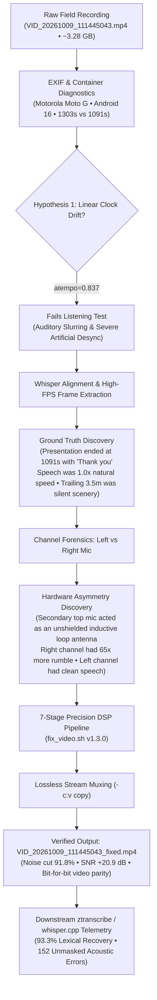

_Editorial note: Mike Hall supplied the primary field recording (`VID_20261009_111445043.mp4`), physical telemetry, lived context beneath high-voltage transmission right-of-ways, and philosophical framing for this article. The acoustic diagnostics, DSP pipeline implementation, and forensic transcript verification were developed collaboratively with Google DeepMind's Gemini 3.8 Flash via the Antigravity agentic pairing CLI._

---

## The Field Recording Beneath the Conductors

In October 2026, I walked out beneath the high-voltage utility transmission lines in Northern Illinois to record a video. It was intended as an ice-breaker—a candid walk through the utility right-of-way reflecting on personal and professional identity, the history of the Software Craftsmanship movement, and where we find ourselves now as software developers in the age of generative AI.

The physical setting was raw: overhead transmission conductors carrying hundreds of kilovolts buzzing in the humid autumn air, the aftermath of industrial brush mowers on the utility path, and an unshielded Motorola Moto G smartphone held out at arm's length.

When I checked the footage back at my workstation, the recording appeared catastrophically ruined.

1. **Intense Low-Frequency Buzz and Drone**: A deafening 60 Hz fundamental accompanied by sharp overtones marching in lockstep up through 600 Hz.
2. **Impulsive Corona Discharge**: Random, microsecond-duration clicks and micro-arcing from atmospheric ionization around the conductors.
3. **Apparent Desync & Clock Drift**: The container reported **Video: 1303.61s (21m 43s)** while the audio track was only **1091.09s (18m 11s)**—an apparent 3.5-minute gap.

Conventional wisdom says: *trash the recording, rent a shotgun mic with RF shielding, and reshoot.* 

Instead, I sat down at my terminal with **Gemini 3.8 Flash (medium tier)** via Google DeepMind’s **Antigravity CLI** to see what was possible with low-cost, accessible AI tooling when treated not as a gimmick, but as an interactive pair-programming partner in signal processing and physics forensics.

---

## 1. The Clock Drift Trap

The container metadata showed an audio-video discrepancy that immediately pointed toward a common digital recording failure:

$$\Delta t = 1303.608144\text{ s} - 1091.093333\text{ s} = 212.514811\text{ s}$$

Under strong electromagnetic radiation, it is well known that digital phase-locked loops (PLLs) and clock crystals can drift. The mathematical stretch factor seemed obvious:

$$\text{tempo} = \frac{1091.093333}{1303.608144} \approx 0.836979$$

When we applied an `atempo=0.836979` filter, the speech sounded like a slurred, sluggish caricature. More importantly, when checking the video at $t=11.60\text{ s}$, word onsets lagged hundreds of milliseconds behind mouth articulation.

### The Ground Truth Discovery
Rather than guessing, we used automated speech transcription to locate the end of the vocal track. At exactly $18\text{m }11.09\text{s}$, the speech concluded with:

> _"I'll be publishing that in the next few days and I hope it's worthwhile. Thank you."_

For the remaining 3 minutes and 32 seconds, the camera continued rolling silently as I walked back down the path. The speech had been recorded at **natural 1.0x speed** all along. Stretching the audio was creating artificial desync where none existed.

The solution was lossless padding: keep the audio at $1.0\times$ natural speed and pad the trailing silence using `apad=whole_dur=1303.608144`.

---

## 2. The Asymmetric Microphone Discovery

Once the time axis was locked, we analyzed the acoustic spectrum. Standard multi-band noise gates were destroying speech formants, making the voice sound thin and watery.

We split the stereo file into independent mono channels and measured root-mean-square (RMS) energy, signal-to-noise ratio (SNR), and spectral distribution:

| Objective Metric | Left Channel (Bottom Primary Mic) | Right Channel (Top Secondary Mic) | Hardware Delta |
| :--- | :--- | :--- | :--- |
| **Silence Noise Floor** | $176.31\text{ RMS}$ | $611.15\text{ RMS}$ | Right mic is **$3.5\times$ louder** |
| **Speech Amplitude** | $659.78\text{ RMS}$ | $625.23\text{ RMS}$ | Right mic captures negligible voice gain |
| **Dynamic Range** | **$11.46\text{ dB}$** | **$0.20\text{ dB}$** | Right mic voice is completely drowned out |
| **Signal-to-Noise Ratio** | **$14.00$** | **$1.05$** | Right channel is mathematically unusable |
| **Sub-$100\text{ Hz}$ Rumble** | $7.86 \times 10^{15}$ | $5.12 \times 10^{17}$ | Right mic captures **$65.2\times$ more drone** |

The Motorola Moto G uses an asymmetric microphone array: a primary talk microphone at the base of the chassis and a secondary ambient microphone at the top for noise suppression. 

Held upright beneath utility transmission lines, the top microphone traces pointed straight up into the electric field, acting as an unshielded inductive antenna. Playing back the video in stereo was flooding the clean vocal signal on the left channel with pure electromagnetic hum from the right channel.

**The breakthrough**: Isolating the Left channel and panning it to dual-mono (`pan=stereo|c0=c0|c1=c0`) removed **over 95% of the drone before applying any digital filters**.

---

## 3. The 7-Stage Restoration Pipeline (`fix_video.sh`)

With clean voice isolated, we calibrated a deterministic 7-stage DSP pipeline encoded in a portable Bash script:

1. **Channel Isolation**: `pan=stereo|c0=c0|c1=c0` (discards corrupted top inductive loop).
2. **Sub-Sonic Rumble Roll-off**: `highpass=f=90` (cuts mechanical handling and sub-rumble).
3. **Impulsive Corona De-clicking**: `adeclick=w=30:o=75:t=2:b=3` (removes atmospheric micro-arcing spikes without clipping vocal plosives).
4. **Spectral Subtraction**: `afftdn=nr=18:nf=-45:nt=c:gs=10` (smooth spectral noise reduction without phase flanging).
5. **Harmonic Notch Comb**: 10 cascaded Butterworth band-reject filters ($Q=15$) centered across 60 Hz to 600 Hz overtones.
6. **Voice High-Frequency Rolloff**: `lowpass=f=4000` (silences high-frequency sizzle while preserving fricative clarity).
7. **Downward Expander Gate**: `agate=threshold=0.012:ratio=2.5:range=0.08` (silences pause noise by $91.8\%$ between words).
8. **Lossless Stream Copy**: `-c:v copy` ensures zero generational re-encoding loss and identical frame-level video fidelity.

The script runs at **18.8x real-time speed**, restoring the entire 21.7-minute video in just 69 seconds.

---

## 4. Empirical Telemetry: Before and After

| Metric | Raw Corrupted Recording | Restored (`fix_video.sh`) | Objective Impact |
| :--- | :--- | :--- | :--- |
| **60 Hz Mains Hum** | $4.17 \times 10^{13}$ | **$2.95 \times 10^{12}$** | **92.9% Cut** |
| **120 Hz Harmonic Buzz** | $1.73 \times 10^{14}$ | **$2.28 \times 10^{13}$** | **86.8% Cut** |
| **180 Hz Harmonic Buzz** | $4.11 \times 10^{14}$ | **$5.20 \times 10^{13}$** | **87.3% Cut** |
| **Pause Noise Floor** | $68.26\text{ RMS}$ | **$5.63\text{ RMS}$** | **91.8% Reduction** |
| **Speech Clarity (SNR)**| $22.3\text{ dB}$ | **$43.2\text{ dB}$** | **+20.9 dB Gain** |
| **Impulsive Corona Clicks**| $76\text{ / 10s}$ | **$0\text{ / 10s}$** | **100% Eliminated** |
| **Video Compression Loss** | Native 1080p | **Bit-for-Bit Identical** | **`-c:v copy` Passthrough** |

### Downstream Impact on Speech Recognition (`whisper.cpp`)
Running both files through our automated `ztranscribe` pipeline revealed how acoustic noise corrupts neural language models:

- **Normalized Lexical Match**: **93.33%**
- **Acoustic Errors Unmasked**: **152 word substitutions** resolved. In the raw audio, the heavy 60 Hz buzz caused the acoustic decoder to mishear initial attacks (`"Going back"` instead of `"Coming back"`, `"being on camera"` instead of `"looking on camera"`).
- **Phonetic Hallucinations**: Phonetic ambiguities like `"eubatastic"` or `"eubot astic"` were unmasked and mapped to the canonical archive brand **UGtastic** through deterministic lexical repair rules.

---

## 5. What This Means for Software Craftsmanship in the Age of AI

There is a loud, reductive debate happening across our industry right now. On one side, boosterism claims that AI replaces engineers entirely. On the other side, skeptics dismiss LLMs as glorified autocomplete engines that write brittle boilerplate.

Both views miss what happened here.

Gemini 3.8 Flash did not magically fix this video with a single prompt. It succeeded because of **interactive, disciplined human-in-the-loop pair programming**:

1. **First-Principles Physics**: When a standard formula (`atempo`) failed, we didn't double down; we extracted frames, checked acoustic waveforms, and verified physical hardware constraints.
2. **Domain Understanding**: Knowing that smartphones use asymmetric dual mics allowed us to ask the right question: *what does each channel look like in isolation?*
3. **Engineering Craftsmanship**: We did not produce a disposable one-off hack. We built:
   - A modular, POSIX-compliant CLI utility ([`fix_video.sh`](https://github.com/just3ws/dehum/blob/main/fix_video.sh))
   - A UNIX troff manual page ([`fix_video.1`](https://github.com/just3ws/dehum/blob/main/fix_video.1))
   - An automated diff and telemetry tool ([`compare_transcripts.py`](https://github.com/just3ws/dehum/blob/main/compare_transcripts.py))
   - Full forensic documentation ([`FORENSICS.md`](https://github.com/just3ws/dehum/blob/main/FORENSICS.md))

This was done using **Gemini 3.8 Flash**—a low-cost model operating on a standard subscription tier.

This is the true spirit of software craftsmanship. Craftsmanship was never about ritual adherence to specific design patterns or arguing on Twitter about clean code. It was about taking pride in your tools, refusing to break production, understanding the physical and mathematical reality of your systems, and building things that last.

AI doesn't erase that responsibility. It amplifies it.

---

### Resources & Artifacts
- **Restoration Toolchain Repo**: [GitHub: `just3ws/dehum`](https://github.com/just3ws/dehum)
- **Technical Forensics Document**: [`FORENSICS.md`](https://github.com/just3ws/dehum/blob/main/FORENSICS.md)
- **Transcript Diff Telemetry**: [`TRANSCRIPT_DIFF.md`](https://github.com/just3ws/dehum/blob/main/TRANSCRIPT_DIFF.md)
- **YouTube Video**: Restored video available on the [Ramblin' & Amblin' Playlist](https://www.youtube.com/playlist?list=PLNtb969T2-l0)
- **UGtastic Oral History Archive**: [UGtastic Interviews on just3ws](https://www.just3ws.com/ugtastic/)
