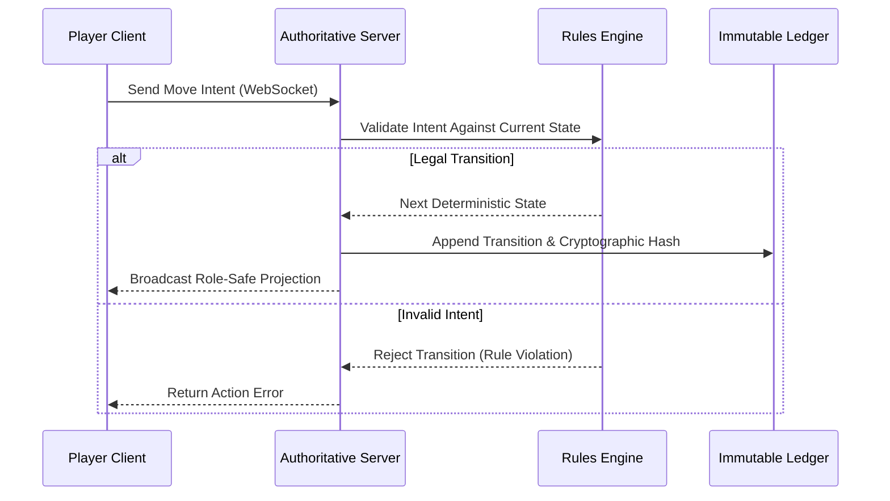
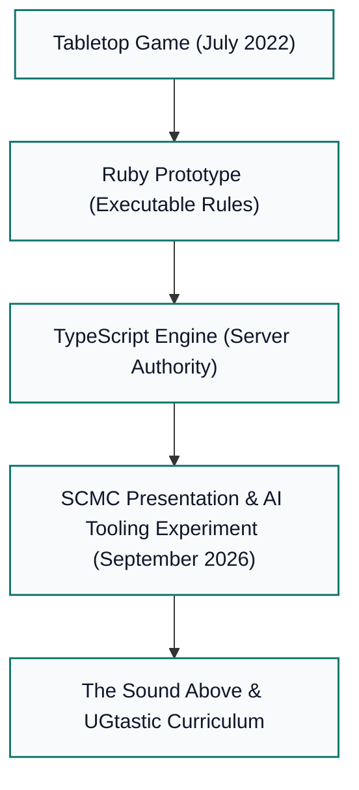
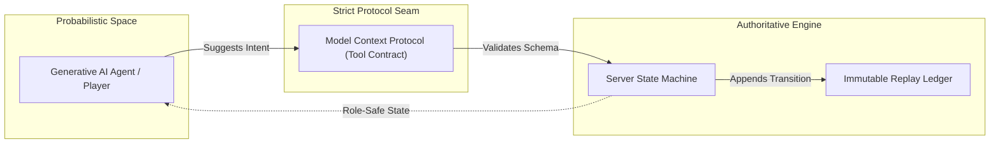

In July 2022, during a steady, soaking rain at Boy Scout Camp Tesomas in northern Wisconsin, I sat at a wooden picnic table with two standard 52-card decks, a pen, and a notebook.

The camp schedule had paused under the downpour. While water ran off the corrugated pavilion roof, I wanted to solve a specific game design puzzle: could you build a deep, tactical two-player card duel using only two everyday decks of cards, with zero dice rolls and no mid-game shuffle?

Every outcome had to follow strictly from the cards visible on the table and the choices each player made. If an attack succeeded, you could trace exactly why. If a column fell, you could see the math. The rules had to be simple enough for two scouts to understand on a damp bench, yet mathematically sound enough to run identically in software.

That rainy afternoon experiment became **Phalanx Duel**.

Over the next four years, it grew from cards on a picnic table into an executable Ruby combat prototype, then into a server-authoritative TypeScript engine, a native Go command-line client, an automated container release pipeline, and a live production platform at [phalanxduel.com](https://phalanxduel.com).

Along the way, it became something more than a game: it became an architecture laboratory. And when I began preparing a presentation for Software Craftsmanship McHenry County (SCMC), Phalanx Duel was the working product, and building the presentation became an experiment in what could be built out using AI-augmented developer tooling.

---

### Prototyping in Ruby: Making the Rules Executable

Every software craftsman knows the gap between a design in your head and running software. Tabletop game rules suffer from the exact same challenge: edge cases hide behind ambiguous English phrasing.

To test the physical rules, I wrote a prototype in Ruby. The model was straightforward:
- Each player controls an eight-card formation arranged in two ranks across four columns.
- The front rank serves as the vanguard, taking the brunt of attacks and striking opposing columns.
- The back rank serves as the flank, reinforcing the line and absorbing overflow damage.
- When an attack strikes a column, damage must chew through the vanguard and flank before a single point can reach the player's Life Points.

Suits determine how damage behaves. Diamonds absorb shock and reduce carryover between cards. Hearts shield remaining Life Points. Clubs double eligible overflow. Spades double whatever damage reaches the player's core.

Writing the combat prototype in Ruby exposed rule ambiguities within hours. What happens when a column collapses mid-attack? Who decides reinforcement timing? By writing executable specifications, the rules stopped being an informal tabletop argument and became a legible contract.

```ruby
# Ruby prototype seam: verifying column damage carryover
def resolve_attack(attacker_card, defender_column)
  damage = attacker_card.value
  defender_column.cards.each do |target|
    break if damage <= 0
    absorbed = [damage, target.defense_value].min
    target.damage += absorbed
    damage -= absorbed
    apply_suit_modifiers(target, damage)
  end
  damage # Remainder reaches Life Points
end
```

The prototype proved the rules worked. But taking those rules into a networked multiplayer environment required a complete shift in systems thinking.

---

### The Architecture Laboratory: Server Authority and the Meaning of a Move

When engineering multiplayer systems, the most dangerous mistake is trusting the client to resolve state.

In early 2023, I rebuilt Phalanx Duel from the ground up as a server-authoritative TypeScript monorepo. In this architecture, clients never dictate what happens. A client merely expresses **intent**: *"Player 1 wants to attack column 3 with card 8 of Spades."*



The server receives that intent over WebSockets, passes it to a pure, isolated TypeScript engine package, validates it against the current match state, and computes the next state. If the move is illegal, the engine rejects it with a specific rule identifier. If legal, the server records the transition in an append-only ledger and broadcasts a **role-safe projection** to each participant:
- Player 1 receives their hand and visible table cards.
- Player 2 receives their hand and visible table cards.
- Spectators receive a time-delayed view with hidden information masked.

The client is just a dumb terminal rendering a projection. The server and the engine are the sole arbiters of reality.

---

### The SCMC Presentation: Building with AI-Augmented Tooling

In late summer 2026, when preparing a talk for Software Craftsmanship McHenry County (SCMC), I wanted to explore a direct question:

*How much of a technical presentation can you build out using AI-augmented developer tooling?*

I wanted to see how far modern tools could take us: drafting slides, structuring visual diagrams, generating synthetic bot-versus-bot demonstration videos, and building a companion web guide, all anchored directly against running code. At the time, I did not know about OBS; the focus was purely on exploring how AI tools could assist a solo developer in communicating deep systems architecture to a room of peers.

On September 15, 2026, I walked into SCMC and delivered **Phalanx Duel: Make the Rules Legible**.



We walked through the journey:
1. **The physical cards**: Demonstrating the two-page quickstart guide.
2. **The state machine**: Tracing how turns move from deployment to combat, cleanup, reinforcement, and draw.
3. **Replay verification**: Demonstrating how every completed match generates a cryptographic fingerprint that allows any match to be replayed tick by tick.
4. **OpenTelemetry instrumentation**: Inspecting distributed spans across WebSocket disconnects and reconnects.
5. **The Model Context Protocol (MCP)**: Showing how AI agents can connect to the engine as players or analysts through an explicit, bounded tool interface.

The presentation worked because Phalanx Duel was real. It was not a slide deck about hypothetical microservices. It was a tangible game running in production that everyone in the room could touch, inspect, and understand.

---

### The Meta Dimension: Capabilities and Hallucinations in AI Tooling

Building a presentation about Phalanx Duel using AI-augmented tooling turned out to be super meta, and genuinely fascinating.

It exposed both sides of generative tools in sharp relief:
- **What the tools enable**: Rapid synthesis, boilerplate scaffolding, visual layout generation, and fast iteration across documentation and slide decks.
- **Where the tools hallucinate**: Language models approximate rather than verify. Without strict human verification, they will invent narrative details with total fluency: imagining multi-camera broadcast studios before you even knew the software existed, or injecting philosophical treatises where straightforward engineering explanations belong.

This meta experience reinforces the foundational lesson of Software Craftsmanship McHenry County, UGtastic, and *The Sound Above*: **ground truth matters**.

Whether you are building a two-player card duel on a picnic table or evaluating generative models in production, the core contract never changes:
- Keep the business logic and game rules strictly deterministic.
- Keep the server authoritative over state transitions.
- Use generative tools for acceleration and assistance, but keep the boundary explicit and verified by human stewardship.

---

### Deterministic Boundaries in the Age of AI

This mindset directly informs how we must approach generative AI and autonomous developer agents.

When language models generate fluent code, it is tempting to treat them as authoritative. But fluent text is not verified truth. An LLM cannot be trusted with authoritative business logic or state transitions because it operates in probabilistic approximations.

Phalanx Duel demonstrates the clean boundary:
- The **engine** is deterministic, immutable, and strictly validated.
- The **model** is an external agent interacting with the engine through an explicit MCP tool schema.
- The model can suggest moves, evaluate tactics, or query game state, but it can never bypass the server's rules validation.



By keeping the rules legible and the engine authoritative, the AI becomes a creative participant rather than an operational hazard.

---

### The Takeaway for Enterprise Engineering

The lessons of Phalanx Duel are the exact lessons that allow engineering organizations to modernize high-stakes legacy platforms:
1. **Make the rules legible**: If a business workflow cannot be explained on paper, it cannot be safely automated in software.
2. **Server authority is non-negotiable**: Never trust the caller to maintain system invariants.
3. **Replayability is trust**: When every state transition can be deterministically replayed and audited, fear vanishes from production.
4. **Cultivate the child's voice**: Approach difficult legacy systems with curiosity, playfulness, and generosity. Make working with you a safe, empowering experience where the whole team wins together.

Phalanx Duel started at a soggy camp table. It helped build the broadcast studio for *The Sound Above*. And it stands as a permanent reminder that the highest expression of engineering craftsmanship is not complexity or intensity: it is quiet, legible simplicity that keeps everyone safe.

---

*Presentation materials, the two-page quickstart PDF, and the editable slide deck are available at [just3ws.com/phalanx-duel/](/phalanx-duel/). Watch demonstrations and gameplay on the [Phalanx Duel Series Playlist on YouTube](https://www.youtube.com/playlist?list=PLHenvAZhJjHo). Play a live match at [phalanxduel.com](https://phalanxduel.com).*
