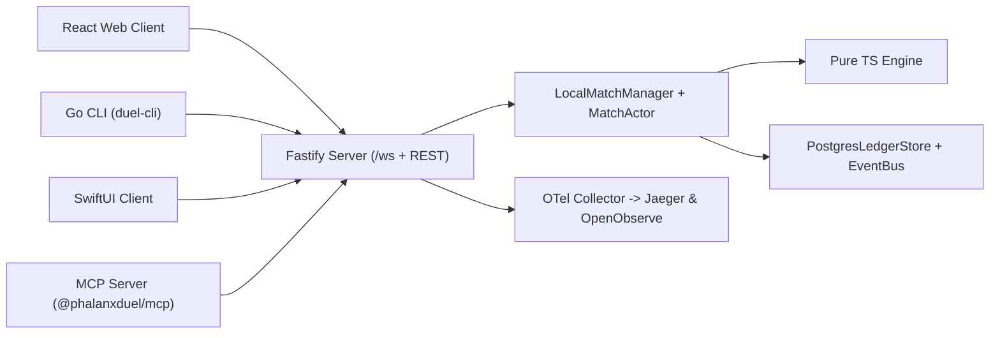

*Canonical edition on `just3ws.com` · Companion summary on [phalanxduel.com/articles/engineering-process/](https://phalanxduel.com/articles/engineering-process/) · Engine `v1.6.0`*

Phalanx Duel is a card game on the surface, but underneath it is a production reliability laboratory. Every architectural choice in `v1.6.0` exists to answer a practical engineering question: *how do you keep a real-time multiplayer system deterministic, horizontally scalable, observable, and safe to change at high velocity?*

## 1. Pure Engine, Dumb Terminals

The `@phalanxduel/engine` package has zero network or database dependencies. It takes a `GameState` and an `Action` (player intent) and returns the next `GameState`, transition trace, and canonical SHA-256 hashes (`computeStateHash` / `computeTurnHash`).

On top of that pure core, the Fastify server (`server/src/app.ts`) exposes both WebSocket (`/ws`) and REST (`POST /api/matches/:id/action`) action paths backed by the exact same authorization (`JWT` or `playerSecret`) and Fog-of-War projection (`projectStateForViewer`).

## 2. Horizontal Scaling & Session Recovery

In `v1.6.0`, match orchestration runs through `LocalMatchManager` and `MatchActor` with an append-only `PostgresLedgerStore` and `PostgresEventBus`. If a player's connection drops mid-turn - whether on desktop Wi-Fi, a mobile browser, or the Go terminal client - `rejoinMatch` reattaches their session and replays the latest redacted projection without losing state.

## 3. One Contract, Four Clients

Because the protocol is defined in OpenAPI (`/docs`) and AsyncAPI (`/docs/asyncapi.yaml`), we generate typed SDKs and run four distinct clients against the same server:
- **React Web Client (`client/`):** Full dark-mode battlefield with proportional playing-card aspect ratios, live Combat Math Inspector, and replay scrubber.
- **Go Terminal Client (`clients/go/duel-cli`):** Interactive and bot-driven CLI with `-name`, `-join`, reconnect, and `bot-mcts` support.
- **Native SwiftUI Client (`game-swiftui`):** Apple-platform native client aligned to `v1.6.0`.
- **MCP Server (`@phalanxduel/mcp`):** Agentic gameplay surface for bots, evaluation, and match analysis.

## 4. Bots, Ladders & Local LAN Tournaments

Players can train against tiered bots ranging from `Scout`, `Grunt`, and `Soldier` up to specialist and Monte Carlo Tree Search (`sp-mcts`) opponents, with seasonal Glicko-2 / Elo ratings exposed per category (`/api/ladder/:category`). For in-person events, the Admin Cockpit and LAN HTTP support let an organizer run a local tournament with delayed spectator feeds and verifiable match logs.

## 5. Non-Negotiable Operational Guardrails

Fast iteration only stays safe when the guardrails cannot be bypassed casually:
- **Database Environment Isolation:** Dedicated roles and wrapper scripts (`with-dev-postgres.sh`, `with-test-postgres.sh`, `with-tooling-postgres.sh`) structurally prevent tests from touching development data (`pnpm verify:db:isolation`).
- **Playability Gate:** `pnpm qa:playthrough:verify` must pass end-to-end before UI work proceeds - no polishing a broken game loop.
- **Single-Threaded `main` & Unified Checks:** Small, frequent commits verified by `pnpm check` (build, lint, typecheck, and full test suite).
- **OpenTelemetry Native:** Traces and logs flow directly through `otel-collector` to **Jaeger** and **OpenObserve**, retiring legacy proprietary SaaS lock-in.

## Watch the Engineering & Platform Videos (`@just3ws-mike`)

- [Phalanx Duel Game Development (Ramblin' & Amblin')](https://youtu.be/D7yTXxoNGLw)
- [1v1 Live PvP: Creating, Joining & Auto-Reconnecting Matches](https://youtu.be/56IffXxKVbM) (Ep. 10)
- [1vBot Training Ladder: Scout, Grunt & Soldier](https://youtu.be/aS5Q8geLxgo) (Ep. 11)
- [Mastering Specialist Bots & MCTS](https://youtu.be/KqK9tf2cYy8) (Ep. 12)
- [Understanding Your Ranking, Elo Categories & Seasonal Ladders](https://youtu.be/vzGigTVqByc) (Ep. 13)
- [Hosting & Directing a Local Tournament (Admin Portal & Runbook)](https://youtu.be/4dv7ViR10ZY) (Ep. 18)
- [Playing from the Terminal with Go `duel-cli`](https://youtu.be/em4h4DQrDUw) (Ep. 19)

## Canonical Sources & Attribution

- **Source Repository:** [`github.com/phalanxduel/phalanxduel`](https://github.com/phalanxduel/phalanxduel) (AGPL-3.0)
- **Companion Summary:** [phalanxduel.com/articles/engineering-process/](https://phalanxduel.com/articles/engineering-process/)
- **Wiki Diagrams:** [Container Architecture](https://github.com/phalanxduel/phalanxduel/wiki/Container-Architecture-Diagram) · [Runtime Sequence](https://github.com/phalanxduel/phalanxduel/wiki/Runtime-Sequence-Diagram) · [Telemetry Pipeline](https://github.com/phalanxduel/phalanxduel/wiki/Telemetry-Pipeline-Diagram)

## Series Navigation

- [← Part 3: Living Architecture & Diagrams](/2026/11/26/phalanx-duel-series-part-3-living-architecture-and-diagrams.html)
- **Part 4 (Current):** The Engineering Process & Multi-Client Platform
- [Next: Part 5 - Automated Video Curriculum & Media Pipeline →](/2026/11/26/phalanx-duel-series-part-5-automated-video-curriculum-and-media-pipeline.html)
