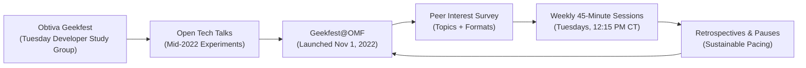

This is **Part 1** of a four-part series documenting **Geekfest@OMF**, the internal peer-learning community I started at [OneMain Financial](/resume/positions/onemain/) in November 2022. This series draws on my session logs, planning notes, and public archive records while excluding proprietary company details and colleague names.

## Why Start an Internal Peer Forum?

Large engineering organizations rarely lack smart people. They lack low-stakes rooms where engineers from different squads can learn together.

Daily delivery work pulls teams into narrow lanes. Engineers spend months shipping features inside one service while losing sight of adjacent stacks, shared tools, and emerging practices. Formal corporate tech talks rarely fix that gap. They often require polished slide decks, approval reviews, and top-down agendas that raise the bar too high for everyday practitioners.

Operating as a **Staff Software Engineer** (serving as Software Architecture Lead for the Acquisition Lane and later Associate Director, Staff Engineer, a senior IC role with no direct reports), I wanted a weekly room with almost zero friction. People needed a place to share what interested them, test rough ideas, and reconnect as craftspeople without waiting on management mandates.

## Credit Where It Is Due: The Obtiva Lineage

I did not invent Geekfest. Dave Hoover, Kevin Taylor, and the team at **[Obtiva](/resume/positions/obtiva/)** (later acquired by [Groupon](/resume/positions/groupon/)) pioneered the original Tuesday Geekfest in Chicago.

When I worked at Obtiva, Tuesday Geekfest was the highlight of my week. Developers owned the room. Over time, it grew into a trusted space where people rehearsed conference and user-group talks, shared open-source experiments, and ran hands-on micro-hack sessions. Format mattered less than showing up and participating. That same peer-enablement mindset later shaped how I approached engineering onboarding at Groupon and community organizing in [my broader career history](/history/).

If you want the deeper history of that tradition, watch [The Apprenticeship Move: Dave Hoover on GeekFest and Developer Mentorship](/interviews/dave-hoover-geekfest-geekfest/) or the [archived UGtastic YouTube recording with Dave Hoover](https://youtu.be/MytNNjBsBBk) (9m 41s, synced to the public archive).

## From Open Tech Talks to Geekfest@OMF

In mid-2022, I ran several informal sessions called *Open Tech Talks*. They covered microservices, federated GraphQL, event-driven architecture, and Git katas.

Those early sessions worked, but the name caused confusion with formal corporate tech talks. On **November 1, 2022**, I relaunched the group as **Geekfest@OMF** to honor Obtiva's Tuesday tradition and signal a different kind of room.

The charter stayed short and plain:

> Let's share what interests us, what we are looking at over the horizon, or something useful around the corner. We grow as we learn, and by sharing, we grow together.

The ground rules were simple:

- **Fixed weekly cadence:** Tuesdays from 12:15 to 1:00 PM Central. Short enough to fit a lunch break, consistent enough to build a habit.
- **Open attendance:** Anyone could drop in through a standing meeting link. No mandatory invite lists, no manager sign-off.
- **No slide tax:** A live terminal, a code walkthrough, a shared diagram, or an open discussion counted just as much as a formal deck.
- **Recorded by default:** Busy engineers could catch up later when delivery deadlines conflicted with Tuesday lunch.

## Letting Peers Shape the Backlog

A solo organizer can carry a forum for a month or two. After that, guessing what people want to learn becomes exhausting.

Early on, I ran a short peer interest survey with two questions:

1. **What subjects do you want to learn about?** Responses spanned programming languages (Ruby, Go, JavaScript), core design concepts (SOLID, domain-driven design), relational and NoSQL databases, runtimes, networking, shell scripting, DevOps tooling, event-driven systems, and security.
2. **Which formats help you learn best?** Peers consistently ranked interactive demos, live coding, and informal walkthroughs alongside or ahead of traditional slide presentations.

That survey did two things at once. It gave me a backlog grounded in real curiosity, and it gave quiet engineers permission to suggest topics they wanted to see without volunteering to lecture on day one.

## Designing for Organizer Sustainability

Many grassroots meetups burn out after their first quarter. The organizer scrambles every Monday night for a topic, misses two weeks, and quietly cancels the series.

Two habits kept Geekfest@OMF running for 18 months across 49+ recorded sessions:

- **Scheduled retrospectives:** The initial schedule only ran through late March 2023. On **March 28, 2023**, we paused to celebrate what we had covered, review survey results, and plan the next stretch together.
- **Deliberate breaks:** In **July 2023**, I called a planned summer break from formal presentations while leaving the Tuesday call open for casual conversation. Naming the pause prevented guilt and kept the habit intact.

Those small structural choices turned a personal experiment into a reliable weekly space. In Part 2, I break down the actual curriculum we covered and why mixing fundamentals, polyglot demos, and shared hygiene kept attendance strong.

## Series Navigation

- **Part 1 (Current):** Lineage, Charter, and Zero-Friction Design
- **Part 2:** [A Practical Curriculum for Working Engineers](/2026/11/27/geekfest-at-omf-part-2-a-practical-curriculum-for-working-engineers.html)
- **Part 3:** [Early Local-First AI and OpenTelemetry in the Brown-Bag Room](/2026/11/27/geekfest-at-omf-part-3-local-first-ai-and-opentelemetry-demos.html)
- **Part 4:** [From Brown-Bag to Community of Practice and Sustainable Handoff](/2026/11/27/geekfest-at-omf-part-4-from-brown-bag-to-community-of-practice-and-handoff.html)

Related context: [OneMain Financial Role Record](/resume/positions/onemain/) · [Canonical Resume](/) · [Download Complete 4-Part Field Guide (PDF)](/exports/geekfest-at-omf-field-guide.pdf) · [EPUB](/exports/geekfest-at-omf-field-guide.epub) · [From Geekfest to SRE Synthesis](/ai/2026/08/30/from-geekfest-to-sre-sustainable-engineering-communities/).
