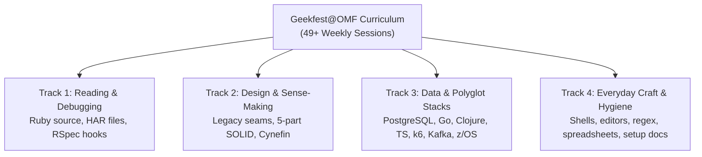

This is **Part 2** of a four-part series documenting **Geekfest@OMF**. In [Part 1](/2026/11/27/geekfest-at-omf-part-1-lineage-charter-and-zero-friction-design.html), I covered the Obtiva lineage and zero-friction design. Here I look at the actual curriculum across 18 months and 49+ recorded sessions, and how those Tuesdays intersected with real production architecture work on the Acquisition Lane.

## Balance Variety With Depth

A single-topic lunch group quickly shrinks to one squad. A purely random group feels scattered and forgettable.

To keep engineers returning from across the organization, Geekfest@OMF rotated across four practical tracks. Every session focused on something a working developer could try that same afternoon.

## Track 1: Reading the Real System

Many debugging habits rely on guessing or copying snippets from search results. Several early sessions pushed the opposite habit: read the live system directly.

- **Reading Ruby (Nov 1, 2022):** The kickoff session skipped slides completely. We used `gem open` and `bundle open` to inspect library source code in a live environment instead of guessing how a dependency behaved.
- **Near, HAR, Wherever You Are (Mar 14, 2023):** "What happened in the browser?" often ends in a shrug. We walked through recording and exporting HTTP Archive (HAR) files from browser developer tools so frontend and backend engineers could inspect the exact network exchange.
- **A Bundle of Gems (Mar 21, 2023):** Every Rubyist runs `bundle install`, but few inspect how RubyGems and Bundler resolve dependencies. We built a minimal gem from scratch to demystify packaging and supply-chain risk.
- **Before, After, and Around with RSpec (Oct 3, 2023):** Large test suites hide surprising setup costs. We traced how RSpec executes test hooks so teams could write clearer, faster test setups.

## Track 2: Design Fundamentals and Sense-Making

Frameworks change every few years. Design principles and problem-framing skills age much better.

- **Working Effectively with Legacy Code (Nov 15, 2022):** We watched and discussed Michael Feathers' core ideas on seams, characterization tests, and making safe changes in mature codebases.
- **The 5-Part SOLID Series (Dec 2022 to Jan 2023):** Rather than rushing through all five principles in one slide deck, we gave each letter its own 45-minute Tuesday: Single Responsibility, Open-Closed, Liskov Substitution, Interface Segregation, and Dependency Inversion. Spreading the arc across five weeks let engineers bring real refactoring questions back each Tuesday.

### Curated Reference Talks from the SOLID Arc

To ground the Liskov Substitution (Jan 17, 2023) and Interface Segregation (Jan 24, 2023) sessions in primary sources and concrete low-level design examples, I maintained YouTube study playlists alongside the Tuesday discussions. Those public reference talks anchor the curriculum in time (metrics synced November 27, 2026):

- [How Data Abstraction Changed Computing Forever (Barbara Liskov, TEDxMIT)](https://youtu.be/_jTc1BTFdIo) (published Jul 2019, 21m 39s, 40.7k views)
- [Liskov: The Liskov Substitution Principle](https://youtu.be/-Z-17h3jG0A) (published Apr 2020, 4m 23s, 29.5k views)
- [Low Level Design 106: Inheritance and Polymorphism](https://youtu.be/tIavGKafBV8) (published Apr 2022, 8m 58s, 38.8k views)
- [Low Level Design 107: Liskov Substitution Principle](https://youtu.be/HbGDobtxzWk) (published May 2022, 9m 05s, 88.4k views)
- [Low Level Design 108: Interface Segregation Principle](https://youtu.be/-E-E6pd-psU) (published May 2022, 7m 50s, 49.1k views)
- **Cynefin, Kind of Fun (Aug 8, 2023):** Technical debates often stall because teams treat complex problems as simple checklists. We introduced David Snowden's Cynefin sense-making framework to give squads shared language for triaging work before committing to a solution.

## Track 3: Databases and Polyglot Literacy

Enterprise platforms rarely run on one language. Engineers in one lane benefit when they understand the constraints of neighboring systems.

- **Databases and Practical PostgreSQL (Nov 22, 2022 & May 9, 2023):** We started with how relational databases store, index, and query data. Later, we ran a hands-on PostgreSQL session (`SELECT * FROM "SQL"`) covering foreign keys, triggers, audit tables, materialized views, join types, and real-time `LISTEN`/`NOTIFY` channels wired to a small Ruby `pg` listener.
- **Polyglot Exploration:** Sessions walked through building a small CLI in Go (*Do not pass Go(lang)*), demystifying Lisp syntax in Clojure (*Don't fear the `()`*), bridging Rails experience to Ionic and Node.js, and exploring TypeScript modules with peer guest speakers.
- **Cross-Boundary Infrastructure:** We covered Redis-backed feature flags with Rollout, server-side session state evaluation with DynamoDB, GraphQL load testing with Grafana k6, a dedicated Kafka fundamentals webinar, and a peer walkthrough of bridging modern APIs to z/OS mainframe backends.

Each of those sessions lowered the fear of unfamiliar boundaries. When an application engineer understands how a mainframe connector or a load test works, cross-team conversations get calmer and faster.

## Track 4: Everyday Craft and Shared Hygiene

Some of the highest-energy Tuesdays had nothing to do with frameworks. They focused on the daily tools every engineer touches.

- **Spreadsheets. No, really. (Nov 8, 2022):** Before reaching for a custom microservice, ask whether a spreadsheet solves the problem faster.
- **Consoles, Terminals, and Shells, Oh My (ZSH)! (Apr 18, 2023):** Clarifying the difference between terminals, consoles, Bash, and Zsh, plus practical shell automation.
- **Editor Wars (May 23, 2023):** Five-to-fifteen-minute lightning demos where colleagues showed why they loved Vim, Emacs, VS Code, or RubyMine. Lighthearted, high-participation, and packed with workflow tips.
- **Regular Expressions (Jun 20, 2023):** A practical tour from `\A` to `\z` without mystique.
- **Spring Cleaning: Workstation Setup Docs (Feb 7, 2023):** One Tuesday, we skipped lectures altogether and spent 45 minutes updating stale developer onboarding documentation together. Turning a brown-bag into live maintenance showed that peer communities can leave shared artifacts behind.

## How the Curriculum Connected to Production Work

None of these Tuesdays were detached academic lectures. They tracked directly alongside the real engineering problems documented in [my OneMain Financial position record](/resume/positions/onemain/) and [architecture case studies](/case-studies/):

- **Debugging a distributed monolith:** Sessions on reading Ruby dependency source, exporting browser HAR traces, and Michael Feathers' legacy seams built shared diagnostic habits across teams maintaining decade-old acquisition workflows.
- **Session state resilience:** The May 2023 peer walkthrough evaluating DynamoDB for server-side session state intersected directly with diagnosing and eliminating a Rails session-cookie overflow defect affecting 4% of digital applicant traffic via a zero-downtime migration to AWS DynamoDB.
- **Enablement through shared hygiene:** Live workstation documentation maintenance and relational database internals reflected the Acquisition Lane enablement team's day-to-day focus on making legacy boundaries legible and safer for delivery squads to change.

## What Made the Curriculum Work

Three patterns stood out across those 18 months:

1. **Playful titles lowered the stakes.** Calling a session *Near, HAR, Wherever You Are* or *Do not pass Go(lang)* signaled curiosity over corporate formality.
2. **Guest speakers multiplied reach.** Inviting peers from other teams to demo TypeScript, DynamoDB, GraphQL load testing, or mainframe API connectors broke single-speaker dependency.
3. **Hands-on beats abstract.** Live terminal sessions, scratch repositories, and shared problem solving produced far better discussion than polished slide decks.

In Part 3, I look at the two emerging topics that shifted Geekfest@OMF from general peer learning into an enterprise catalyst: privacy-conscious local AI and OpenTelemetry.

## Series Navigation

- **Part 1:** [Lineage, Charter, and Zero-Friction Design](/2026/11/27/geekfest-at-omf-part-1-lineage-charter-and-zero-friction-design.html)
- **Part 2 (Current):** A Practical Curriculum for Working Engineers
- **Part 3:** [Early Local-First AI and OpenTelemetry in the Brown-Bag Room](/2026/11/27/geekfest-at-omf-part-3-local-first-ai-and-opentelemetry-demos.html)
- **Part 4:** [From Brown-Bag to Community of Practice and Sustainable Handoff](/2026/11/27/geekfest-at-omf-part-4-from-brown-bag-to-community-of-practice-and-handoff.html)
