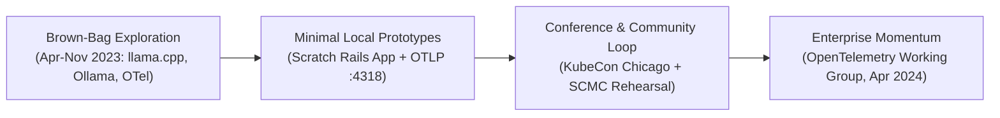

This is **Part 3** of a four-part series documenting **Geekfest@OMF**. Once the weekly Tuesday habit was established ([Part 1](/ai/2026/11/27/geekfest-at-omf-part-1-lineage-charter-and-zero-friction-design/) and [Part 2](/ai/2026/11/27/geekfest-at-omf-part-2-a-practical-curriculum-for-working-engineers/)), the room became something more valuable than a study group. It became a safe place to test unfamiliar technology before the organization had formal standards for it.

Between April 2023 and February 2024, two threads stood out: **privacy-conscious local AI** and **OpenTelemetry**.

## Exploring Local-First AI Without Hype

In early 2023, Large Language Models moved from research papers into everyday developer conversations overnight. In a regulated financial enterprise, sending internal code or documents to third-party cloud APIs was a non-starter. Waiting passively for policies to settle meant engineers would fall behind on how the tools actually worked.

Geekfest@OMF took a pragmatic middle path: run open models locally and inspect them with engineering rigor.

- **Let's Look More at LLMs (Apr 4, 2023):** We stepped into unfamiliar territory openly. I demonstrated `llama.cpp` running local weights and OpenAI's `Whisper` speech-to-text tool (which I was using to transcribe archival user-group interviews). I explicitly invited ML specialists to join and correct our mental models. Starting with humility kept the room curious instead of defensive.
- **Local LLM with Ollama (Nov 28, 2023):** Seven months later, local tooling had matured dramatically. I walked through integrating **Ollama** into a Ruby on Rails prototype to analyze and score internal documentation while keeping every byte of data on local hardware. We debugged JSON parsing and streaming responses live on the call.
- **Spin up SQL with Vanna.ai (Jan 23, 2024):** We opened 2024 with a Python demo exploring natural-language-to-SQL generation, examining both where it helped and where schema ambiguity still required human judgment.

Those sessions planted an important norm: you can learn emerging AI patterns responsibly in a regulated environment by favoring local-first prototypes and honest boundary checks.

## The OpenTelemetry Spark

The second thread changed the trajectory of Geekfest@OMF completely.

In September 2023, distributed tracing was still a distant idea for most application squads. Rather than writing a 30-page architecture proposal, I brought a scratch demo to Tuesday lunch.

- **Looking at OpenTelemetry (Sep 12, 2023):** We generated a brand-new minimal Rails app (`rails new animal_canine_info --minimal`), wired up Ruby OpenTelemetry instrumentation, and exported live OTLP spans to a local collector on the standard OTLP/HTTP port (`4318`). Seeing a real trace waterfall appear in minutes made observability concrete.
- **OpenTelemetry the Demo (Sep 19, 2023):** The following week, we walked through the official multi-service OpenTelemetry Demo application. Engineers could see how traces crossed language and service boundaries in a distributed system.
- **KubeCon + CloudNativeCon Chicago Recap (Nov 21, 2023):** After attending KubeCon in Chicago, I brought field notes back to Geekfest@OMF with a focus on the OpenTelemetry stack and real-world adoption patterns.

### KubeCon Chicago 2023 and OpenTelemetry Study References

Alongside the live demos, I tracked public CNCF and conference talks in study watchlists to keep our Collector, sampling, and logging discussions aligned with upstream standards (metadata synced November 27, 2026):

- [Connected Observability Pipelines in the OpenTelemetry Collector (Dan Jaglowski)](https://youtu.be/uPpZ23iu6kI) (published May 2023, 26m 52s, 3.4k views)
- [Journey from Fluent Bit, Fluentd and Prometheus to OpenTelemetry Collector (Marcin Stozek)](https://youtu.be/8VFA1d-7W28) (published Nov 2023, 30m 03s, 2.4k views)
- [Introducing Logs in OpenTelemetry: What It Unlocks and How to Use It (Morgan McLean & Dan Jaglowski)](https://youtu.be/a1KZwfLr2PQ) (published Nov 2023, 35m 56s, 6.2k views)
- [OTTL Me Why: Transforming Telemetry in the OpenTelemetry Collector (Tyler Helmuth & Evan Bradley)](https://youtu.be/uVs0oUV72CE) (published Dec 2023, 28m 33s, 3.1k views)
- [Dynamic Sampling in Practice (Kent Quirk, Honeycomb)](https://youtu.be/r5j02aQ_Y4U) (published Dec 2023, 30m 47s, 751 views)

## Closing the Circle Back to Obtiva

One session in **February 2024** captured the full spirit of the original Obtiva Geekfest.

On **February 13, 2024**, I used Geekfest@OMF to rehearse an external user-group talk I was preparing for **SCMC** (Software Craftsmanship McHenry County), titled *"From Monitoring to Observability with OpenTelemetry."* Colleagues reviewed the outline, challenged unclear transitions, and sharpened the story from traditional monitoring to context-rich observability.

That single session closed a 15-year loop. At Obtiva in 2009, we used Tuesday Geekfest to practice talks for Chicago user groups. In 2024, Geekfest@OMF served the exact same role, feeding lessons between the external software craftsmanship community and the internal engineering organization.

## Why Small Demos Beat Big Mandates

Looking back at those nine months, a clear pattern emerges:

1. **Scratch apps remove politics.** Demonstrating OpenTelemetry on a throwaway Rails app meant nobody felt criticized about their production codebase.
2. **Local-first prototypes lower compliance anxiety.** Running Ollama or a local OTLP collector on a laptop let engineers test real mechanics safely.
3. **Curiosity builds coalition before budget exists.** By the time leadership was ready to sponsor formal observability work, engineers across multiple lanes already shared vocabulary and working mental models.

In Part 4, I trace what happened next: how those Tuesday OpenTelemetry demos grew into the company's first Community of Practice and how we handed it off to permanent full-time stewardship.

## Series Navigation

- **Part 1:** [Lineage, Charter, and Zero-Friction Design](/ai/2026/11/27/geekfest-at-omf-part-1-lineage-charter-and-zero-friction-design/)
- **Part 2:** [A Practical Curriculum for Working Engineers](/ai/2026/11/27/geekfest-at-omf-part-2-a-practical-curriculum-for-working-engineers/)
- **Part 3 (Current):** Early Local-First AI and OpenTelemetry in the Brown-Bag Room
- **Part 4:** [From Brown-Bag to Community of Practice and Sustainable Handoff](/ai/2026/11/27/geekfest-at-omf-part-4-from-brown-bag-to-community-of-practice-and-handoff/)

Related synthesis: [Rolling Out OpenTelemetry in the Real World: Lessons from Rails to Mainframe](/ai/2026/08/30/rolling-out-opentelemetry-in-the-real-world/).
