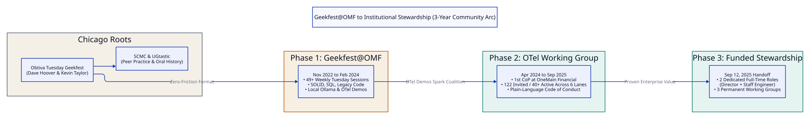

This is **Part 4** of a four-part series documenting **Geekfest@OMF**. In [Part 3](/2026/11/27/geekfest-at-omf-part-3-local-first-ai-and-opentelemetry-demos.html), I described how scratch OpenTelemetry demos sparked cross-team curiosity. Here I trace how that energy matured into an enterprise Community of Practice and ended with a deliberate stewardship handoff.

## The Secret Value Starts Before the First Line of Code

Most organizations treat observability as a tooling purchase. Pick a vendor, install an agent, and wait for dashboards.

In a long-lived enterprise with heterogeneous stacks (Ruby on Rails, Node.js, Java, API gateways, Kafka, and mainframes), that approach stalls fast. The real value of **OpenTelemetry** appears before the first integration lands: **it forces siloed teams to talk to each other.**

You cannot trace a customer journey across six lanes without asking your neighbors how their service works, what headers survive their gateway, and what constraints they live under. Conway's Law reminds us that systems mirror the communication paths of the organization that built them. If you want a connected, observable distributed system, you have to build connected human communication paths first.

## Scaling Into a Representative Forum

In **April 2024**, the observability thread outgrew a general Tuesday brown-bag and spun out as the **OpenTelemetry Working Group (OTel WG)**, establishing the first formal Community of Practice at OneMain Financial.

Over the next 17 months, the weekly Friday forum grew to **122 invited members**, with **40+ active engineers** participating across six product and platform lanes. That pattern soon inspired parallel Communities of Practice for event streaming, workflow orchestration, and domain API gateways.

The working group worked because it acted less like a top-down committee and more like a **representative forum**, closer to a United Nations of practitioners than an architecture board:

- **Two-way representation:** Engineers brought real integration blockers from their squads into the room, compared notes with adjacent teams, and carried shared patterns back home.
- **Respect for prior constraints:** Long-lived enterprises carry decisions made under past deadlines and technologies. Mocking legacy choices shuts down collaboration; acknowledging different realities opens it up.
- **Practical pairing over mandates:** Sessions focused on active work: propagating W3C Trace Context headers, correlating logs and spans across language boundaries, and verifying telemetry hygiene together.

## Writing a Plain-Language Code of Conduct

As attendance grew past a few dozen engineers, implicit norms were no longer enough. In January 2025, I drafted a concise, one-page **Code of Conduct** for the working group.

I did not want a legalistic document. A first-time visitor needed to read one page and know how the room operated. Five principles anchored it:

1. **Assume good intent, even in stark disagreement.** Every squad operates under different constraints and risk tolerances.
2. **Leave title hierarchy at the door.** Good ideas cannot emerge in a room dominated by senior titles.
3. **Make corporate newcomers feel safe.** For many engineers hired into traditional enterprise roles, speaking up in an open cross-team forum is already a big step outside their comfort zone.
4. **Clarify what a working group is.** It is a collaborative connection point, not a dedicated delivery team that absorbs everyone else's backlog.
5. **Protect the practitioners doing the work.** Education and curiosity belong in the room, while active integration blockers get priority so real teams stay unblocked.

## The September 2025 Stewardship Handoff

A grassroots community succeeds when it makes itself unnecessary as a volunteer side project.

By mid-2025, cross-lane adoption and working production traces had proved the strategic value of unified observability. Executive leadership funded **two dedicated full-time roles** (a Director and a Staff Engineer) and structured the effort into **three focused working groups** under permanent operational stewardship.

On **September 12, 2025**, I held my final OpenTelemetry Working Group session and formally handed off stewardship.

Stepping back from something you built over three years is never purely mechanical. It takes discipline to let a community evolve under new owners without clinging to control. Yet that handoff was the whole point from day one: turning a Tuesday lunch experiment from November 2022 into permanent institutional capability that no longer depends on one person's calendar.

## What This Arc Means in Practice as a Staff Software Engineer

On [my canonical resume](/), [OneMain Financial role record](/resume/positions/onemain/), and [Staff Platform & Enablement Lead profile](/resumes/mike-hall-staff-platform-lead/), this three-year community arc is the human half of the same architecture work. Without direct reports or top-down authority, hands-on technical leadership still created measurable organizational leverage:

- **Scope:** Bridged six product and platform lanes spanning Ruby on Rails, Node.js, API gateways, Kafka, and mainframes.
- **Leverage:** Replaced isolated squad experiments with shared W3C Trace Context patterns, pairing loops, and a repeatable Community of Practice template.
- **Durability:** Ended not with a single champion burning out, but with two newly funded full-time roles and three permanent working groups carrying the work forward.

## Four Lessons for Staff Engineers Building Internal Communities

If you are trying to spark a similar arc inside a large engineering organization, four lessons travel well:

1. **Start small and drop the ceremony.** A 45-minute weekly session with live demos beats a quarterly summit every time.
2. **Let curiosity lead, then specialize.** A broad peer forum (like Geekfest@OMF) builds trust first; focused working groups (like the OTel WG) turn that trust into shared architecture.
3. **Design for representation, not heroism.** Rotate voices, write down clear behavioral norms, and connect squads horizontally.
4. **Plan your exit early.** Measure success by whether the organization eventually funds and owns the capability without you.

### External Talks That Informed This Arc

During the 2024 to 2025 working group phase, these public talks from my Conway's Law and OpenTelemetry study playlists shaped how I framed team topology and observability culture (metadata synced November 27, 2026):

- [How I Finally Stopped Worrying & Learnt to Love Conway's Law (James Lewis, GOTO 2015)](https://youtu.be/l1tyfb5we7I) (published Jul 2015, 40m 53s, 19.6k views)
- [Conway's Law: When Best Practices Are Not Enough (Julien Topcu)](https://youtu.be/c03WwH82NQI) (published Jan 2024, 49m 04s, 758 views)
- [Shift Into an Observability Mindset with OpenTelemetry (Daniel Gomez Blanco, Skyscanner)](https://youtu.be/_0AorR5JUS8) (published Mar 2024, 22m 06s, 1.1k views)
- [Software Architectures, Team Topologies & Complexity Science (James Lewis, GOTO 2023)](https://youtu.be/TgFSdEP9gcc) (published Jun 2024, 50m 26s, 30.6k views)

## Series Navigation

- **Part 1:** [Lineage, Charter, and Zero-Friction Design](/2026/11/27/geekfest-at-omf-part-1-lineage-charter-and-zero-friction-design.html)
- **Part 2:** [A Practical Curriculum for Working Engineers](/2026/11/27/geekfest-at-omf-part-2-a-practical-curriculum-for-working-engineers.html)
- **Part 3:** [Early Local-First AI and OpenTelemetry in the Brown-Bag Room](/2026/11/27/geekfest-at-omf-part-3-local-first-ai-and-opentelemetry-demos.html)
- **Part 4 (Current):** From Brown-Bag to Community of Practice and Sustainable Handoff

Related context: [Canonical Resume](/) · [OneMain Financial Role Record](/resume/positions/onemain/) · [Staff Platform & Enablement Lead Resume](/resumes/mike-hall-staff-platform-lead/) · [Download Complete 4-Part Field Guide (PDF)](/exports/geekfest-at-omf-field-guide.pdf) · [EPUB](/exports/geekfest-at-omf-field-guide.epub) · [From Geekfest to SRE Synthesis](/ai/2026/08/30/from-geekfest-to-sre-sustainable-engineering-communities/).
