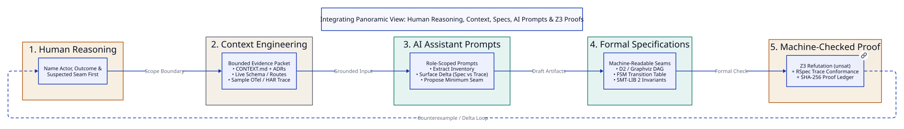

You probably have a system you need to understand right now. Maybe it is a decade-old legacy platform, a multi-team workflow with silent failures, or a codebase where documentation drifted years ago.

**Panoramic View is not the solution to that system.** It is the mechanism and discipline for mapping, tracking, and sharpening your understanding over time. By combining instrumentation and observability with plain-language models, it builds shared comprehension across every role: from the developer, to the designer, to the business process owner.

I developed this discipline through manual instrumentation at enterprise scale, tracing customer journeys from desktop browser to mainframe and back again. Today, I run that same discipline as an integrated, AI-assisted workflow across my projects. It is not as complicated as you might think it has to be, and it is not easy either.

AI coding assistants are fast at generating code and convincing when they guess wrong. Giving both humans and AI agents the same empirical map before anyone edits production code keeps everyone honest.

This guide spells out how to apply Panoramic View to your own system across five layers: human reasoning, context engineering, formal specifications, scoped AI prompts, and machine-checked proofs.



## Layer 1: Good Old-Fashioned Reasoning First

Never start an architectural investigation by pasting a vague question into a chat window. Spend ten minutes with a notebook and answer four questions yourself:

1. **Who is the actor?** (Customer, internal operator, webhook partner, or automated job.)
2. **What outcome are they pursuing?** (Submit an application, settle a payout, publish an artifact.)
3. **Where is the suspected seam or failure?** (A dropped request, a schema lock, a cross-team handoff.)
4. **What would falsify my hypothesis?** (A concrete log line, HTTP status, span attribute, or database row.)

Reasoning first sets the blast radius. If you cannot state the premise in three sentences, an AI assistant will happily invent a plausible-sounding architecture that does not exist in your repository.

## Layer 2: Context Engineering (Bound the Packet)

Context engineering is not dumping an entire monolith into a context window. It is assembling a **small, high-signal evidence packet** anchored to the seam you named in Layer 1:

- **Durable system contracts:** `CONTEXT.md`, relevant ADRs, and canonical naming rules so the assistant never hallucinates internal terms.
- **Structural slices:** Only the routes, controllers, state machines, and schema definitions along the target path (or a scoped `graphify` / Groma query).
- **Runtime evidence:** One anonymized HAR trace, one OpenTelemetry span waterfall, or one failing query plan.
- **Explicit unknowns:** A short bullet list of what you *do not* know yet, instructing the assistant to flag gaps instead of guessing.

Keep the packet under a few focused files. Tight context prevents the model from drifting into unrelated subsystems.

## Layer 3: Specifications as Externalized Contracts

Human mental models cannot be proved mathematically. To make a seam checkable, translate the findings into **plain-text, version-controlled specifications**:

- **Topology & dependency graphs (`D2` / `Graphviz DOT`):** Make ingress paths, gateways, and foreign-key hierarchies explicit and reviewable in pull requests.
- **State machine tables (`YAML` / `JSON`):** Enumerate every legal state, initial state, terminal/recovery state, and allowed transition.
- **Checkpoint contracts (`OpenTelemetry` / `BPMN`):** List the exact ordered checkpoints a healthy journey must emit.

Once a seam lives in a file, both engineers and automated validators can inspect it without relying on tribal memory.

## Layer 4: Disciplined AI Assistant Prompts

Use AI assistants as **fast cartographers and adversarial reviewers**, never as silent authorities. Four focused prompt patterns cover the full Panoramic View loop:

### Prompt 1: Inventory Without Speculation
```text
Role: Systems cartographer.
Context: [attach CONTEXT.md, target controller/service files, schema slice].
Task: Trace the actor journey from [entry point] to [storage/external call].
Output a numbered sequence showing: Layer, File:Line, State Mutation, and External Dependency.
Rule: If a branch or downstream call is not visible in the provided files, mark it UNKNOWN. Do not infer or guess.
```

### Prompt 2: Reconcile Three Accounts (Find the Delta)
```text
Compare these three inputs:
1. Stakeholder belief: [2-3 sentences of what Product/Ops expects]
2. Implemented model: [inventory from Prompt 1]
3. Runtime evidence: [anonymized OTel trace / HAR / error log]

List every contradiction (Delta) between belief, code, and runtime.
Rank deltas by operational risk and cite the exact evidence line for each.
```

### Prompt 3: Draft Formal Spec & Diagram
```text
Convert the verified inventory into:
1. A D2 architecture diagram (src/diagrams/<name>.d2) showing the exact layers and failure offramps.
2. A finite state machine table listing states, initial state, terminal/recovery states, and legal transitions.
3. An SMT-LIB 2 invariant check (Z3) asserting that no legal transition deadlocks or violates [domain invariant].
```

### Prompt 4: Adversarial Counterexample Hunt
```text
Act as a skeptical Staff Engineer reviewing this seam before production rollout.
Try to break the proposed migration or state machine.
Identify any race condition, retry amplification, partial write, or silent failure mode not covered by the invariants.
```

## Layer 5: Machine-Checked Proofs & Runtime Conformance

After the assistant drafts the specification, **remove the LLM from the trust loop**. Verify the math and runtime behavior with deterministic tools:

1. **SMT-LIB 2 Formal Refutation (`Z3`):** Assert the *negation* of each invariant (e.g., *"some FK edge violates topological order"*, *"some legal transition fails to decrease the termination variant"*, or *"a payment state machine disburses twice"*). Require `z3` to return `unsat` across the universal domain.
2. **Executable Conformance Tests (`RSpec`):** Run automated unit and counterexample tests proving both valid paths and failure detection (cyclic graphs, deadlocks, and undocumented runtime transitions).
3. **Published Proof Certificate:** Emit a SHA-256 hashed proof ledger ([panoramic_z3_proof_certificate.json](/assets/data/panoramic_z3_proof_certificate.json)) alongside the human-readable map so anyone can re-run `z3 src/panoramic_view/proofs.smt2` independently.

## Live Working Example in This Repository

Every step above is live and inspectable in this codebase:

- **Method & Interactive Wave Explorer:** [Panoramic View](/panoramic-view/)
- **Machine-Checked Z3 Formal Proofs:** [src/panoramic_view/proofs.smt2](https://github.com/just3ws/just3ws.github.io/blob/master/src/panoramic_view/proofs.smt2) (`4/4` theorems proved `unsat` via Z3 5.4.1)
- **Z3 Proof Certificate:** [panoramic_z3_proof_certificate.json](/assets/data/panoramic_z3_proof_certificate.json)
- **Executable Ruby Verifier & RSpec Suite:** [src/panoramic_view/conformance.rb](https://github.com/just3ws/just3ws.github.io/blob/master/src/panoramic_view/conformance.rb) and [spec/panoramic_view_conformance_spec.rb](https://github.com/just3ws/just3ws.github.io/blob/master/spec/panoramic_view_conformance_spec.rb)
- **Downloadable Reference:** [Panoramic View Field Manual (PDF)](/exports/panoramic-view-field-manual.pdf) · [EPUB](/exports/panoramic-view-field-manual.epub)
