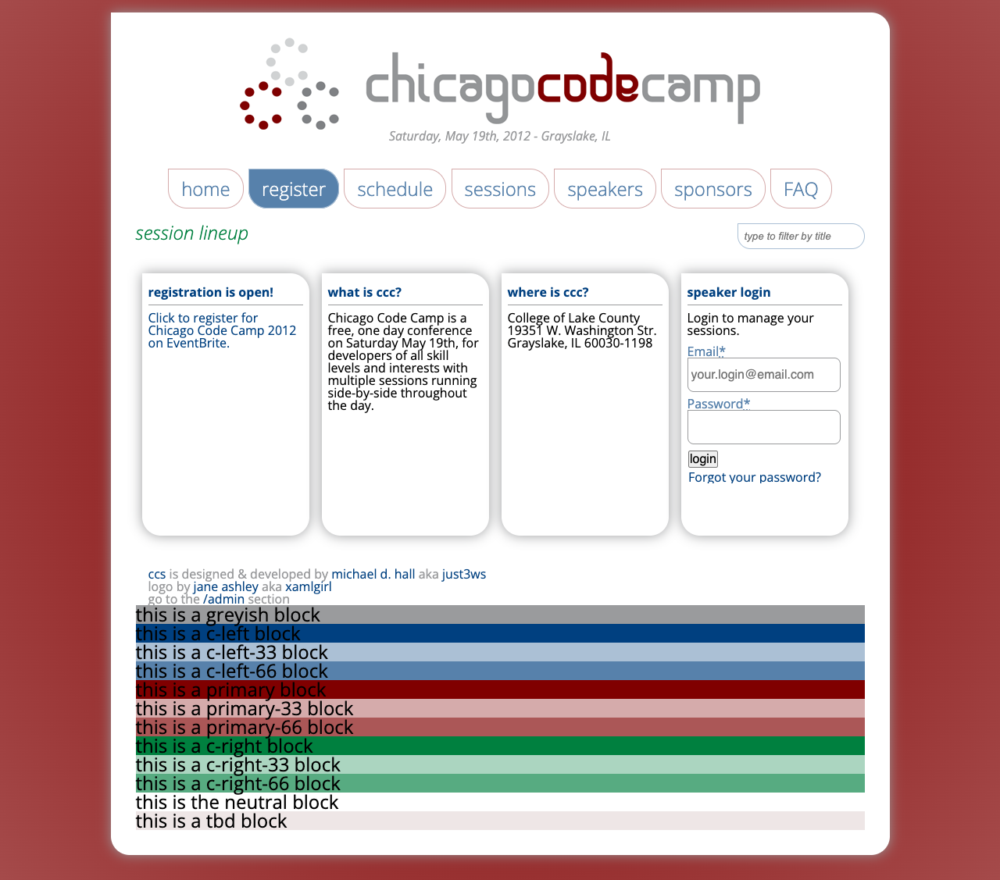
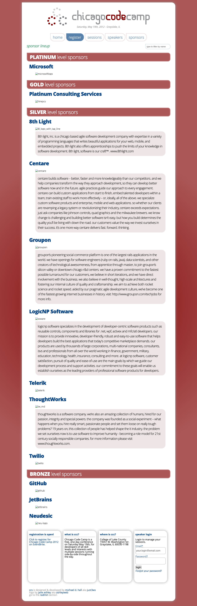
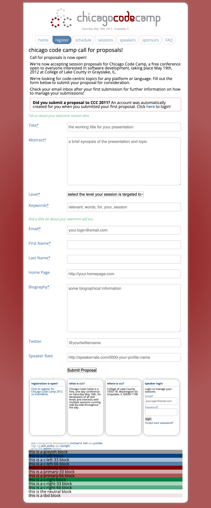
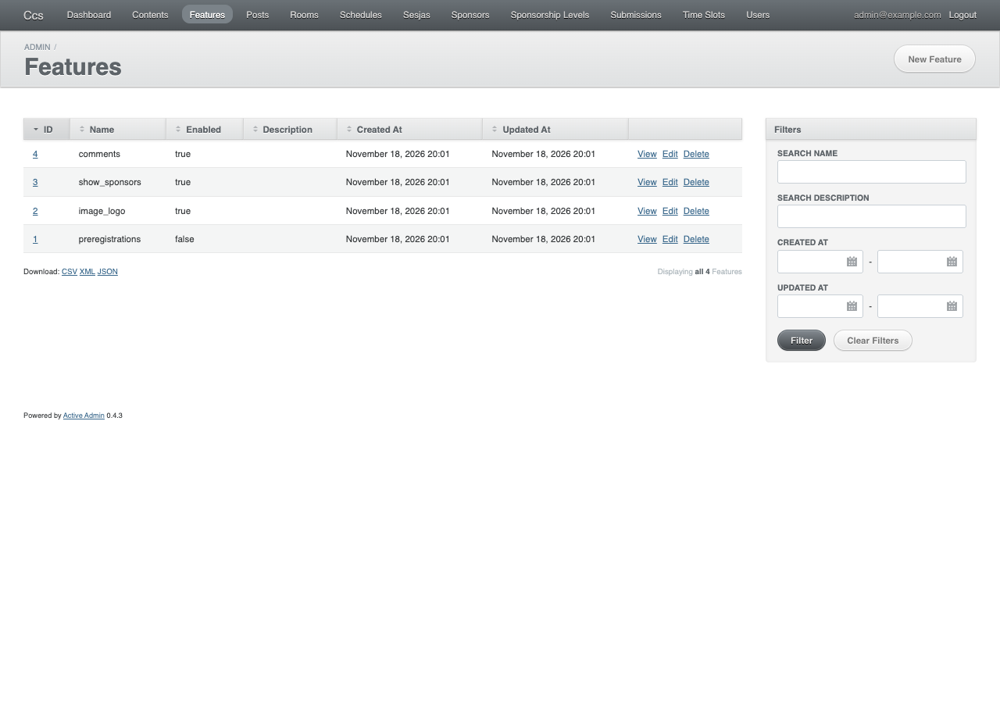
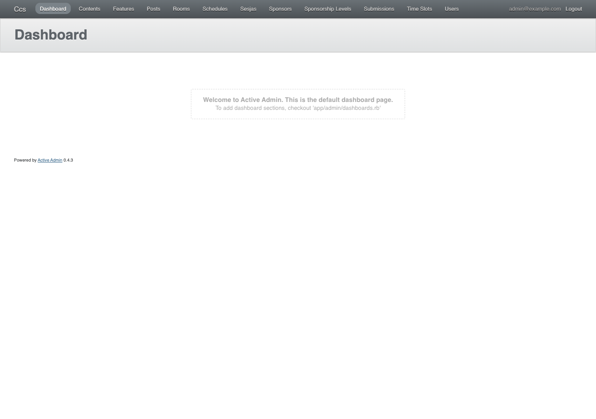

# Chicago Code Camp (2010–2012) & Code Camp Server: A Technical & Archival Retrospective

> **Quarantined technical synthesis:** This retrospective was compiled from the `just3ws/ccs` git repository (`prod-2012-05` at `1b5f639`), a live Ruby 1.9.3 / Rails 3.2 Colima container boot (`origin/2025-12`), and contemporary May 2012 Internet Archive snapshots of `chicagocodecamp.com`. All dates, symbols, routes, sponsors, and speakers below are cited directly from those primary sources.

## 1. Provenance & Contemporary Internet Archive Match (May 2012)

The `just3ws/ccs` repository preserves the Rails application that powered **`chicagocodecamp.com`** across three consecutive May conferences (2010, 2011, and 2012). Its last 2012 production-era commit, tagged `prod-2012-05` (`1b5f639`, May 15, 2012), aligns 1:1 with contemporary **Internet Archive** captures of the live Heroku deployment:

- **Live Home (`2012-05-18`, 1 day before the May 19, 2012 camp):** [`web.archive.org/web/20120518214850/http://chicagocodecamp.com/`](https://web.archive.org/web/20120518214850/http://chicagocodecamp.com/)
  
- **Live Sponsors (`2012-05-06`):** [`web.archive.org/web/20120506020818/http://chicagocodecamp.com/sponsors`](https://web.archive.org/web/20120506020818/http://chicagocodecamp.com/sponsors)
  - **Platinum:** Microsoft
  - **Gold:** Platinum Consulting Services
  - **Silver:** 8th Light, Centare, Groupon, LogicNP Software, Telerik, ThoughtWorks, Twilio
  - **Bronze:** GitHub, JetBrains, Neudesic
  
- **Live Speakers (`2012-05-06`):** [`web.archive.org/web/20120506022442/http://chicagocodecamp.com/speakers`](https://web.archive.org/web/20120506022442/http://chicagocodecamp.com/speakers) — 32 speakers: Heather Acton, Jeff Alstadt, Jonathan Baltz, Keith Burnell, Jim Buswell, Joel Cochran, Steven Degutis, Michael Eaton, Aaron Erickson, Mark Glenn, Ray Hightower, Joe Hummel, Mike Jansen, Tyler Jennings, Colin Jones, Steve Kim, Justin Love, CM Lubinski, Micah Martin, Sean Massa, Min/Lwin Maung, Chris McAvoy, Kevin McMahon, Doug Mulley, Sergio Pereira, Michael Perry, Igor Polevoy, Chris Powers, Devin Rader, Jean Seely, Eric Smith, Daniel Sniderman.
- **Live Schedule (`2012-04-21`) & Session Detail (`2012-05-06`):** [`/schedules`](https://web.archive.org/web/20120421092014/http://chicagocodecamp.com/schedules) and [`/sessions/118`](https://web.archive.org/web/20120506020651/http://chicagocodecamp.com/sessions/118).

---

## 2. Three Eras in Git History (796 Commits, 2010–2012)

1. **Act I — Launch (Jan–May 2010, 175 commits):** Started `2010-01-23` (`a8f4b11`), running Rails 2.3.5, RVM `.rvmrc`, Cucumber/RSpec, and early Compass/Sass. GPL v2 was locked in on `2010-04-07` before the first external commits arrived. Early speaker headshots (`129862d`, `2010-04-25`) preserve a snapshot of the regional developer community, including Dave Bost (whose memory we honor respectfully).
2. **Act II — The Rails 3 Rebuild (Jan–Oct 2011, 489 commits):** 155 commits in February 2011 alone. Rebuilt onto Rails 3, Haml/Sass, jQuery, Devise + Devise Invitable, CanCan, ActiveAdmin, Formtastic, Dalli/Memcached, S3, Eventbrite, and Heroku (`heroku_san`).
3. **Act III — The 2012 Camp (Jan–May 2012, 132 commits):** Built on an OS X MacBook Pro with `mxcl/homebrew`, RVM `1.9.2-patched@ccs`, and `heroku_san`, culminating in four rapid-fire CSS fixes on May 15, 2012 (`1b5f639`).

Contributors across `prod-2012-05`: **Michael D. Hall** (764 commits), **Sergio Pereira** (24 commits, including 2 early commits as `unknown <Sergio@.(none)>`), **Adam Walters** (7 commits), and **Dustin Updyke** (1 commit).

---

## 3. 1:1 Sitemap & Multi-Perspective Matrix

| Perspective | Route / Surface | Local Dev Capture | Wayback Match |
| :--- | :--- | :--- | :--- |
| **Visitor (`guest`)** | `/` | [`2012-home.png`](/assets/images/chicago-code-camp-2012/2012-home.png) | [`wayback-2012-home.png`](/assets/images/chicago-code-camp-2012/wayback-2012-home.png) |
| **Visitor (`guest`)** | `/schedules` | [`2012-schedule.png`](/assets/images/chicago-code-camp-2012/2012-schedule.png) | [`wayback-2012-schedules.png`](/assets/images/chicago-code-camp-2012/wayback-2012-schedules.png) |
| **Visitor (`guest`)** | `/sessions` & `/sessions/118` | [`2012-sessions.png`](/assets/images/chicago-code-camp-2012/2012-sessions.png) | [`wayback-2012-session-118.png`](/assets/images/chicago-code-camp-2012/wayback-2012-session-118.png) |
| **Visitor (`guest`)** | `/speakers` | [`2012-speakers.png`](/assets/images/chicago-code-camp-2012/2012-speakers.png) | [`wayback-2012-speakers.png`](/assets/images/chicago-code-camp-2012/wayback-2012-speakers.png) |
| **Visitor (`guest`)** | `/sponsors` | [`2012-sponsors.png`](/assets/images/chicago-code-camp-2012/2012-sponsors.png) | [`wayback-2012-sponsors.png`](/assets/images/chicago-code-camp-2012/wayback-2012-sponsors.png) |
| **Visitor (`guest`)** | `/submissions/new` (CFP) | [`2012-submissions-new.png`](/assets/images/chicago-code-camp-2012/2012-submissions-new.png) | — |
| **Visitor (`guest`)** | `/faq` (`contents#show`) | [`2012-faq.png`](/assets/images/chicago-code-camp-2012/2012-faq.png) | — |
| **Auth (`Devise`)** | `/d/users/sign_in` & `/sign_up` | [`2012-sign-in.png`](/assets/images/chicago-code-camp-2012/2012-sign-in.png) · [`2012-sign-up.png`](/assets/images/chicago-code-camp-2012/2012-sign-up.png) | — |
| **Speaker (`speaker`)** | `/users/3/edit` | [`2012-speaker-profile-edit.png`](/assets/images/chicago-code-camp-2012/2012-speaker-profile-edit.png) | — |
| **Organizer (`AdminUser`)** | `/admin/login` & `/admin` | [`2012-admin-login.png`](/assets/images/chicago-code-camp-2012/2012-admin-login.png) · [`2012-admin-dashboard.png`](/assets/images/chicago-code-camp-2012/2012-admin-dashboard.png) | — |
| **Organizer (`AdminUser`)** | `/admin/features` | [`2012-admin-features.png`](/assets/images/chicago-code-camp-2012/2012-admin-features.png) | — |
| **Organizer (`AdminUser`)** | `/admin/sesjas`, `/submissions`, `/users`, `/schedules`, `/sponsors` | [`sesjas`](/assets/images/chicago-code-camp-2012/2012-admin-sesjas.png) · [`submissions`](/assets/images/chicago-code-camp-2012/2012-admin-submissions.png) · [`users`](/assets/images/chicago-code-camp-2012/2012-admin-users.png) · [`schedules`](/assets/images/chicago-code-camp-2012/2012-admin-schedules.png) · [`sponsors`](/assets/images/chicago-code-camp-2012/2012-admin-sponsors.png) | — |
| **Dev Style / Diagnostic** | `/?dss=1` (`diagnostic` CSS) | [`2012-home-diagnostic.png`](/assets/images/chicago-code-camp-2012/2012-home-diagnostic.png) | — |

---

## 4. Design Ethos: Intentional, Non-Corporate, & Built with a Living Style Guide

In an era when conference sites defaulted to sterile corporate templates, `ccs` was deliberately opinionated:

- **Triadic Sass palette (`_colors.sass`):** Maroon `#800000` (`$c-primary`) gradient backdrop paired with `-120°` blue `#004080` (`$c-left`) and `+120°` green `#00803F` (`$c-right`), each with 33% and 66% tints.
- **Built-in dev-only style guide (`shared/color_proof`):** Running in `development` mode renders the full `#color-proof` swatch bar directly below the footer so color relationships could be checked live in-browser.
- **Typography & geometry:** Google Web Fonts (`Open Sans`), lowercase headings (`h1..h5 { text-transform: lowercase }`), asymmetric `+square-corner-top-left(24px)` cards, vendor-prefixed `box-shadow`, and IE6/IE7 fallbacks (`formtastic_ie6.css`, `formtastic_ie7.css`, `html5shiv`).
- **Pre-Sprockets JS & 2012 A11y:** `javascript_expansions[:defaults]` loaded `jquery`, `jquery.validate`, `jquery.placeholder`, and `modernizr`; forms used Formtastic `<fieldset>`/`<legend>`/`<label>` structure in a pre-ARIA `
` layout.

---

## 5. Organizer & Speaker Workflows (ActiveAdmin, Feature Flags & `VERSION_TAG`)

- **Frictionless CFP (`SubmissionsController#create`):** Submitting a talk automatically created a `User` with `role = "speaker"` and a generated temporary password if no account existed for that email. Earlier workflows (`ImportsController`) parsed `;`-delimited CSVs from S3 and sent `devise_invitable` invitations.
- **Multi-year partitioning (`VERSION_TAG ||= '2012-05'`):** `Sesja` (Polish for "session", avoiding Rails' `session` collision) and `Submission` used `default_scope` to partition event years in a single database.
- **Live Feature Gating (`Feature.ok?`):** `preregistrations`, `image_logo`, `show_sponsors`, and `comments` were toggled live in ActiveAdmin (`0.4.3`) without redeploying.
- **Auth & Access Control:** `Devise ~> 1`, `CanCan` hierarchical `ROLES = %w[guest attendee speaker admin]`, and `EmailDomainValidator` running live DNS `MX` lookups (`Resolv::DNS::Resource::IN::MX`).

---

## 6. Tests, Early CI & Proto-Observability

Long before modern OpenTelemetry or GitHub Actions, `ccs` already had clear instincts for automated verification and runtime visibility:

- **BDD + Unit Stack:** `RSpec` (`spec/models/`, `spec/controllers/`, `spec/requests/`, `spec/mailers/`, `spec/helpers/`), `Cucumber` (`features/*.feature` for administration, authentication, contents, submissions), and `FactoryGirl` (`spec/factories.rb`).
- **Early CI Coverage Reporting (`.simplecov`):** Configured `SimpleCov` with `SimpleCov::Formatter::RcovFormatter` (`simplecov-rcov`)—specifically so coverage reports could be consumed by **Hudson/Jenkins** RCov plugins.
- **Proto-Observability & Dev Diagnostics:**
  - **N+1 Query Detection:** `Bullet` wired in `config/environments/development.rb` (`Bullet.bullet_logger`, `Bullet.rails_logger`, `Bullet.console`).
  - **Exception Tracking:** `config/initializers/hoptoad.rb` (`HoptoadNotifier`, the predecessor to Airbrake).
  - **CSS Diagnostic Mode (`?dss=1`):** `ApplicationHelper#display_diagnostic_stylesheet?` (`params["dss"] && Rails.env != "production"`) injected `diagnostic.css` on demand alongside the `#color-proof` dev bar.
  - **Structured Error Logging:** `Rails.logger.warn` on DNS MX validation failures (`EmailDomainValidator`) and `logger.error` on CSV export row exceptions (`SubmissionsController#index`).

