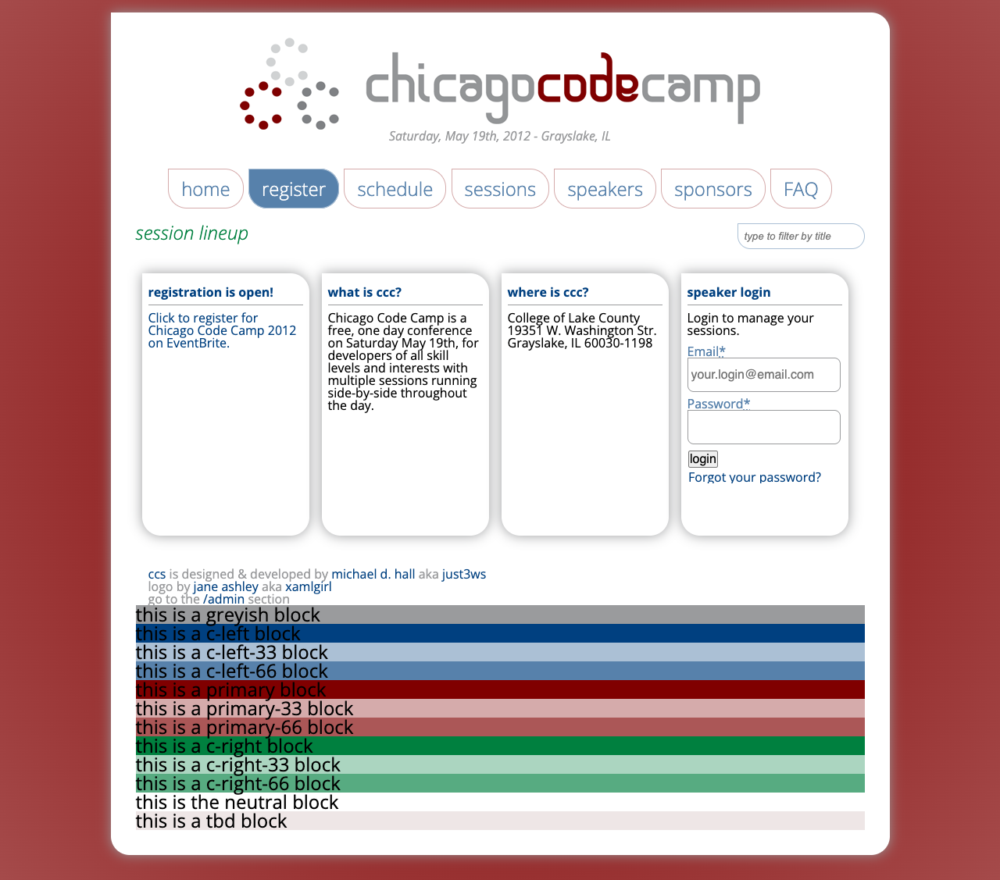
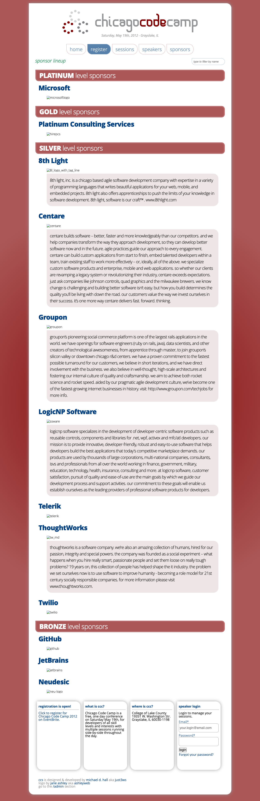

<article class="page">
  
<a href="/ai/series/chicago-code-camp/">&larr; Back to Series Index</a>

  

    <strong>Quarantined Tier 3 Synthesis:</strong> Derived from <code>just3ws/ccs</code> (<code>1b5f639</code>), Colima runtime boot (<code>origin/2025-12</code>), and May 2012 Wayback Machine captures.
  

  <h1>Episode 01: The Time Capsule</h1>

  

    In May 2012, <strong>Chicago Code Camp</strong> ran on <strong>Code Camp Server (<code>ccs</code>)</strong>—a Rails 3.0.11 app on Ruby 1.9.3 deployed to Heroku with <code>heroku_san</code>, <code>thin</code>, <code>foreman</code>, Memcached (<code>Dalli</code>), and Amazon S3. Fourteen years later, booting <code>origin/2025-12</code> on Apple Silicon via <strong>Colima</strong> (updating 2009 <code>config.guess</code>/<code>config.sub</code> for Ruby 1.9.3-p551 and linking <code>ffi 1.0.11</code> against system <code>libffi-dev</code>) brought the site back to life on <code>localhost:3000</code>.
  

  

    
  

  <h2>Matching Contemporary Internet Archive Captures</h2>
  

    Comparing the resurrected app against May 2012 <strong>Internet Archive</strong> snapshots confirms 1:1 provenance with the live Heroku production site:
  

  <ul>
    <li><strong>Home (May 18, 2012):</strong> <a href="https://web.archive.org/web/20120518214850/http://chicagocodecamp.com/" target="_blank" rel="noopener"><code>20120518214850/http://chicagocodecamp.com/</code></a></li>
    <li><strong>Sponsors (May 6, 2012):</strong> <a href="https://web.archive.org/web/20120506020818/http://chicagocodecamp.com/sponsors" target="_blank" rel="noopener"><code>20120506020818/http://chicagocodecamp.com/sponsors</code></a> — Platinum (Microsoft), Gold (Platinum Consulting Services), Silver (8th Light, Centare, Groupon, LogicNP Software, Telerik, ThoughtWorks, Twilio), Bronze (GitHub, JetBrains, Neudesic).</li>
    <li><strong>Speakers (May 6, 2012):</strong> <a href="https://web.archive.org/web/20120506022442/http://chicagocodecamp.com/speakers" target="_blank" rel="noopener"><code>20120506022442/http://chicagocodecamp.com/speakers</code></a> — 32 speakers from the regional community.</li>
    <li><strong>Schedule (Apr 21, 2012):</strong> <a href="https://web.archive.org/web/20120421092014/http://chicagocodecamp.com/schedules" target="_blank" rel="noopener"><code>20120421092014/http://chicagocodecamp.com/schedules</code></a></li>
  </ul>

  

    
  

  <h2>Three Eras in 796 Commits (2010–2012)</h2>
  <ol>
    <li><strong>2010 Launch (175 commits):</strong> Started <code>2010-01-23</code> (<code>a8f4b11</code>), Rails 2.3.5, RVM <code>.rvmrc</code>, Cucumber/RSpec, GPL v2 locked in <code>2010-04-07</code>. Early speaker headshots (<code>129862d</code>) preserve a snapshot of the community, including Dave Bost (whose memory we honor respectfully).</li>
    <li><strong>2011 Rails 3 Rebuild (489 commits):</strong> 155 commits in February 2011 alone—Haml/Sass, jQuery, Devise + Devise Invitable, CanCan, ActiveAdmin, Formtastic, S3, Eventbrite, Heroku.</li>
    <li><strong>2012 Camp (132 commits):</strong> OS X MacBook Pro with <code>mxcl/homebrew</code>, RVM <code>1.9.2-patched@ccs</code>, culminating in four rapid-fire CSS fixes on May 15, 2012 (<code>1b5f639</code>).</li>
  </ol>

  
<a href="/ai/series/chicago-code-camp/episode-02/">Next: Episode 02 — How We Built Web Apps in 2012 &rarr;</a>

</article>
