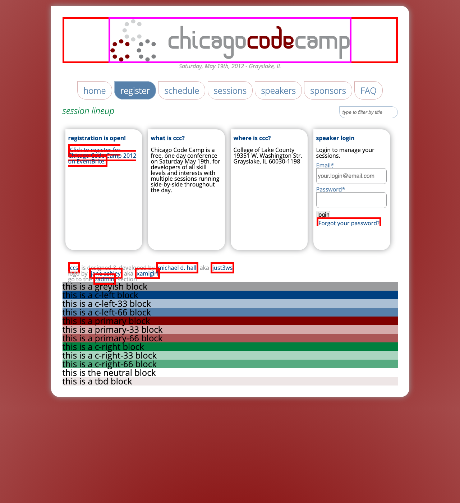
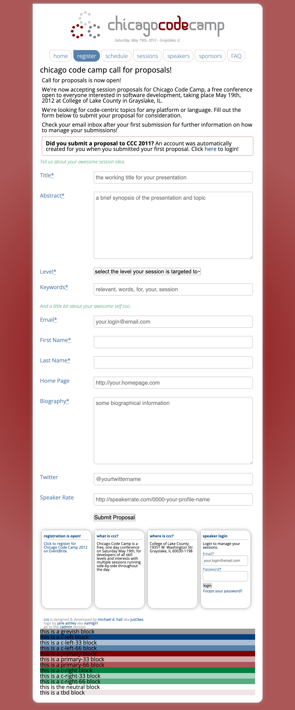
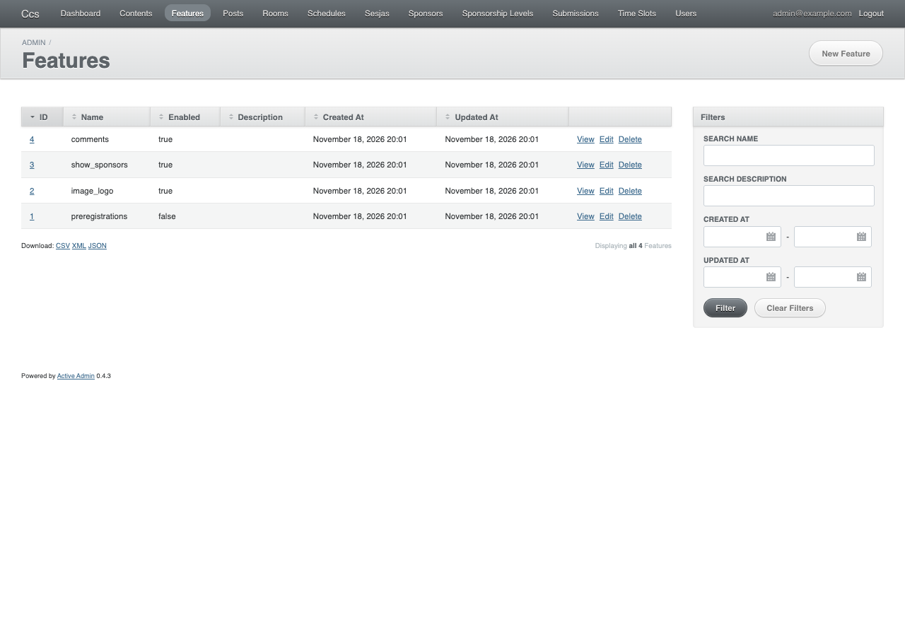

<article class="page">
  
<a href="/ai/series/chicago-code-camp/">&larr; Back to Series Index</a>

  

    <strong>Quarantined Tier 3 Synthesis:</strong> Grounded in <code>just3ws/ccs</code> source files and full-page captures from <code>localhost:3000</code> and May 2012 Internet Archive snapshots.
  

  <h1>Episode 02: How We Built Web Apps in 2012</h1>

  <h2>1. Design Ethos &amp; Living Style Guide</h2>
  

    Rather than a generic corporate template, <code>ccs</code> used indented <code>.sass</code> with a triadic palette in <code>app/stylesheets/_colors.sass</code>—maroon <code>#800000</code> primary gradient, <code>#004080</code> blue, <code>#00803F</code> green, lowercase headings (<code>h1..h5</code>), Google Web Fonts (<code>Open Sans</code>), asymmetric <code>+square-corner-top-left(24px)</code> cards, and IE6/IE7 fallbacks (<code>formtastic_ie6.css</code>, <code>formtastic_ie7.css</code>, <code>html5shiv</code>). In <code>development</code> mode, <code>shared/color_proof</code> renders the full swatch bar below the footer, and <code>?dss=1</code> activates <code>diagnostic.css</code>.
  

  

    
  

  <h2>2. Role-by-Role Workflows</h2>
  <ul>
    <li><strong>Visitors (<code>guest</code>):</strong> Browse <code>/</code>, <code>/schedules</code>, <code>/sessions</code>, <code>/speakers</code>, <code>/sponsors</code>, and Markdown CMS pages via <code>/:path</code> (<code>/faq</code>). Only sessions with <code>rsvped_at</code> set (<code>Sesja.displayable</code>) appear publicly.</li>
    <li><strong>Speakers (<code>speaker</code>):</strong> Submitting a talk at <code>/submissions/new</code> auto-created a <code>speaker</code> account with a generated temporary password (<code>SubmissionsController#create</code>). Earlier workflows (<code>ImportsController</code>) parsed <code>;</code>-delimited CSVs from S3 and sent <code>devise_invitable</code> emails.</li>
    <li><strong>Organizers (<code>AdminUser</code>):</strong> ActiveAdmin 0.4.3 at <code>/admin</code> managed 11 resources, including live <code>Feature.ok?</code> toggles (<code>preregistrations</code>, <code>image_logo</code>, <code>show_sponsors</code>, <code>comments</code>) and <code>VERSION_TAG ||= '2012-05'</code> event-year scoping.</li>
  </ul>

  

    
  

  

    
  

  <h2>3. Tests, Early CI &amp; Proto-Observability</h2>
  <ul>
    <li><strong>BDD &amp; Unit Suite:</strong> <code>RSpec</code> + <code>Cucumber</code> (<code>features/*.feature</code>) + <code>FactoryGirl</code>.</li>
    <li><strong>CI Coverage:</strong> <code>.simplecov</code> configured <code>SimpleCov::Formatter::RcovFormatter</code> (<code>simplecov-rcov</code>) for Hudson/Jenkins RCov plugins.</li>
    <li><strong>Proto-Observability:</strong> <code>Bullet</code> N+1 query detection in <code>development.rb</code>, <code>HoptoadNotifier</code> (pre-Airbrake) in <code>config/initializers/hoptoad.rb</code>, <code>?dss=1</code> CSS diagnostics, <code>#color-proof</code>, and <code>Rails.logger.warn</code>/<code>error</code> on DNS MX checks and CSV export failures.</li>
  </ul>

  
<a href="/ai/series/chicago-code-camp/episode-01/">&larr; Episode 01</a> · <a href="/ai/series/chicago-code-camp/episode-03/">Episode 03: AGPLv3 &amp; Next Steps &rarr;</a>

</article>
