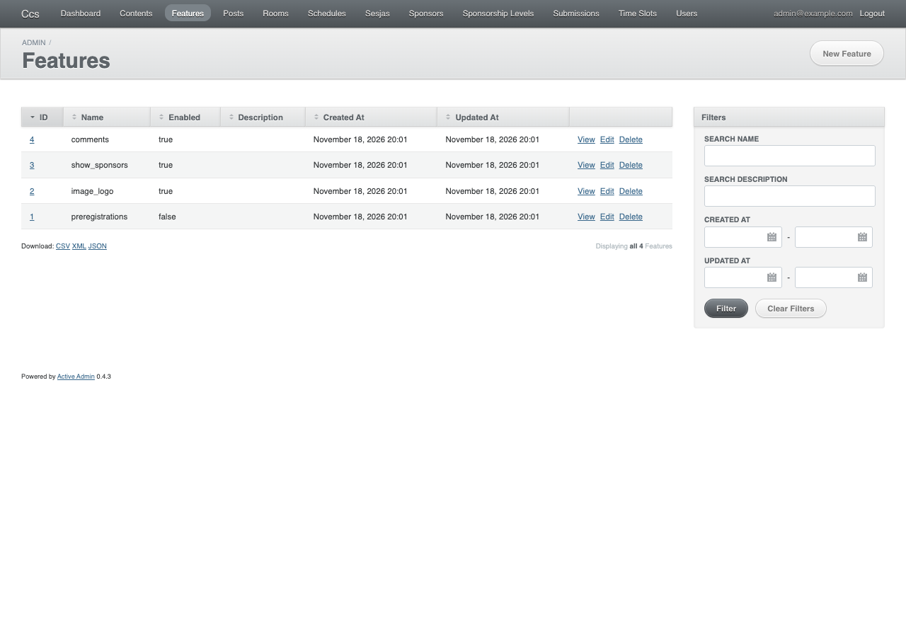

<article class="page">
  
<a href="/ai/series/chicago-code-camp/">&larr; Back to Series Index</a>

  

    <strong>Quarantined Tier 3 Synthesis:</strong> Companion essay for <code>ep-04-under-the-hood</code> on YouTube playlist <a href="https://www.youtube.com/playlist?list=PLFRktsUF3P4o" target="_blank" rel="noopener"><code>PLFRktsUF3P4o</code></a>.
  

  <h1>Episode 04: Under the Hood</h1>

  <h2>1. <code>Sesja</code>, <code>VERSION_TAG</code> &amp; Frictionless CFP</h2>
  

    Because <code>Session</code> collides with Rails' HTTP <code>session</code>, the talk model was named <code>Sesja</code> (Polish for "session") and routed publicly at <code>/sessions</code>. Multi-year partitioning ran via <code>VERSION_TAG ||= '2012-05'</code> in <code>config/application.rb</code>. Submitting a talk at <code>/submissions/new</code> automatically created a <code>speaker</code> account with a generated password if the email wasn't registered yet.
  

  <h2>2. ActiveAdmin 0.4.3 &amp; Live Feature Flags</h2>
  

    Organizers managed 11 resources in ActiveAdmin 0.4.3 at <code>/admin</code>, including database-backed <code>Feature.ok?</code> flags (<code>preregistrations</code>, <code>image_logo</code>, <code>show_sponsors</code>, <code>comments</code>) toggled live without redeploying.
  

  

  <h2>3. Tests, Early CI &amp; Proto-Observability</h2>
  <ul>
    <li><strong>Testing:</strong> <code>RSpec</code> + <code>Cucumber</code> + <code>FactoryGirl</code>.</li>
    <li><strong>CI Coverage:</strong> <code>.simplecov</code> wired <code>SimpleCov::Formatter::RcovFormatter</code> for Hudson/Jenkins RCov plugins.</li>
    <li><strong>Proto-Observability:</strong> <code>Bullet</code> N+1 query detection in <code>development.rb</code>, <code>HoptoadNotifier</code> (pre-Airbrake), <code>?dss=1</code> CSS diagnostics, <code>#color-proof</code>, and <code>Rails.logger</code> warnings on DNS MX checks and CSV exports.</li>
  </ul>

  
<a href="/ai/series/chicago-code-camp/episode-03/">&larr; Episode 03</a> · <a href="/ai/series/chicago-code-camp/episode-05/">Episode 05: Carrying It Forward &rarr;</a>

</article>
