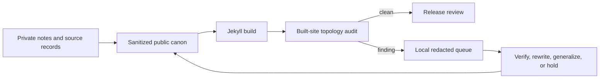

# bin/ Directory Command Index

This directory contains executable tools and drivers for building, validating, and ingesting data for the site.

## Primary Human Drivers

| Command | Usage | Description |
| :--- | :--- | :--- |
| [`./bin/server`](server) | `./bin/server` | Launches local Jekyll development server on `http://127.0.0.1:4000/` with live reload. |
| [`./bin/pipeline`](pipeline) | `./bin/pipeline <domain> <action>` | Unified runner (`media`, `validate`, `data`, `site`). |
| `audit_public_surface.rb` | `ruby bin/audit_public_surface.rb --help` | Scan publishable prose and built output for privacy, provenance, quarantine, and topology risks. |

---

## Unified Pipeline Router (`bin/pipeline`)

All operations are grouped under four cohesive domain verbs while preserving flat backward-compatible aliases:

```sh
# Namespaced syntax
./bin/pipeline media intake       # Run Google Drive media intake pipeline
./bin/pipeline media stream       # Run near-realtime SSE & telemetry streaming server
./bin/pipeline media swiftbar     # Run YouTube pipeline pulse for macOS SwiftBar
./bin/pipeline media stage        # Run 37-episode staging & rehearsal workflow harness
./bin/pipeline media patreon      # Run Patreon API v2 integration & credits CLI
./bin/pipeline media episode      # Run Episode Semantic Dossier & Workbench CLI
./bin/pipeline media youtube      # Run YouTube publishing pipeline CLI
./bin/pipeline media sync-prompts # Sync topic prompts to Google Drive for Ramblin' and Errata
./bin/pipeline media status       # Aggregate media pipeline status

./bin/pipeline validate fast      # Fast repository hygiene & em-dash audit
./bin/pipeline validate obs       # OBS studio assertions & overlay checks
./bin/pipeline validate site      # HTML-Proofer, SEO, and rendered site audit
./bin/pipeline validate all       # Full validation gate suite

./bin/pipeline data generate      # Regenerate data-driven interview/video pages
./bin/pipeline data graph         # Audit canonical archive relationship graph
./bin/pipeline data semantic-graph # Generate JSON-LD semantic graph artifacts
./bin/pipeline data semantic-audit # Generate semantic quality report
./bin/pipeline data sitemap       # Print sitemap coverage summary

./bin/pipeline site build         # Run generate and build _site with Jekyll
./bin/pipeline site test          # Run RSpec unit tests
./bin/pipeline site ci            # Local CI (regenerate, build, test, validate)
./bin/pipeline site verify        # CI gate (build, test, validate committed artifacts)
./bin/pipeline site smoke         # Playwright smoke checks against built _site
./bin/pipeline site install       # Install built site to /Library/WebServer/Documents
```

Flat aliases (e.g., `./bin/pipeline intake`, `./bin/pipeline build`, `./bin/pipeline test`, `./bin/pipeline validate`) continue to work seamlessly.

---

## Architectural Discipline: The Ponytail Principle

Per `.agents/skills/ponytail/SKILL.md` and `GEMINI.md`:
1. **Omission First**: Avoid authoring speculative single-use scripts.
2. **Inlining Over Config**: Use inline constants where single-operator localhost needs suffice.
3. **Stdlib Simplicity**: Favor standard library tools and simple loops before external dependencies.
4. **Annotated Seams**: Tag all deliberate trade-offs with `# ponytail: <rationale>; upgrade trigger: <condition>`.

---

## Command Categories & Naming Conventions

The preferred public driver names use a domain prefix. `www-graphify` is the
repository wrapper for Graphify and supplies the local model alias, loopback
endpoint, one-worker limit, and conservative token budget. Override those
defaults with `GRAPHIFY_MODEL`, `GRAPHIFY_ENDPOINT`,
`GRAPHIFY_CONCURRENCY`, or `GRAPHIFY_TOKEN_BUDGET` when needed.

```sh
./bin/www-graphify extract --mode deep --no-cluster
graphify query "Which archive themes connect to OpenTelemetry?"
```

### 1. Unified Drivers & CLI Tools
- `server`: Local dev server launcher.
- `pipeline`: Main pipeline CLI router.
- `install-git-hooks`: Installs repository-managed `.githooks/` path for pre-commit validation.
- `deploy_status`: Check deployment status.

### 2. Media Intake & YouTube Publishing
- `intake_drive_video.rb`: Zero-disk-waste cloud streaming intake from Google Drive.
- `live_dashboard_streamer.rb`: Near-realtime SSE streamer on `127.0.0.1:7025`.
- `youtube-swiftbar`: macOS SwiftBar menu bar status emitter.
- `youtube_pipeline.rb`: Unified operational overview CLI.
- `stage_episode_workflow.rb`: 37-episode staging and rehearsal harness.
- `patreon_pipeline.rb`: Patreon API v2 compute funding and attribution.
- `episode_workbench.rb`: Semantic dossier compiler and cue runner.

### 3. Executive Pitch & Resume Generators (`generate_*`)
Scripts that read `_data/*.yml` sources and compile pages/artifacts into Jekyll source:
- `generate_executive_brief.rb`: Generates custom 1-page executive pitch briefs.
- `generate_pdf_resume.js`: Playwright script that renders print-optimized PDF packages.
- `regenerate_resumes`: High-level wrapper script that syncs archetype metadata and renders PDF resumes.
- `generate_timeline_data.rb`
- `generate_speakers_data.rb`
- `generate_resume_position_pages.rb`
- `generate_context_summaries.rb`

### 4. Validators & MCP Verification (`validate_*`, `verify_*`)
Quality checks executed by CI (`./bin/pipeline verify`):
- `verify_mcp_spec.js`: Stdio MCP protocol self-verification runner.
- `validate_exports.rb`: Verifies JSON, Markdown, Text, and PDF resume exports.
- `validate_repo_hygiene.rb`: Enforces repo file tracking policies.
- `validate_seo_output.rb`: Checks structured metadata and SEO tags.
- `validate_data_uniqueness.rb`: Checks for duplicate records in YAML data.

### 5. Archival & Ingestion Tasks (`import_*`, `enrich_*`, `audit_*`)
Automated data processing and archival tools:
- `import_transcripts_from_outbox.rb`: Batch ingest transcripts.
- `enrich_speaker_profiles.rb`: Deep research and speaker enrichment.
- `audit_metadata.rb`: Comprehensive metadata completeness audit.
- `audit_public_surface.rb`: Redacted editorial and built-site publication gate.


