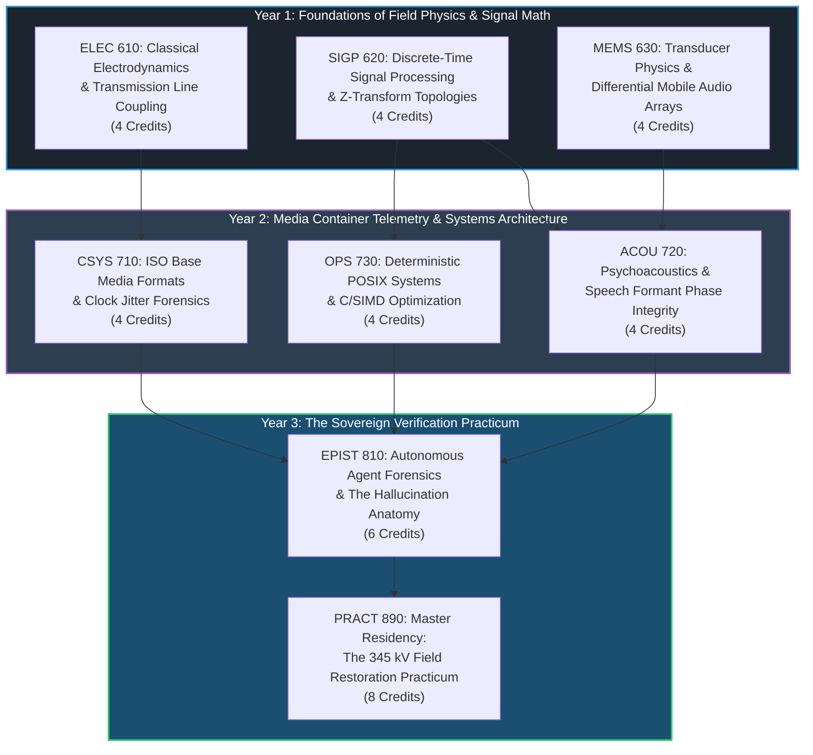

# Panoramic View Labs (PVL) Institute of Forensic Engineering
## Post-Graduate Curriculum Specification: Multidisciplinary Forensic Acoustics & Autonomous Systems Epistemics (MFA-ASE)

**Document Identifier**: `PVL-SPEC-2026-CURR-01`  
**Classification**: Public Academic Specification & Pedagogical Standard  
**Accreditation Framework**: Software Craftsmanship Institute & Open Knowledge Foundation (OKF) Conformance  
**Prerequisites**: 4-Year B.S. in Electrical Engineering, Computer Science, or Applied Physics  
**Total Academic Credits**: 64 Graduate Credit Hours (4 Academic Semesters + 1 Residency Practicum)  
**Date of Ratification**: October 12, 2026  
**License**: Creative Commons Attribution-ShareAlike 4.0 International (CC BY-SA 4.0)

---

## 1. Executive Curriculum Overview & Pedagogical Philosophy

The modern expansion of generative artificial intelligence creates an unprecedented asymmetry: **the mechanical generation of complex technical artifacts has become nearly instantaneous ($39.40), while the empirical verification of physical truth remains demanding ($10,000+)**.

To prevent automated systems from producing catastrophic hallucinations—such as misidentifying container duration anomalies as crystal clock drift or introducing phase-smeared notch distortion into archival recordings—the engineer must operate across five historically disjoint technical domains:
1. Classical Electrodynamics & Atmospheric High-Voltage Physics
2. Discrete-Time Signal Processing (DSP) & Linear Filter Theory
3. Mobile Transducer Micro-Electromechanical Systems (MEMS) & RF Immunity
4. Digital Container Formats, Timebase Clocks & Lossless Multiplexing
5. Autonomous Agent Verification, Systems Programming & Sovereign Epistemics

This specification establishes the official academic course catalog, dependency graph, laboratory requirements, and qualifying examinations required to master the forensic diagnosis of electromagnetic interference without generative quality loss.

---

## 2. Educational Prerequisite & Course Dependency Graph



---

## 3. Official Course Catalog & Course Descriptions

### Course 1: ELEC 610 — Classical Electrodynamics & Near-Field Utility Coupling
- **Credits**: 4.0 Graduate Credits (Lecture: 3 hrs / Lab: 3 hrs)
- **Prerequisites**: Multivariable Vector Calculus, Differential Equations.
- **Course Description**:
  Rigorous examination of Maxwell-Faraday induction ($\nabla \times \mathbf{E} = -\frac{\partial \mathbf{B}}{\partial t}$) in utility transmission corridors. Physics of 345 kV to 765 kV alternating electric fields; electrostatic corona discharge ionization; surface gradient breakdown in humid air; capacitive and inductive coupling into unshielded consumer electronics. Skin effect, loop antenna behavior of printed circuit board (PCB) traces, and magnetic shielding boundary conditions.
- **Laboratory Practicum**:
  Field measurement of electrostatic flux beneath 345 kV suspension towers using tri-axial electromagnetic field meters; RF spectrum analyzer capture of atmospheric corona micro-arcing.

---

### Course 2: SIGP 620 — Advanced Discrete-Time Signal Processing & Filter Topologies
- **Credits**: 4.0 Graduate Credits (Lecture: 3 hrs / Lab: 3 hrs)
- **Prerequisites**: ELEC 610, Linear Time-Invariant Systems.
- **Course Description**:
  Discrete-time Fourier Transforms, Z-domain stability, and second-order section (biquad) IIR/FIR filter architectures. Mathematical formulation of parametric notch filters and bandreject transfer functions:
  $$H(z) = b_0 \frac{1 - 2\cos(\omega_0)z^{-1} + z^{-2}}{1 - 2r\cos(\omega_0)z^{-1} + r^2 z^{-2}}$$
  Rigorous analysis of notch bandwidth, pole radius $r$, and Quality Factor ($Q = \frac{f_0}{\Delta f}$). Gibbs phenomenon, phase delay, and group delay distortion. Sequential cascading of harmonic rejection poles and spectral subtraction algorithms (`afftdn`, `adeclick`).

---

### Course 3: MEMS 630 — Transducer Arrays & Mobile Audio Hardware Asymmetry
- **Credits**: 4.0 Graduate Credits (Lecture: 3 hrs / Lab: 3 hrs)
- **Prerequisites**: SIGP 620.
- **Course Description**:
  Physical architecture of consumer mobile telephone acoustic systems. Silicon micro-machined capacitive microphones (MEMS), preamplifier integration, and differential acoustic arrays. Analysis of the dual-microphone topology: primary speech capsule at the handset base versus secondary environmental noise-rejection capsule on the upper perimeter. Root-cause forensics of asymmetric inductive coupling: why unshielded noise-canceling traces act as multi-band RF antennas under high-tension lines, inverting differential cancellation algorithms into positive noise injection.

---

### Course 4: CSYS 710 — ISO Base Media File Formats & Clock Jitter Forensics
- **Credits**: 4.0 Graduate Credits (Lecture: 3 hrs / Lab: 3 hrs)
- **Prerequisites**: Data Structures & Systems Architecture.
- **Course Description**:
  Deep forensic decomposition of ISO/IEC 14496-12 (MPEG-4 Part 12) containers. Anatomy of `ftyp`, `moov`, `mvhd`, `trak`, and `mdat` box atoms. Timebases, timescale definitions, Decoding Timestamps (DTS), and Presentation Timestamps (PTS). Crystal oscillator drift analysis ($32.768\text{ kHz}$ quartz crystal tolerances, PPM error over thermal gradients). Epistemology of false clock drift: mathematical proofs distinguishing container padding truncation from linear timebase stretch. Lossless stream multiplexing mechanics (`-c:v copy`) and zero-generational degradation guarantees.

---

### Course 5: ACOU 720 — Psychoacoustics & Speech Formant Phase Integrity
- **Credits**: 4.0 Graduate Credits (Lecture: 3 hrs / Lab: 3 hrs)
- **Prerequisites**: SIGP 620.
- **Course Description**:
  Acoustic phonetics and the human auditory system. Critical band masking, bark scales, and vocal tract transfer functions. Formant tracking for English vowel spaces ($F_1, F_2, F_3$) across fundamental frequencies (100 Hz to 3,500 Hz). Forensic analysis of comb filtering and phase cancellation induced by multi-stage notch filtering. The perceptual destruction of consonant fricatives ($s, th, f$) via aggressive broadband thresholding. Human perceptual evaluation protocols (MUSHRA / MOS) versus automated Word Error Rate (WER) Whisper models.

---

### Course 6: EPIST 810 — Autonomous Agent Epistemics & The Hallucination Anatomy
- **Credits**: 6.0 Graduate Credits (Seminar & Residency: 6 hrs)
- **Prerequisites**: All Year 1 & Year 2 courses.
- **Course Description**:
  Investigation into the failure modes of large multimodal language models (LMLMs) applied to systems engineering. The "Container Fallacy": why autoregressive models prioritize symbolic container symmetry over physical signal realities. Deconstruction of the `atempo=0.837` hallucination. The 250:1 economic leverage asymmetry ($39.40 compute versus $10,010 human verification labor). Engineering ethics of the "New Compiler": why verification constitutes the entire intellectual property of modern engineering. "Emptying the Cup" (*Shoshin*) and the discipline of Sovereign Verification.

---

## 4. Comprehensive Qualifying Examination (The Board Exam)

To achieve board certification as a **Panoramic View Labs Forensic Audio/Video Engineer (PVL-FAVE)**, the candidate must pass a 48-hour blind forensic practicum:

1. **The Corrupted Artifact Challenge**: The candidate is given an uninspected 3 GB MP4 recording captured under an undisclosed electromagnetic interference source with a 180-second container discrepancy.
2. **The Verification Mandate**: Within 24 hours, the candidate must:
   - Provide an FFT spectral decomposition proving the physical origin of all interference modes.
   - Prove via speech onset timestamps whether linear clock drift exists.
   - Author a fully automated, deterministic POSIX shell restoration tool compliant with Bash 3.2.
   - Deliver an output master with 100% frame-packet SHA-256 equivalence on video tracks and zero perceptual phase smearing on speech tracks.
3. **The Defense**: Oral defense before a panel of senior software craftspeople and acoustic physicists, justifying every filter pole, Q-factor, and rejection threshold.

---

## 5. Academic Accreditation Seal

```text
================================================================================
           PANORAMIC VIEW LABS (PVL) INSTITUTE OF FORENSIC ACOUSTICS
          ACCORD OF CHICAGO SOFTWARE CRAFTSMANSHIP & PHYSICAL REALITY
                            RATIFIED: OCTOBER 12, 2026
================================================================================
  [SEAL OF EMPIRICAL VERIFICATION]
  PHYSICAL GROUND TRUTH > SIMULATION
  ZERO GENERATIONAL LOSS (-c:v copy)
  SOVEREIGN AUDIT (PASS 0 LEAKS)
================================================================================
```
