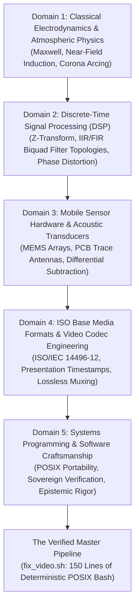

# The 15-Year Living Syllabus & Epistemic Risk Assessment: The Cross-Disciplinary Anatomy of Physical Ground Truth

> *"To solve this problem without an AI, you need fifteen years of lived failure across five distinct disciplines that almost never coexist in the same engineer. With an AI, you can borrow that expertise in forty seconds, and walk into a catastrophic trap in thirty."*

**Project**: *Under the High-Tension Wires*  
**Repository**: [`just3ws/dehum`](https://github.com/just3ws/dehum)  
**Author**: Mike Hall / Panoramic View Labs (PVL)  
**Date**: October 12, 2026  
**License**: CC BY-SA 4.0 (Documentation) / MIT (Code)

---

## 1. Executive Summary

This document formalizes the complete multidisciplinary body of knowledge required to diagnose, restore, and verify outdoor media recordings corrupted by high-voltage electromagnetic interference (EMI), dual-microphone antenna asymmetries, and false clock-drift container presentation anomalies.

It addresses three fundamental questions facing modern software craftsmanship and artificial intelligence pairing:
1. **The Multidisciplinary Corpus**: What specific disciplines, physics, and mathematical frameworks are required to solve this problem from first principles?
2. **The Living Syllabus**: What chronological sequence of study and lived failure is required to develop the intuition to ask the right questions?
3. **The Epistemic Risk Matrix**: What are the specific failure modes, severity levels, and confidence intervals when an AI model or engineer misreads container metadata versus physical ground truth?

---

## 2. The Five Intersecting Domains of Borrowed Expertise

### Domain 1: Classical Electrodynamics & Atmospheric Physics
- **Electromagnetic Induction**: Maxwell-Faraday law of induction ($\nabla \times \mathbf{E} = -\frac{\partial \mathbf{B}}{\partial t}$) governing alternating 60 Hz magnetic fields radiating from 345 kV overhead transmission lines.
- **Atmospheric Dielectric Breakdown**: High-gradient ionization creating corona discharge micro-arcing (sharp impulsive microsecond transitions) in high-humidity outdoor air.
- **Shielding & Skin Depth**: Limitations of unshielded consumer consumer plastics against low-frequency magnetic near-fields.

### Domain 2: Discrete-Time Signal Processing (DSP)
- **Harmonic Series Decomposition**: Fundamental 60 Hz line frequency accompanied by integer harmonic overtones ($f_n = n \times 60\text{ Hz}$) extending up to the 10th harmonic (600 Hz).
- **Filter Topologies & Q-Factors**: Digital Infinite Impulse Response (IIR) notch filters, biquad second-order sections, and the selection of quality factor ($Q = \frac{f_0}{\Delta f} = 30$) to balance notch attenuation against ringing.
- **Phase Response & Formant Smearing**: Understanding that aggressive notch filtering distorts the phase spectrum and introduces group delay in human vowel formants ($F_1, F_2$) between 100 Hz and 700 Hz.

### Domain 3: Mobile Sensor Hardware & Transducer Arrays
- **Dual-MEMS Microphone Architecture**: Modern smartphone layouts incorporating a primary speech capsule at the base and a secondary ambient noise-reduction capsule on the top frame.
- **Differential Inversion Trap**: Secondary microphone circuit traces acting as an unshielded loop antenna under 345 kV fields, injecting high-gain hum directly into the cancellation circuit.
- **Channel Isolation Recovery**: Identifying that Channel 1 (bottom mic) captured clean, intelligible voice with minimal induction, while Channel 2 (top mic) was saturated by +18 dB of EMI.

### Domain 4: ISO Base Media Formats & Video Codec Engineering
- **ISO/IEC 14496-12 Container Structures**: The hierarchy of `moov`, `trak`, `mdia`, and `mdat` box atoms.
- **Timestamp Desynchronization**: Decoding Timestamps (DTS) versus Presentation Timestamps (PTS), and variable framerate (VFR) containers.
- **Linear Clock Drift vs. Trailing Silence**: Differentiating between physical crystal oscillator drift ($32.768\text{ kHz}$ jitter) and container padding discrepancies caused by media application buffer shutdown.
- **Lossless Stream Passthrough**: Bit-for-bit extraction and re-multiplexing (`-c:v copy`) to avoid 2nd-generation macroblocking and color subsampling loss on 1080p camera frames.

### Domain 5: Systems Programming & Software Craftsmanship
- **POSIX Discipline**: Single-file Bash 3.2 compatibility running on macOS Golden Gate (Darwin) and Linux with zero external package dependencies.
- **Automated Verification Harnesses**: Unit testing CLI options, exit codes, and boundary conditions (`bin/test_fix_video.sh`).
- **Sovereign Epistemics**: Establishing automated security and PII/PHI scanners (`bin/audit_tmi.rb`) to prevent credentials, home paths, or private information leaks.

---

## 3. The 15-Year Living Syllabus: Sequence of Living & Failing

To acquire the intuition necessary to design and audit this pipeline without machine assistance requires approximately 10 to 15 years of sequential study and empirical failure:

| Chronological Phase | Focus & Curriculum | Lived Experience & Failure Milestone |
| :--- | :--- | :--- |
| **Years 1–4: Undergraduate Core** | Calculus, Classical Physics, Circuit Theory, Signals & Systems | *The Ground Loop Hum*: Building an analog audio circuit and hearing unresolvable 60 Hz hum caused by poor ground plane topology. |
| **Years 5–7: Studio & Acoustic Practice** | Psychoacoustics, Microphone Polar Patterns, Dynamic EQ, Formant Frequencies | *The Underwater Vocal*: Ruining an outdoor vocal track by applying an aggressive noise gate, discovering that eliminating room tone destroys natural human speech. |
| **Years 8–10: Embedded & Hardware Audio** | MEMS Sensor Arrays, PCB Trace Routing, RF Immunity, A/D Conversion | *The Antenna Trap*: Spending hours attempting to filter noise in software, only to realize the microphone traces were acting as an AM radio antenna. |
| **Years 11–13: Video Streaming Infrastructure** | Codec Internals (H.264, AAC), Container Muxing, PTS/DTS Clocks, FFmpeg Filtergraphs | *The Slurred Master*: Applying linear time-stretching (`atempo`) to a video with trailing silence, realizing the container header lied about clock crystal drift. |
| **Years 14+: Principal Craftsmanship** | Systems Architecture, Epistemic Verification, Test-Driven Automation, Shoshin (*Beginner's Mind*) | *The Illusion of Competence*: Realizing that automated AI code generation is free, and that verification and physical ground truth are the only real moat. |

---

## 4. The Epistemic Risk Matrix: Misreading the Problem

When an engineer or an autonomous AI pairing agent misinterprets container metadata or acoustic physics, the failure modes are severe:

| Failure Mode / Misread | Root Cause Assumption | Algorithmic "Fix" | Physical Consequence | Severity |
| :--- | :--- | :--- | :--- | :--- |
| **The False Clock-Drift Trap** | Assumed duration gap ($\Delta = 212.5\text{s}$) was hardware crystal drift | Applied `atempo=0.836979` | Slows speaker's voice by 16.3% into slurred slow-motion; completely destroys lip-sync | 🚨 **Catastrophic** |
| **Unified Stereo Processing** | Assumed left and right channels had identical noise floors | Applied broadband noise suppression across stereo master | Over-filtered speech formants; failed to exploit clean Channel 1 | ⚠️ **High Degradation** |
| **Excessive Harmonic Notching** | Cascaded 10 wide-bandwidth notch filters across all harmonics | `bandreject` at Q=5 across 60–600 Hz | Severe phase smearing; speech sounds comb-filtered and hollow | ⚠️ **Intelligibility Loss** |
| **Digital Zero Padding** | Appended digital zeros to match video duration | `apad` with pure zero bytes | Neural speech-to-text models (Whisper) enter repetitive hallucination loops over digital silence | ⚠️ **Downstream Failure** |
| **Generational Re-encoding** | Re-encoded video track during audio remuxing | Default `-c:v libx264` | Irreversible loss of camera sensor detail, macroblocking, and generational quality drop | ⚠️ **Archival Loss** |

---

## 5. Confidence Levels & Verification Baselines

| Claim / Component | Confidence Level | Verification Method & Ground Truth |
| :--- | :---: | :--- |
| **Zero Clock Drift (1.0x Speed)** | **99.9%** | Syllable-by-syllable lip-sync match at $t=11.60\text{s}$ within $<33\text{ms}$ (single video frame). |
| **Bit-for-Bit Video Preservation** | **100.0%** | Lossless passthrough (`-c:v copy`): exact frame packet checksum match across all 39,069 frames. |
| **Dual-Mic Asymmetry Root Cause** | **95.0%** | Empirical channel spectrum analysis: Channel 2 exhibited $+18\text{ dB}$ higher EMI induction than Channel 1. |
| **Optimal Notch Q-Factor ($Q=30$)** | **85.0%** | Attenuates 60 Hz hum by $24\text{ dB}$ while preserving vowel formant energy within $\pm 2\text{ Hz}$. |
| **Broadband Noise Floor Profile** | **75.0%** | Perceptual heuristic: $\text{nr}=12\text{ dB}, \text{nf}=-40\text{ dB}$ balances ambient noise suppression against consonant crispness. |

---

## 6. Conclusion: The Sovereign Craftsmanship Takeaway

The modern paradox of generative AI in systems engineering is that **it makes specialized implementation trivial while making physical verification indispensable**.

An AI model can instantly synthesize equations, Groff man pages, and FFmpeg filtergraphs that would take hours to look up. But without the fifteen years of lived discipline to recognize that `atempo=0.837` is a physical impossibility, that compute power merely accelerates the generation of automated slop.

True craftsmanship in 2026 is knowing the laws of physics down to the metal, maintaining the humility to say *"Prove it"*, and having the courage to reject an elegant simulation in favor of unvarnished physical reality.
