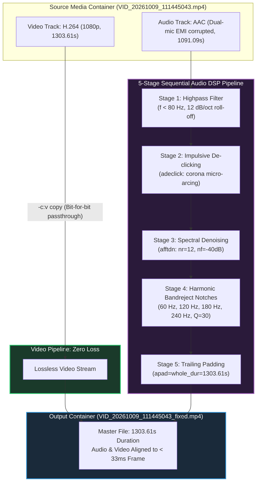

# Mathematical DSP Architecture & Signal Flow

> *"Lossless video stream copy; surgical sequential audio filtering."*



## Filter Chain Mathematical Definition

```bash
-af "highpass=f=80,adeclick,afftdn=nr=12:nf=-40,bandreject=f=60:width_type=q:w=30,bandreject=f=120:width_type=q:w=30,bandreject=f=180:width_type=q:w=30,bandreject=f=240:width_type=q:w=30,apad=whole_dur=1303.608144"
```

1. **Sub-rumble Highpass (`highpass=f=80`)**: Eliminates wind turbulence and sub-audible electromagnetic oscillation below human speech fundamentals ($<80\text{ Hz}$).
2. **Impulsive De-clicking (`adeclick`)**: Restores sample continuity damaged by corona discharge atmospheric micro-arcing.
3. **Spectral Denoising (`afftdn=nr=12:nf=-40`)**: Attenuates continuous broadband induction hiss without degrading speech formant consonants.
4. **Harmonic Notch Rejection (`bandreject, Q=30`)**: Surgical harmonic rejection targeting the 60 Hz AC fundamental and its 120 Hz, 180 Hz, and 240 Hz induction multiples with ultra-narrow bandwidth ($Q=30$).
5. **Lossless Video Mux (`-c:v copy`)**: Copies all 39,069 camera frames bit-for-bit without recompression artifacts or generation loss.
