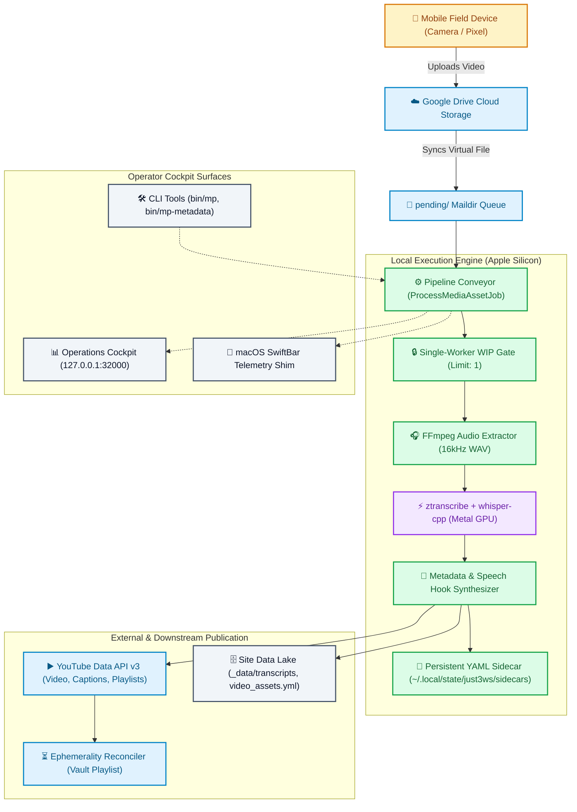

# Media Pipeline System: Purpose Specification & Core Mission

## 1. Executive Summary & Purpose

The **Media Pipeline System** is an autonomous, single-operator media intake, speech-to-text transcription, metadata synthesis, and YouTube publishing platform.

Its primary purpose is to convert raw field recordings and historical studio curriculum into canonical, structured, and search-indexed knowledge assets with zero permanent local storage footprint and minimal cognitive load on the operator.

The pipeline serves Mike Hall's public and historical media corpus across three foundational tracks:

1. **Ramblin' & Amblin'** (`ramblin-amblin`): Spontaneous, unscripted field observations and systems craftsmanship reflections recorded while walking outdoors.
2. **The Sound Above** (`the-sound-above`): A 35-episode oral history and audio forensics rewatch series exploring the software craftsmanship movement, Chicago tech user groups, and the human communication layer.
3. **Errata & Technical Demos** (`errata`): Technical screencasts, bug post-mortems, architectural walkthroughs, and code refactor recordings.

---

## 2. Core Operational Tenets

The entire media pipeline is engineered around six non-negotiable architectural tenets:

### Tenet 1: Zero Permanent Local Disk Footprint (Zero Disk Waste)

- High-definition video files consume 1 GB to 4 GB per recording. On a 256 GB internal Apple Silicon SSD, retaining raw footage locally would quickly exhaust host disk space.
- Raw video resides strictly in Google Drive cloud storage (`CloudStorage/GoogleDrive-mike@just3ws.com/My Drive/Media Intake/`).
- Local scratch audio generated during processing (`/tmp/intake_scratch_*` or `~/.local/state/just3ws/scratch/`) is temporary and strictly evicted immediately after transcription completes.
- Master video files are mirrored into year-month cloud archives (`processed/YYYY-MM/`) and evicted from local SSD staging upon verification.

### Tenet 2: Strict Single-Worker Serial Concurrency (1-Item WIP Limit)

- Media processing requires intensive Apple Silicon hardware resources (FFmpeg audio extraction, Metal GPU neural inference via `whisper-cpp`, and multi-gigabyte HTTPS network chunk streaming).
- Concurrency is strictly clamped to `1` across the entire machine. Exactly one video is processed at any given moment.
- Prevents thermal throttling, memory exhaustion, and fan noise during live work or audio recording sessions.

### Tenet 3: Strict FIFO Queue Discipline by File Age

- Ingress candidates across all channels and series are sequenced strictly by file age (APFS file creation timestamp / birthtime, falling back to modification time).
- Guarantees chronological publication order and prevents newer uploads from starving older recordings in the queue.

### Tenet 4: Sovereign Archiving & Digital Ephemerality

- Active public content follows a rolling-horizon ephemerality policy.
- For field recordings, the channel keeps the newest two videos within a 3-day active horizon public on YouTube and in the primary series playlist (`PLNtb969T2-l0`).
- Older videos are autonomously rolled into a sovereign private archive playlist (`PLYCKmHMYvC7s`) on YouTube, while full-text transcripts and rich YAML dossiers are permanently preserved in the local site repository.

### Tenet 5: Bidirectional Metadata Persistence & Sovereignty

- Video titles, descriptions, and tags generated during processing must be persisted locally in human-readable sidecars (`~/.local/state/just3ws/sidecars/<target>/<stem>.yml`) and the static site data lake (`_data/video_assets.yml`).
- The operator must be able to inspect, edit, and push revised metadata directly to YouTube via REST/CLI without requiring video re-upload.

### Tenet 6: Self-Describing Observability & Diagnostic Transparency

- The pipeline exposes real-time telemetry via Server-Sent Events (SSE), OpenTelemetry traces/spans, LTSV wide logs, and macOS SwiftBar status.
- Every subprocess execution emits structured events, records performance latencies against formal Service Level Objectives (SLOs), and provides one-click quarantine diagnostics and requeue controls.

### Tenet 7: State-Aware Lifecycle Administration & Pre-Flight Control

- The operator can inspect any local record at inception (e.g. while in `pending` or `processing`).
- When an asset is `pending`, the operator can set pre-flight titles, descriptions, and tags which will be respected as canonical overrides when the worker begins processing.
- The administration interface displays the active pipeline state and subprocess progress to prevent race conditions during active processing.
- Once published, the operator has an explicit choice: save edits locally only, or push them directly to YouTube via `videos.update` without video re-upload.

---

## 3. System Context & Component Topology

---

## 4. Key Publishing Tracks & Content Calibration

| Series Target | Slug | Publishing Mode | Auto Hook Title | Ephemerality Policy | Primary Playlist |
| :--- | :--- | :--- | :--- | :--- | :--- |
| **Ramblin' & Amblin'** | `ramblin-amblin` | Unscripted field notes | Enabled (first spoken thought) | Rolling 3-day / 2 public active videos, older rolled to Vault | `PLNtb969T2-l0` |
| **The Sound Above** | `the-sound-above` | Studio oral history | Dossier-driven (35 curriculum episodes) | Permanent public curriculum | `PLYCKmHMYvC7s` |
| **Errata** | `errata` | Screencasts / Post-mortems | Auto-titled with date and topic | Unlisted by default | Ad-hoc playlists |

---

## 5. Non-Negotiable Engineering Constraints

1. **Zero Em Dashes**: All titles, descriptions, documentation, commit messages, and logs must be 100% free of Unicode em dashes (`\u2014`) or double hyphens with surrounding spaces (`--`).
2. **Apple Silicon Hardware Safety**: Ingress copy operations must use user-space chunk streaming with retry backoff to survive macOS APFS FileProvider cloud download latency without deadlocking.
3. **Canonical Naming**: SCMC is strictly **Software Craftsmanship McHenry County**. Never Chicago, Midwest, or Movement.
