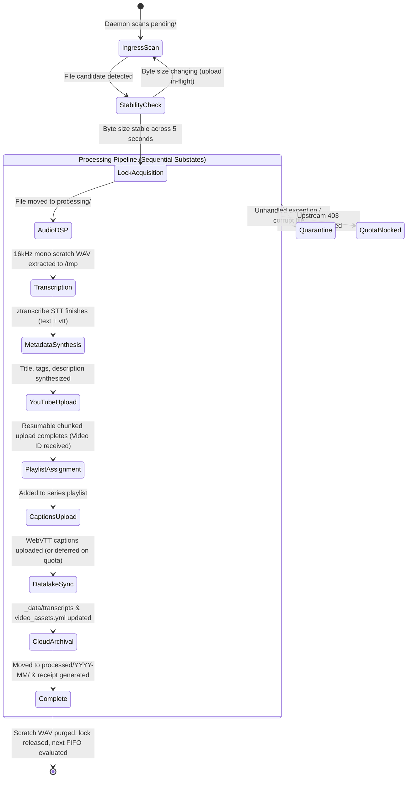

# Original Media Pipeline Implementation Specification

## 1. Architectural Blueprint & Scripts Overview

The original media pipeline was engineered as an autonomous local system platform composed of three primary Ruby components and shared zdots platform recipes:

1. **`bin/intake_drive_video.rb` (1,628 lines)**: Core worker CLI and orchestration engine. Managed file discovery, FIFO sequencing, APFS stability verification, atomic locking, audio extraction, Whisper transcription, metadata synthesis, resumable YouTube uploading, playlist insertion, captions, receipt writing, and cloud archival.
2. **`bin/live_dashboard_streamer.rb` (1,051 lines)**: Standalone WEBrick HTTP/SSE daemon listening on loopback port 7025. Handled autonomous periodic queue scanning (every 15s), worker PID liveness audits, stale lock cleanup, stranded file recovery, operator action routing (`/halt`, `/stop`, `/resume`, `/retry`), and Server-Sent Event streaming (`/events`, `/status`, `/api/live/stream`).
3. **`bin/lib/job_substate_tracker.rb` (368 lines)**: Checkpoint state tracker (`JobSubstateTracker`). Maintained granular substate checkpoints in companion `<filename>.state.json` files to enable crash recovery without repeating expensive completed steps.
4. **`ztranscribe` (`~/.config/zsh/bin/ztranscribe -> recipes/yt-transcribe`)**: Shared zdots platform tool executing `whisper-cpp` with Apple Silicon Metal acceleration, language models (`large-v3-turbo`), and domain vocabulary prompts.

---

## 2. Directory & Queue Topology (Maildir Discipline)

The original pipeline mapped Google Drive folders to a modified Maildir-style queue hierarchy across each channel and series track:

```
Media Intake/whoistechcmty/<target_slug>/
├── staged/          # Manual hold directory: safe backup that avoids autonomous intake
├── pending/         # Active FIFO ingress queue: scanned by daemon and worker
├── processing/      # In-flight lock directory: exactly one active video across all channels
├── processed/       # Permanent cloud archive: organized chronologically by YYYY-MM
│   └── YYYY-MM/
│       ├── <filename>.mp4
│       ├── <filename>.mp4.receipt.json
│       └── <filename>.yml (companion sidecar)
├── failed/          # Quarantine queue: isolated on unhandled exceptions
│   ├── <filename>.mp4
│   ├── <filename>.mp4.error.log
│   └── <filename>.mp4.state.json
└── blocked/         # Quota cooldown queue: isolated during YouTube API quota exhaustion
    ├── <filename>.mp4
    ├── <filename>.mp4.blocked.json
    └── <filename>.mp4.state.json
```

---

## 3. Substate Lifecycle & State Machine

The processing lifecycle operated as a sequential composite statechart governed by `JobSubstateTracker`. When resuming from interruption or quarantine, execution skipped all previously completed substates:



### Discrete Substate Definitions and Skip Logic

1. **`audio_dsp`**: Extracted 16kHz mono PCM WAV via `ffmpeg -vn -acodec pcm_s16le -ar 16000 -ac 1`. Skipped if scratch WAV was already present on disk.
2. **`transcription`**: Ran `ztranscribe` on Apple Silicon Metal GPU with domain priming prompt (`SCMC, Obtiva, 8th Light, Chicago Alt.NET`). Skipped if transcript text and VTT existed in tracker state.
3. **`metadata_synthesis`**: Evaluated dossier matches (`episode-XX.yml`), sidecars, speech hooks, and title character budgets (<= 100 characters).
4. **`youtube_upload`**: Resumable chunked upload with 3-attempt exponential backoff. Verified remote video existence before skipping to prevent duplicate uploads.
5. **`playlist_assignment`**: Inserted video into target playlist. Probed existing playlist items via `yt-dlp` or API to prevent duplicate playlist entries.
6. **`captions_upload`**: Uploaded WebVTT captions. Handled quota conservation: if quota was low or 403 occurred, deferred captions upload without failing the job, because full transcripts were already embedded in the video description.
7. **`datalake_sync`**: Wrote YAML transcript dossier to `_data/transcripts/<slug>.yml` and registered metadata in `_data/video_assets.yml`.
8. **`archival`**: Moved video to `processed/YYYY-MM/`, wrote `<filename>.receipt.json`, purged `/tmp` scratch audio, and released file lock.

---

## 4. Key Logic Contracts & Edge Case Defenses

### 1. In-Flight Upload Stability Guard

To prevent processing partially uploaded files while mobile devices were recording or syncing over cellular connections:

- Sampled file size at time `t0`.
- Slept 3 seconds, sampled at `t1`.
- Slept 2 seconds, sampled at `t2`.
- If `t0 != t1` or `t1 != t2` or `size == 0`, marked unstable and deferred to next cycle.

### 2. Upstream YouTube Quota Management and Cooldown

- Monitored YouTube Data API v3 quota budget (10,000 units/day; upload = 1,600 units, captions = 400 units).
- Caught `quotaExceeded` / `403` exceptions.
- Quarantined files to `blocked/` with `<filename>.blocked.json` detailing reset time (2:00 AM CT / 00:00 PT).
- Automated cooldown sentinel prevented all worker launches until the midnight Pacific reset.

### 3. Self-Healing Process Liveness and Stranded File Recovery

The streamer daemon ran an audit loop every 15 seconds:

- Inspected PID in `~/.local/state/just3ws/pipeline.lock`.
- If PID was no longer alive (`kill -0 <pid>` failed), unlinked the stale lock.
- Scanned `processing/` across all targets. If files were stranded with no active worker, automatically restored them to `pending/` and emitted a recovery event.

### 4. Zero Permanent Local Footprint Eviction

- All audio extraction was written to `/tmp/intake_scratch_<pid>_<salt>.wav`.
- An `ensure` block in `process_file` unlinked all scratch audio files upon exit, ensuring 0 MB permanent disk consumption.

### 5. Teleprompter Studio and OBS Broadcast Integration

- Loaded 35 semantic dossiers from `_data/episodes/episode-XX.yml`.
- Provided an interactive 6-Act rundown teleprompter with auto-scrolling, mirror flip for teleprompter glass, and live broadcast cue chips (`[SCENE]`, `[FREEFORM]`, `[SHOW]`, `[PAUSE]`).
- Supported `textream://` protocol integration and `.textream` multi-page file generation.
- Exposed `/api/live/pipeline/cue_obs?episode=<num>` to trigger OBS Studio scene overlays.

### 6. Real-Time Telemetry and Control API

Served on loopback port 7025:

- Served `/status` JSON with health enum (`idle_ready`, `pending`, `processing`, `degraded_quarantine`, `halted`, `stopped`).
- Served `/events` Server-Sent Events stream with `intake_update`, `telemetry`, and `bpmn_transition` event types.
- Supported operator controls: `POST /api/live/pipeline/halt` (graceful pause), `POST /api/live/pipeline/stop` (abort), `POST /api/live/pipeline/resume` (resume), and `POST /api/live/pipeline/retry` (retry from quarantine).
