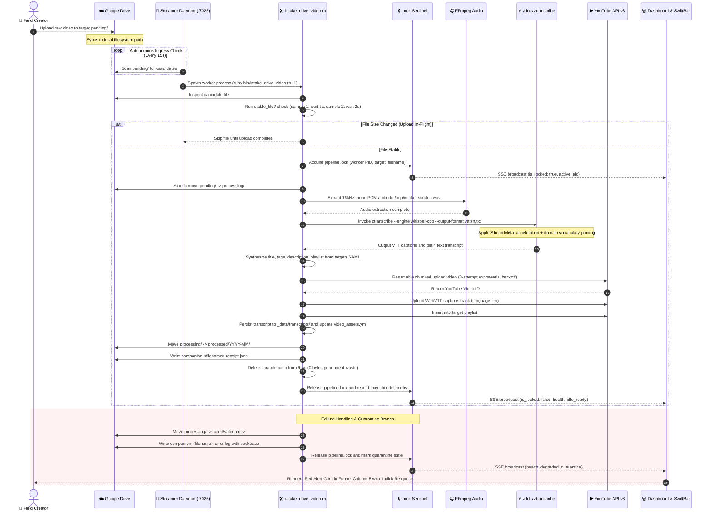
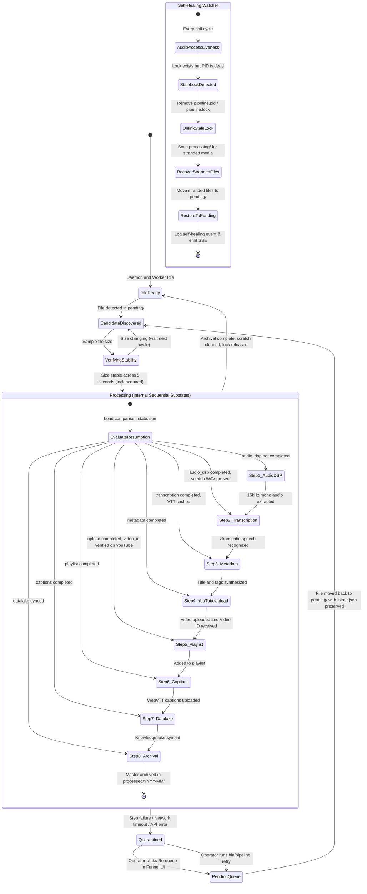

# Media Pipeline Architecture, Contracts, and Schemas

## Executive Summary & Core Design Tenets

The media publishing system automates video ingestion, speech recognition, metadata synthesis, and YouTube publishing across all channels and series: *Ramblin' & Amblin'*, *The Sound Above*, and technical *Errata*. The architecture adheres to six core operational tenets:

1. **Unified `$HOME/ai/media-pipeline` Storage Topology & Zero Scratch Waste**: The storage root lives at `$HOME/ai/media-pipeline` (`/Users/mike/ai/media-pipeline`), inside the `$HOME/ai` directory synced bidirectionally with Google Drive Computer Backup (`My Drive/ai/media-pipeline`). Because `/Users/mike/ai/media-pipeline` is a native local APFS directory rather than a `~/Library/CloudStorage` FileProvider virtual mount (`com.apple.macl`), `launchd` background workers operate with full POSIX read/write access and zero `Errno::EPERM` or `Errno::ETIMEDOUT` faults while Google Drive for Desktop handles background cloud sync. Temporary scratch audio files (`/tmp/intake_scratch_*`) are evicted immediately on completion or failure.
2. **Centralized Configuration Contract (`PipelineConfigService`)**: Working directories (`pipeline.working_directory`), storage roots (`storage.local_root`, `storage.cloud_root_pattern`), companion repository paths (`pipeline.site_root`), service ports (`network.port`, `network.llm_port`, `network.embed_port`, `network.postgres_port`, `network.otel_port`), and daemon labels (`daemons.*`) are declared in `config/pipeline_stages.yml` and `_data/media_intake_targets.yml` and resolved via `PipelineConfigService` with environment variable overrides rather than hardcoded string literals.
3. **Strict Serial Concurrency**: Exactly one video is processed at any given moment. Processing is governed by a strict single-worker concurrency lock (`media_processing_wip_single`). This guarantees thermal, CPU, memory, and Apple Silicon Neural Engine stability.
4. **Strict FIFO by File Age with Ingress Stability Verification**: Videos within `pending/` are ingested oldest first based on camera timestamp / file creation time. In-flight mobile uploads over cellular or Wi-Fi are protected by a multi-sample stability check (`stable_file?` with 5-second interval verification) preventing premature processing.
5. **Shared zdots Platform Service for Transcription**: Speech-to-text is routed strictly through the shared zdots tool `ztranscribe` (`~/.config/zsh/bin/ztranscribe -> ~/.config/zsh/recipes/yt-transcribe`). This executes `whisper-cpp` with native Apple Silicon Metal GPU acceleration and domain vocabulary priming, outputting WebVTT captions, SRT subtitles, and plain text transcripts.
6. **Autonomous Self-Healing Ingress Watcher**: The service continuously monitors worker liveness and sweeps settled zero-byte or corrupt files into `corrupt/` (`IntakeQuarantineService`).
7. **Unified Observability Triad**: Realtime state is broadcast via Server-Sent Events (SSE), queryable via REST at `/api/status`, emitted as OpenTelemetry spans and column-1 LTSV wide logs, and surfaced directly in both the macOS SwiftBar menu bar and the localhost operations cockpit.

---

## Component Cartography & Dependency Graph

The diagram below maps all actors, background processes, file systems, network boundaries, and user interfaces across the media publishing lifecycle.

```mermaid
graph TD
    classDef mobile fill:#fef3c7,stroke:#d97706,stroke-width:2px,color:#92400e;
    classDef storage fill:#e0f2fe,stroke:#0284c7,stroke-width:2px,color:#075985;
    classDef pipeline fill:#dcfce7,stroke:#16a34a,stroke-width:2px,color:#166534;
    classDef zdots fill:#f3e8ff,stroke:#9333ea,stroke-width:2px,color:#6b21a8;
    classDef google fill:#fee2e2,stroke:#dc2626,stroke-width:2px,color:#991b1b;
    classDef ui fill:#f1f5f9,stroke:#475569,stroke-width:2px,color:#0f172a;

    subgraph Field Ingress
        Mobile["📱 Mobile Field Recording<br/>(Google Pixel / Camera)"]:::mobile
        GDriveApp["☁️ Google Drive Sync Client<br/>(Background Daemon)"]:::mobile
    end

    subgraph Storage & Queues
        QueuePending["📁 pending/<br/>(FIFO Queue by File Age)"]:::storage
        QueueProcessing["⚙️ processing/<br/>(Active In-Flight Lock)"]:::storage
        QueueProcessed["📦 processed/YYYY-MM/<br/>(Permanent Cloud Archive)"]:::storage
        QueueFailed["🚨 failed/<br/>(Quarantine + Error Log)"]:::storage
    end

    subgraph Local Runtime & Orchestration
        IntakeWorker["🛠️ bin/intake_drive_video.rb<br/>(Worker CLI / Lock Guard)"]:::pipeline
        FFmpegEngine["🎧 FFmpeg Audio Extractor<br/>(16kHz Mono PCM in /tmp)"]:::pipeline
        Daemon["📡 bin/live_dashboard_streamer.rb<br/>(Loopback Port 7025)"]:::pipeline
        StateDir["💾 ~/.local/state/just3ws/<br/>(Locks, Activity, History)"]:::pipeline
    end

    subgraph Shared Platform Services
        ZTranscribe["⚡ ztranscribe (zdots)<br/>(recipes/yt-transcribe)"]:::zdots
        WhisperMetal["🧠 whisper-cpp + Metal GPU<br/>(Apple Silicon Acceleration)"]:::zdots
        VocabPrimer["📖 Domain Lexicon Priming<br/>(SCMC, Obtiva, 8th Light)"]:::zdots
    end

    subgraph Publishing Targets & Data Lake
        YouTubeAPI["▶️ YouTube Data API v3<br/>(Videos, Playlists, Captions)"]:::google
        DataLake["🗄️ Career Datalake & Assets<br/>(_data/transcripts, video_assets)"]:::pipeline
    end

    subgraph Cockpit & Telemetry Surfaces
        DashFunnel["📊 Operations Dashboard<br/>(Live Ingress Kanban Funnel)"]:::ui
        DashBPMN["⚙️ BPMN 2.0 Monitor<br/>(SLO Tracking & Simulation)"]:::ui
        DashTeleprompter["📜 Teleprompter Studio<br/>(38 Native Textream Scripts)"]:::ui
        SwiftBar["🍏 SwiftBar Menu Monitor<br/>(Processor State & Queue Counts)"]:::ui
        OBSOverlays["🎬 OBS Studio Broadcast<br/>(Scene Overlays & Cue API)"]:::ui
    end

    Mobile -->|Uploads Video| GDriveApp
    GDriveApp -->|Syncs File| QueuePending
    Daemon -->|Autonomous Scan| QueuePending
    Daemon -->|Spawns Worker| IntakeWorker
    IntakeWorker -->|Validates Stability| QueuePending
    IntakeWorker -->|Acquires Lock| StateDir
    IntakeWorker -->|Moves File| QueueProcessing
    IntakeWorker -->|Extracts Audio| FFmpegEngine
    FFmpegEngine -->|16kHz WAV| ZTranscribe
    ZTranscribe -->|Inference via Metal| WhisperMetal
    VocabPrimer -->|Domain Prompts| ZTranscribe
    ZTranscribe -->|VTT Captions + Text| IntakeWorker
    IntakeWorker -->|Synthesizes Metadata| DataLake
    IntakeWorker -->|Uploads Video & Captions| YouTubeAPI
    IntakeWorker -->|Archives on Success| QueueProcessed
    IntakeWorker -->|Quarantines on Error| QueueFailed
    IntakeWorker -->|Releases Lock & Emits JSONL| StateDir
    StateDir -->|Reads History & Activity| Daemon
    Daemon -->|SSE Event Stream :7025| DashFunnel
    Daemon -->|SSE Status| SwiftBar
    DashFunnel -->|Halt / Stop / Retry API| Daemon
    DashTeleprompter -->|Cue Broadcast Overlay| OBSOverlays
```



---

## End-to-End Workflow Sequence

The sequence diagram below illustrates the exact chronological interactions, token exchanges, lock lifecycles, and error handling branches from mobile capture to YouTube delivery.



---

## Operational State Machine & Recovery Flows

The state machine diagram below models all system states, transitions, self-healing branches, and operator interventions. Crucially, the **Processing** phase functions as a nested composite statechart where each discrete substate tracks its completion checkpoint in `<filename>.state.json`. If a job is interrupted, paused, or restarted from quarantine, execution resumes strictly at the first incomplete substate without repeating completed audio extraction, transcription, or YouTube video uploads.



---

## Concrete Schemas & API Contracts

### 1. Target Intake Configuration Schema (`_data/media_intake_targets.yml`)

Each intake target defines channel ownership, Google Drive folder paths, default YouTube publishing parameters, and content categorization.

```yaml
# Schema Definition for media_intake_targets.yml
targets:
  <target_key>:
    name: string                    # Human readable title of the intake track
    slug: string                    # URL safe identifier
    channel_id: string              # YouTube Channel ID (e.g., UCxxxxxxxx)
    channel_name: string            # YouTube Channel display name
    drive_path: string              # Relative path within Google Drive root
    playlist_id: string             # YouTube Playlist ID for automatic addition
    default_privacy: string         # unlisted | public | private
    category_id: string             # YouTube Category ID (27 = Education, 28 = Science & Tech)
    default_tags: list[string]      # Canonical keyword tags applied to video
    transcription:
      engine: string                # ztranscribe (canonical)
      model: string                 # large-v3-turbo | base.en | medium.en
      language: string              # en
      prompt: string                # Priming vocabulary context
    naming_convention:
      title_template: string        # Pattern for generated video title
      slug_prefix: string           # Prefix for transcript files
    archetype: string               # freeform_field_notes | technical_rewatch | structured_errata
```

#### Example Target Configuration:
```yaml
targets:
  ramblin-amblin:
    name: "Ramblin' & Amblin'"
    slug: "ramblin-amblin"
    channel_id: "UCxxxxxxxx"
    channel_name: "@whoistechcmty"
    drive_path: "media-pipeline/whoistechcmty/ramblin-amblin"
    playlist_id: "PLxxxxxxxxxxxx"
    default_privacy: "unlisted"
    category_id: "27"
    default_tags:
      - "Ramblin & Amblin"
      - "Software Craftsmanship"
      - "Engineering Leadership"
      - "Field Dispatch"
    transcription:
      engine: "ztranscribe"
      model: "large-v3-turbo"
      language: "en"
      prompt: "Software craftsmanship, Chicago Alt.NET, SCMC, McHenry County, 8th Light, Obtiva."
    naming_convention:
      title_template: "Northern Illinois Field Dispatch: {date} - {topic}"
      slug_prefix: "field-dispatch"
    archetype: "freeform_field_notes"
```

---

### 2. Semantic Dossier Schema (`_data/episodes/episode-XX.yml`)

Used by Episode Studio (`#tab-workshop`) and live broadcast cueing.

```yaml
# Schema Definition for Episode Semantic Dossiers
episode:
  number: integer                   # Episode index (00..37)
  slug: string                      # Canonical episode slug
  title: string                     # Practitioner title
  status: string                    # staged | published | draft
  movement:
    number: integer                 # Movement index (1..6)
    name: string                    # Movement title (e.g., "The Chicago Workshop")
  interview_id: string              # Reference ID in _data/interviews.yml
  youtube_id: string                # Published YouTube Video ID (empty if staged)
  video_asset_id: string            # Reference ID in _data/video_assets.yml

narrative_anatomy:
  theme: string                     # Core theme
  tone: string                      # Practitioner tone (e.g., "reflective, authentic")
  core_inquiry: string              # Central engineering question
  ai_era_parallel: string           # Contemporary lesson for AI-assisted programming

human_stories:
  act_1_recollection: string        # Spoken reflection for Act 1
  act_2_recollection: string        # Spoken reflection for Act 2
  act_5_recollection: string        # Spoken reflection for Act 5

teleprompter_script:
  act_1_cold_open: string           # Act 1 spoken rundown
  act_2_historical_context: string  # Act 2 spoken rundown
  act_3_interview_excerpt: string   # Act 3 spoken rundown
  act_4_audio_forensics: string     # Act 4 spoken rundown
  act_5_contemporary_lesson: string # Act 5 spoken rundown
  act_6_closing_credits: string     # Act 6 spoken rundown

research_attachments:
  case_studies: list[string]        # Related case study paths
  patreon_backers: list[string]     # Historical attribution list
  lexicon_concepts: list[string]    # Concepts registered in _data/concepts.yml
```

---

### 3. Daemon Telemetry & Status API Contract

Served by `bin/live_dashboard_streamer.rb` on loopback port 7025.

#### `GET /status` (HTTP 200)
```json
{
  "status": "ok",
  "health": "idle_ready",
  "connected_clients": 2,
  "time": "2026-10-16T18:00:55Z",
  "worker": {
    "active_pid": "50144",
    "is_locked": true,
    "auto_intake_enabled": true
  },
  "queue_summary": {
    "staged": 0,
    "pending": 3,
    "processing": 1,
    "processed": 1,
    "quarantined": 0
  },
  "self_healing": {
    "last_events": [
      {
        "timestamp": "2026-10-16T17:45:00Z",
        "action": "recovered_stranded_file",
        "filename": "VID_example.mp4",
        "source": "processing/",
        "destination": "pending/"
      }
    ]
  },
  "recent_activity": [
    {
      "timestamp": "2026-10-16T17:55:15Z",
      "stage": "lock",
      "level": "info",
      "message": "Acquired concurrency lock for VID_20261015_101120773.mp4 (Target: ramblin-amblin)",
      "details": {
        "filename": "VID_20261015_101120773.mp4",
        "target": "ramblin-amblin"
      }
    }
  ]
}
```

#### Health Status Enum Values:
- `idle_ready`: No active worker, queues clean or empty, lock free.
- `pending`: Files present in `pending/`, worker awaiting launch or next cycle.
- `processing`: Worker PID active, file actively undergoing audio extraction, transcription, or upload.
- `degraded_quarantine`: One or more files have failed and reside in `failed/` awaiting operator retry.
- `halted`: Graceful halt sentinel active (`~/.local/state/just3ws/pipeline.halt`). Worker finishes current file and stops.
- `stopped`: Immediate abort sentinel active or worker terminated.

---

### 4. Operator Control Endpoints Contract

All operator actions are POST endpoints routed through loopback port 7025 or reverse-proxied via `https://www.just3ws.localhost/api/live/*`.

| Endpoint | Method | Parameters | Description |
| :--- | :--- | :--- | :--- |
| `/api/live/pipeline/halt` | `POST` | None | Sets graceful halt sentinel. Ingests current file then pauses queue. |
| `/api/live/pipeline/stop` | `POST` | None | Signals worker PID with `SIGINT`, purges `/tmp`, restores processing file to `pending/`. |
| `/api/live/pipeline/resume` | `POST` | None | Clears halt sentinel, triggers immediate autonomous queue scan. |
| `/api/live/pipeline/retry` | `POST` | `filename=<name>&target=<target>` | Relocates quarantined file from `failed/` back to `pending/` and clears error log. |
| `/api/live/pipeline/queue_pending` | `POST` | `filename=<name>&target=<target>` | Moves staged file from `staged/` to `pending/` for immediate FIFO execution. |
| `/api/live/pipeline/cue_obs` | `POST` | `episode=<num>` | Synchronizes OBS Studio overlay state with requested episode dossier. |

---

### 5. Post-Intake Receipt Schema (`<filename>.receipt.json`)

Written alongside every video in `processed/YYYY-MM/` upon successful publication.

```json
{
  "receipt_version": "1.0",
  "source_filename": "VID_20261015_101120773.mp4",
  "processed_at": "2026-10-16T18:15:22Z",
  "target_channel": "@whoistechcmty",
  "target_track": "ramblin-amblin",
  "youtube_id": "7YeFpKn5FbU",
  "youtube_url": "https://youtu.be/7YeFpKn5FbU",
  "playlist_id": "PLxxxxxxxxxxxx",
  "privacy_status": "unlisted",
  "duration_seconds": 1645.78,
  "transcription": {
    "engine": "ztranscribe",
    "binary": "/Users/mike/.config/zsh/bin/ztranscribe",
    "recipe": "yt-transcribe",
    "model": "large-v3-turbo",
    "word_count": 4218,
    "captions_file": "VID_20261015_101120773.vtt",
    "transcript_file": "_data/transcripts/field-dispatch-20261015.yml"
  },
  "execution_telemetry": {
    "audio_extraction_seconds": 45.2,
    "transcription_seconds": 182.4,
    "metadata_synthesis_seconds": 1.1,
    "youtube_upload_seconds": 64.3,
    "captions_upload_seconds": 2.8,
    "total_elapsed_seconds": 295.8,
    "upload_throughput_mb_s": 64.6
  }
}
```

---

### 6. Activity Stream JSONL Contract (`~/.local/state/just3ws/pipeline_activity.jsonl`)

Appended at every significant state change. Read by the streamer daemon to supply the Live Ingress Funnel event log.

```json
{"timestamp":"2026-10-16T17:55:10Z","stage":"autonomous","level":"info","message":"Autonomous intake triggered single-worker ingestion (PID 50144)","details":{"pid":50144}}
{"timestamp":"2026-10-16T17:55:15Z","stage":"lock","level":"info","message":"Acquired concurrency lock for VID_20261015_101120773.mp4 (Target: ramblin-amblin)","details":{"filename":"VID_20261015_101120773.mp4","target":"ramblin-amblin"}}
{"timestamp":"2026-10-16T17:55:16Z","stage":"audio","level":"info","message":"Extracting 16kHz mono PCM scratch audio via FFmpeg","details":{"scratch":"/tmp/intake_scratch_50144_1792173315.wav"}}
{"timestamp":"2026-10-16T17:56:02Z","stage":"transcribe","level":"info","message":"Invoking ztranscribe pipeline with Apple Silicon Metal acceleration","details":{"model":"large-v3-turbo"}}
{"timestamp":"2026-10-16T17:59:05Z","stage":"upload","level":"info","message":"Uploading video to YouTube API v3 (Resumable chunked)","details":{"size_bytes":4156016521}}
{"timestamp":"2026-10-16T18:00:10Z","stage":"publish","level":"info","message":"Published video 7YeFpKn5FbU to playlist PLxxxxxxxxxxxx","details":{"video_id":"7YeFpKn5FbU"}}
```

---

### 7. Job Substate Checkpoint Schema (`<filename>.state.json`)

Stored in `~/.local/state/just3ws/jobs/<filename>.state.json` and mirrored as a companion sidecar alongside the media file (`<filename>.state.json`). Governed by `JobSubstateTracker` (`bin/lib/job_substate_tracker.rb`). Tracks the meta publication phase and internal step completions to enable idempotent, safe reruns.

```json
{
  "version": "1.0",
  "filename": "VID_20261015_095414134.mp4",
  "file_path": "/Users/mike/Library/CloudStorage/GoogleDrive-mike@just3ws.com/My Drive/media-pipeline/whoistechcmty/ramblin-amblin/processing/VID_20261015_095414134.mp4",
  "created_at": "2026-10-16T18:42:16Z",
  "updated_at": "2026-10-16T18:44:37Z",
  "meta_phase": "processing",
  "current_step": "archival",
  "substates": {
    "audio_dsp": {
      "status": "completed",
      "started_at": "2026-10-16T18:42:16Z",
      "completed_at": "2026-10-16T18:42:17Z",
      "duration_seconds": 1.25,
      "wav_path": "/Users/mike/.local/state/just3ws/scratch/VID_20261015_095414134.mp4/VID_20261015_095414134.mp4.16k.wav"
    },
    "transcription": {
      "status": "completed",
      "started_at": "2026-10-16T18:42:17Z",
      "completed_at": "2026-10-16T18:43:48Z",
      "duration_seconds": 91.46,
      "text": "I talked about a lesser man who had...",
      "vtt": "WEBVTT\n..."
    },
    "metadata_synthesis": {
      "status": "completed",
      "started_at": "2026-10-16T18:43:48Z",
      "completed_at": "2026-10-16T18:43:48Z",
      "duration_seconds": 0.14,
      "title": "Ramblin' & Amblin' (2026-10-15): I talked about a lesser man who had"
    },
    "youtube_upload": {
      "status": "completed",
      "started_at": "2026-10-16T18:43:48Z",
      "completed_at": "2026-10-16T18:44:33Z",
      "duration_seconds": 530.06,
      "video_id": "sulnC44HySc",
      "youtube_url": "https://youtu.be/sulnC44HySc"
    },
    "playlist_assignment": {
      "status": "completed",
      "playlist_id": "PLNtb969T2-l0"
    },
    "captions_upload": {
      "status": "completed",
      "duration_seconds": 0.92
    },
    "datalake_sync": {
      "status": "completed",
      "transcript_saved": true
    },
    "archival": {
      "status": "pending"
    }
  }
}
```

---

## Operator & AI Agent Verification Matrix

When verifying system health, diagnosing incidents, or writing automated tests, execute these deterministic inspection commands:

### Quick Diagnostic One-Liners

```bash
# 1. Check live health status, queue counts, and worker lock
curl -s http://127.0.0.1:7025/status | jq .

# 2. Inspect active ingestion worker and child processes (FFmpeg, ztranscribe)
ps aux | grep -E "intake_drive_video|ztranscribe|ffmpeg" | grep -v grep

# 3. Check scratch audio file footprint in /tmp
ls -lh /tmp/intake_scratch_* 2>/dev/null || echo "Scratch empty (Clean)"

# 4. Check active concurrency lock file contents
cat ~/.local/state/just3ws/pipeline.lock 2>/dev/null || echo "Unlocked (Idle)"

# 5. Tail live activity stream
tail -n 20 ~/.local/state/just3ws/pipeline_activity.jsonl | jq .

# 6. Verify ztranscribe shared tool discovery
~/.config/zsh/bin/ztranscribe --help | head -n 5
```

### Incident Tripping Conditions & Remediation Playbook

| Symptom | Root Cause | Remediation Procedure |
| :--- | :--- | :--- |
| Red card in Funnel Column 5 (`failed/`) | Execution failure during extraction, transcription, or YouTube upload. Error logged in `<filename>.error.log`. | Click `🔄 Re-queue to Pending` on card in dashboard, or run `curl -X POST "http://127.0.0.1:7025/api/live/pipeline/retry?filename=<name>&target=<target>"`. |
| Concurrency lock stuck while no process is alive | Stale PID lock file left after reboot or hard crash. | Self-healing watcher cleans automatically within 15 seconds. Or run `rm ~/.local/state/just3ws/pipeline.lock`. |
| File remains in `pending/` and is not processed | File is currently being uploaded from mobile device and fails `stable_file?` 5-second check. | Allow mobile upload to finish. Once file size stabilizes across 5 seconds, intake begins automatically. |
| Ingestion stops after current file completes | Graceful halt sentinel is armed (`pipeline.halt`). | Click `Resume Queue` in dashboard or run `rm ~/.local/state/just3ws/pipeline.halt`. |
| `ztranscribe` binary not found | Missing symlink `~/.config/zsh/bin/ztranscribe -> ../recipes/yt-transcribe`. | Run `ln -s ~/.config/zsh/recipes/yt-transcribe ~/.config/zsh/bin/ztranscribe`. |

---

## Dashboard Queue Interface & SSE Integration Contracts (`#tab-queue`)

The operator interface at `https://www.just3ws.localhost/youtube/dashboard/#tab-queue` provides the primary operations cockpit for real-time media ingestion, substate progression, and queue control.

### 1. DOM Architecture & Component Contracts

The queue interface is bound to specific DOM container IDs required for real-time rendering:

```html
<!-- Primary View Container -->
<div id="tab-pane-queue" class="tab-pane">

  <!-- Interactive 8-Step BPMN Ribbon -->
  <div id="bpmn-funnel-step-chain" class="bpmn-step-chain">
    <!-- Steps 1 through 8 with status classes (.active, .completed, .pending) -->
  </div>

  <!-- Operator Controls & Channel Filter Chips -->
  <div class="funnel-controls">
    <button id="btn-pipeline-halt" onclick="triggerPipelineAction('halt')">Pause / Halt</button>
    <button id="btn-pipeline-resume" onclick="triggerPipelineAction('resume')">Resume Queue</button>
    <button id="btn-pipeline-kill" onclick="triggerPipelineAction('stop')">Emergency Stop</button>
    <span id="auto-intake-badge" class="badge">Auto-Intake Active</span>
  </div>

  <!-- 5-Column Kanban Funnel -->
  <div class="funnel-board">
    <div class="funnel-col" id="col-staged">
      <span class="badge" id="col-count-staged">0</span>
      <div id="col-cards-staged" class="cards-container"></div>
    </div>
    <div class="funnel-col" id="col-pending">
      <span class="badge" id="col-count-pending">0</span>
      <div id="col-cards-pending" class="cards-container"></div>
    </div>
    <div class="funnel-col" id="col-processing">
      <span class="badge" id="col-count-processing">0</span>
      <div id="col-cards-processing" class="cards-container"></div>
    </div>
    <div class="funnel-col" id="col-processed">
      <span class="badge" id="col-count-processed">0</span>
      <div id="col-cards-processed" class="cards-container"></div>
    </div>
    <div class="funnel-col" id="col-failed">
      <span class="badge" id="col-count-failed">0</span>
      <div id="col-cards-failed" class="cards-container"></div>
    </div>
  </div>

  <!-- Activity Event Stream Console -->
  <div id="pipeline-activity-stream" class="activity-log"></div>
</div>
```

### 2. Client-Side Rendering & Real-Time Wire Protocol

The dashboard consumes real-time telemetry from `http://127.0.0.1:7025/api/live/stream` via `EventSource`:

1. **`intake_update` Event**:
   Carries current card arrays across all 5 columns (`staged`, `pending`, `processing`, `processed`, `failed`), along with target metrics and worker lock state.
   Rendered via `renderIngressFunnel(data)`.

2. **`telemetry` Event**:
   Carries live CPU usage, memory allocation, upload throughput in MB/s, and queue latencies.
   Rendered via `applyRealtimeTelemetry(data)`.

3. **`bpmn_transition` Event**:
   Emitted when an active worker advances between pipeline stages.
   Highlights the corresponding stage indicator in `#bpmn-funnel-step-chain`.

4. **3-Second Fallback Polling**:
   If the SSE connection drops or is unavailable, the dashboard automatically falls back to 3-second polling against `/api/live/pipeline/activity` and `/status`.

### 3. Discrete Substate Badge Mapping

Each active or quarantined job card displays discrete substate indicators synthesized by `renderSubstateBadges(substates)`:

| Stage Key | Label | Completed Icon | In Progress Icon | Failed Icon | Pending Icon |
| :--- | :--- | :--- | :--- | :--- | :--- |
| `audio_dsp` | DSP | `✓` (green) | `🔄` (pulse blue) | `❌` (red) | `⏳` (gray) |
| `transcription` | STT | `✓` (green) | `🔄` (pulse blue) | `❌` (red) | `⏳` (gray) |
| `metadata_synthesis` | Meta | `✓` (green) | `🔄` (pulse blue) | `❌` (red) | `⏳` (gray) |
| `youtube_upload` | Upload | `✓` (green) | `🔄` (pulse blue) | `❌` (red) | `⏳` (gray) |
| `playlist_assignment` | List | `✓` (green) | `🔄` (pulse blue) | `❌` (red) | `⏳` (gray) |
| `captions_upload` | VTT | `✓` (green) | `🔄` (pulse blue) | `❌` (red) | `⏳` (gray) |
| `datalake_sync` | Lake | `✓` (green) | `🔄` (pulse blue) | `❌` (red) | `⏳` (gray) |
| `archival` | Archive | `✓` (green) | `🔄` (pulse blue) | `❌` (red) | `⏳` (gray) |

### 4. Automated Interface Regression Guard

The `#tab-queue` interface and client script contracts are pinned and guarded by automated tests in `spec/youtube/dashboard_queue_spec.rb`:

- **DOM Contract Verification**: Ensures all column containers, count badges, control buttons, filter chips, and activity log nodes exist in `youtube/dashboard.html`.
- **Node.js Syntax Gate (`node --check`)**: Strips Liquid tags and parses all embedded `<script>` blocks with Node to verify zero syntax errors, unclosed function braces, or missing semicolons.
- **Function Contract Enforcement**: Verifies existence and signatures of `triggerPipelineAction`, `renderSubstateBadges`, `renderIngressFunnel`, `applyRealtimeTelemetry`, `initDashboardRealtimeStream`, `setFunnelFilter`, and `inspectFunnelStep`.
- **Substate Icon Mapping Verification**: Asserts consistent visual state transitions across all 8 pipeline phases.

