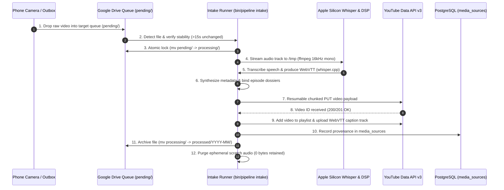

# Media Intake & YouTube Publishing Pipeline: BPMN Specification, SLOs & Alerting Framework

## 1. Architectural Philosophy: The Self-Describing Resilient Pipeline

The Media Intake & Publishing Pipeline operates on a zero-disk-waste cloud streaming architecture. By modeling the workflow as a formal **BPMN 2.0 process** with discrete Service Tasks, Intermediate Boundary Catch Events, and Telemetry Emitters, the system achieves complete operational transparency.

Any operator, autonomous agent, or monitoring daemon can determine:
1. When intake ingestion started.
2. The exact step currently executing.
3. The real-time latency versus established Service Level Objectives (SLOs).
4. When Service Level Agreements (SLAs) or error thresholds are breached, triggering calibrated notifications.

---

## 2. BPMN 2.0 Process Architecture

The executable BPMN definition is maintained canonically at:
[`docs/bpmn/media-intake-pipeline.bpmn`](file:///Users/mike/github.com/just3ws/just3ws.github.io/docs/bpmn/media-intake-pipeline.bpmn)

### Process Topology & Swimlanes
The ingress queue supports a staged hold directory (`staged/`) alongside the execution queues (`pending/`, `processing/`, `processed/`, `failed/`). Files backed up to `staged/` are safely preserved on Google Drive without triggering automated ingestion until explicitly moved into `pending/`.

#### Concurrency & Serialization Policy (Localhost Resource Protection)
To protect localhost CPU, RAM, and Apple Silicon Neural Engine headroom, intake execution is strictly serialized:
1. **One Video at a Time Across All Channels**: The `processing/` directory across all channels and targets admits exactly one video at any given moment. If any video is actively processing anywhere, the pipeline refuses to begin another file until the active run finishes and archives or quarantines.
2. **Oldest-First FIFO Discipline**: When multiple pending files exist, candidates across all channels are ordered by filesystem ingress age (APFS creation time / birthtime, falling back to modification time). The single oldest file is always processed first.



---

## 3. Service Level Indicators (SLIs), Objectives (SLOs) & Agreements (SLAs)

Each step in the pipeline publishes timing telemetry and execution status. The table below codifies the operational boundaries:

| BPMN Step | Service Task Description | Service Level Indicator (SLI) | Service Level Objective (SLO) | Service Level Agreement (SLA Target) | Error Event Tripped |
| :--- | :--- | :--- | :--- | :--- | :--- |
| **Step 1** | Ingress Detection | Time from cloud sync completion to pipeline discovery | 95% discovered in &le; 30 seconds | Max discovery latency &le; 120 seconds | `ERR_INGRESS_DISCOVERY_TIMEOUT` |
| **Step 2** | Stability & Atomic Lock | Time to verify byte invariance and transition to `processing/` | 99% locked in &le; 15 seconds | Lock duration &le; 45 seconds | `ERR_STABILITY_LOCK_FAILED` |
| **Step 3** | Audio DSP Extraction | Duration of sequential `ffmpeg` audio stream extraction to `/tmp/` | 95% extracted in &le; 8 seconds per GB | Extraction &le; 20 seconds per GB | `ERR_FFMPEG_STREAM_CORRUPT` |
| **Step 4** | Whisper Transcription | Real-Time Factor (RTF = duration / audio length) on Apple Silicon | 95% of runs achieve RTF &le; 0.15 (&lt;9s for 1m audio) | Max RTF &le; 0.35 | `ERR_WHISPER_TIMEOUT` |
| **Step 5** | Metadata Synthesis | Character budget compliance, dossier lookup, and title synthesis | 100% compliant (&le; 100 char title, 0 em dashes) | Execution &le; 500 milliseconds | `ERR_METADATA_BUDGET_OVERFLOW` |
| **Step 6** | Resumable YouTube Upload | Streaming upload throughput to YouTube Data API v3 | 90% streams &ge; 25 Mbps | Timeout ceiling: 1800 seconds (30m) | `ERR_YOUTUBE_RESUMABLE_UPLOAD` |
| **Step 7** | Playlist Assignment | Latency of playlistItems.insert API call | 99% assigned in &le; 2 seconds | Latency &le; 5 seconds | `ERR_PLAYLIST_ASSIGNMENT` |
| **Step 8** | Captions Upload | Multipart WebVTT caption track upload and verification | 95% uploaded in &le; 3 seconds | Latency &le; 10 seconds | `ERR_CAPTIONS_UPLOAD` |
| **Step 9** | PostgreSQL Registration | Upsert into `my` database `media_sources` table | 99% committed in &le; 50 milliseconds | Latency &le; 250 milliseconds | `ERR_POSTGRES_INGEST` |
| **Step 10** | Cloud Archival & Eviction | Movement to `processed/YYYY-MM/` and scratch `/tmp` purging | 100% cloud evicted with 0 bytes retained on SSD | Eviction &le; 2 seconds | `ERR_EVICTION_FAILED` |

---

## 4. State Machine & Event-Driven Alerting Matrix

When an anomaly occurs at any step, the pipeline isolates the asset, writes an error log sidecar, and emits a structured notification event:

### Transition State Machine

```
   [ pending/ ]
        │
        ▼ (Stability check passed)
   [ processing/ ]
        │
        ├─────────────────────────┬─────────────────────────┐
        ▼                         ▼                         ▼
  [ Audio DSP / STT ]    [ YouTube API Upload ]    [ Captions / DB ]
        │                         │                         │
        └─────────────────────────┼─────────────────────────┘
                                  │
                  ┌───────────────┴───────────────┐
                  ▼ (Success)                     ▼ (Exception / SLA breach)
          [ processed/YYYY-MM/ ]              [ failed/ ]
          • Scratch purged                    • File quarantined
          • Local SSD: 0 MB                   • Error log created
          • Status: published                 • Alert emitted to Cockpit
```

### Alert Thresholds

1. **Warning Alert (P3: Threshold Degradation)**:
   * **Trigger**: A step exceeds 1.5x of its target SLO (e.g. Whisper RTF drifts above 0.25, or upload speed drops below 15 Mbps).
   * **Action**: Log telemetry warning, annotate dashboard stage pill with amber glow.

2. **Critical Alert (P1: Pipeline Blocked / SLA Breach)**:
   * **Trigger**: YouTube upload connection severed, quota exhausted (HTTP 403), or file stranded in `processing/` for over 45 minutes.
   * **Action**: Move video from `processing/` to `failed/`, generate `<filename>.error.log`, publish red alert badge on Cockpit HUD, and notify terminal operator on next invocation.

3. **Quota Exhaustion Guard**:
   * **Trigger**: Daily YouTube Data API v3 quota consumption approaches 9,000 / 10,000 units.
   * **Action**: Pipeline automatically enters queue-only mode: leaves files in `pending/` and displays postponement advisory until the midnight PT quota reset.
