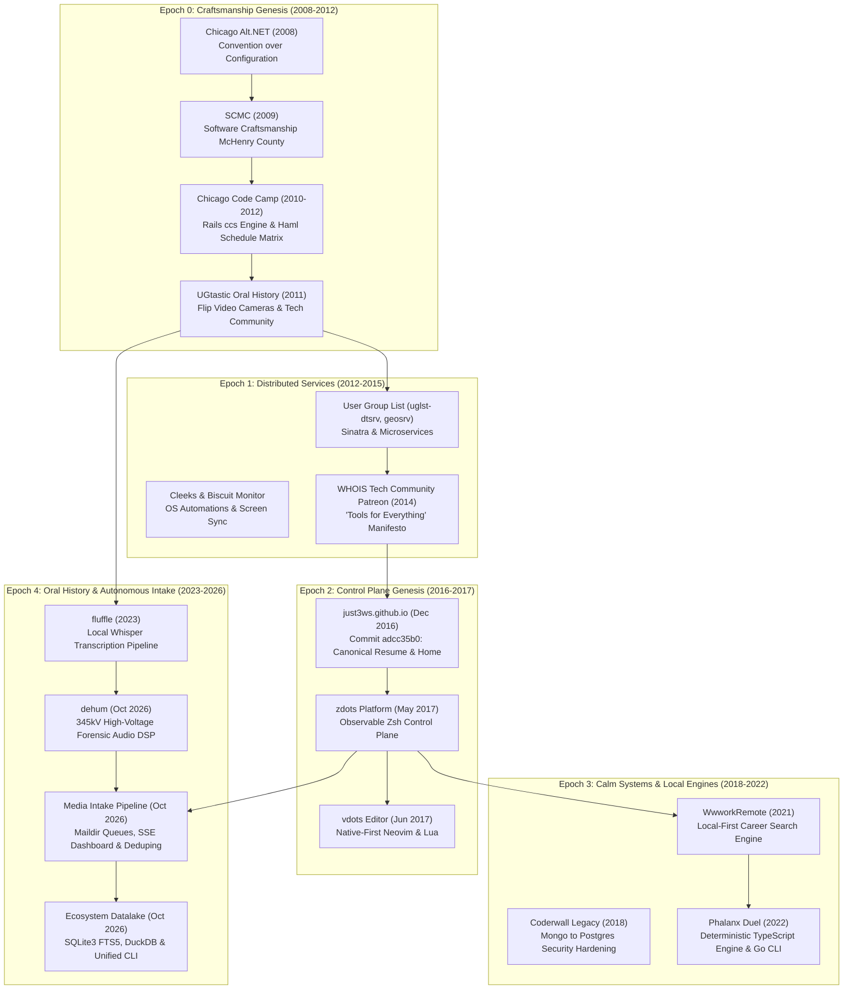
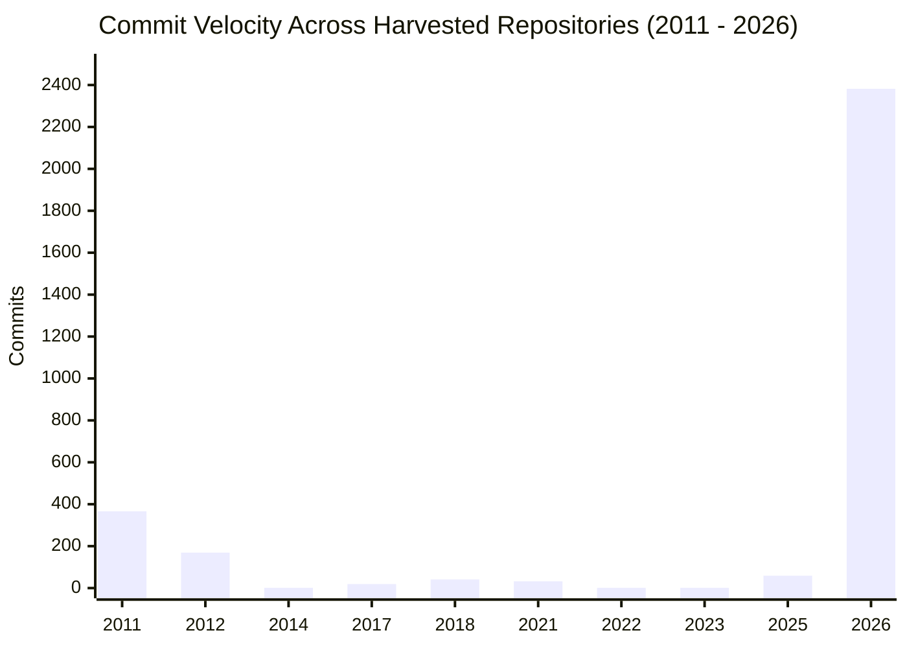
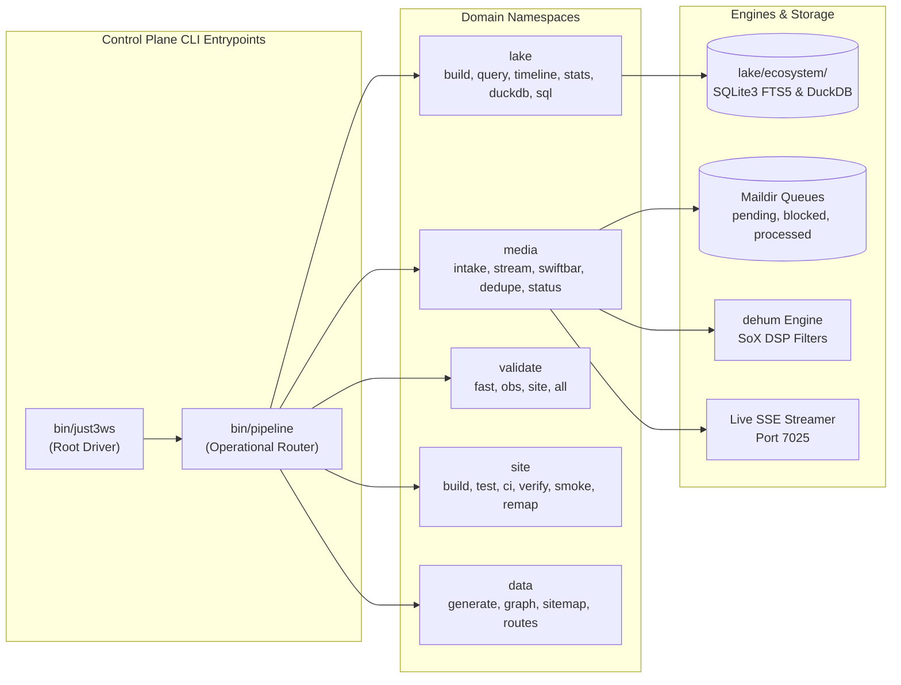

# The Living Ecosystem: Story, Evolution & Datalake Chronology (2008 - 2026)

This document synthesizes eighteen years of engineering history across the repositories of Mike Hall and the four interconnected GitHub organizations: **@just3ws**, **@ugtastic**, **@wwworkremote**, and **@phalanxduel**. Grounded in 3,071 harvested git commits, 66 indexed repositories, and authentic physical and code artifacts, this is the story of how an early software craftsmanship movement in Chicago evolved into an autonomous, observable personal platform and oral history datalake.

---

## 1. Architectural Lineage & Ecosystem Map



---

## 2. Commit Activity Over Time Across Working Repositories



---

## 3. The Five Epochs of Evolution

### Epoch 0: CodePlex Open Source, Alt.NET & Software Craftsmanship Genesis (2006 - 2012)
Before the GitHub era, Mike Hall began publishing open-source C# / .NET libraries under the **Frog's Brain** (`frogsbrain`, `frogsbrain.net`, `frogsbrain.blogspot.com`) and **Just3Ws, Inc.** (`just3ws`, alongside early alias `zalewhol`) identities. Joining Microsoft **CodePlex** on October 29, 2006 (`https://web.archive.org/web/20081009115645/http://www.codeplex.com:80/site/users/view/frogsbrain`), Mike served as Project Coordinator for three open-source libraries:
- **`#Resume` (`sharpresume` / `Just3Ws.SharpResume`, 2006-2009)**: A strongly typed C# implementation of the HR-XML Consortium 2.5 standardized Resume and CV specification (`SharpResume`, `SharpResume.Builder` ASP.NET web interface, and `SharpResume.Test` unit test suite), licensed under the MIT License (`Copyright (c) 2006-2009 Just3Ws, Inc.`). Preserved on CodePlex Archive (`https://codeplexarchive.org/project/sharpresume`), Wayback Machine (`https://web.archive.org/web/20070510045718/http://www.codeplex.com:80/sharpresume`), and Google Code Archive SVN (`just3ws` committer). Notice the 20-year architectural continuity: in 2006-2009 Mike built a strongly typed C# engine for standardized HR-XML resumes, and in 2016-2026 evolved `just3ws.github.io` into a schema-validated YAML/JSON/SQLite3 CareerOS datalake and multi-surface resume generator.
- **`NStun` (`FrogsBrain.NStun`, 2006-2009)**: A native C# implementation of the RFC 3489 STUN (Simple Traversal Underneath Network Address Translators) UDP protocol (`https://codeplexarchive.org/project/nstun`).
- **`SchemaInSight` (2007-2008)**: A .NET 2.0 API for programmatically enumerating SQL Server tables, views, and stored procedure schemas (`https://web.archive.org/web/20081010042556/http://www.frogsbrain.net:80/content/schemainsight/default.aspx`).

The community philosophy took shape in November 2008 when Mike delivered his first user group presentation at **Chicago Alt.NET** on November 12, 2008 at Redpoint Technologies on the 84th floor of the Sears Tower (primary citation: `https://web.archive.org/web/20081101091417/http://www.chicagoalt.net/Home`). The topic was the NHaml alternative view engine for ASP.NET MVC, presented alongside Adam Tybor on Spark. It was a formative moment in Midwestern developer culture, demonstrating how convention over configuration, lightweight templating, and testable controllers (pioneered in Ruby on Rails) were reshaping modern web architecture.

In January 2009, Mike founded **Software Craftsmanship McHenry County (SCMC)**, bringing coding katas, deliberate practice, and journeyman pair programming to the northwest suburbs. In February 2009, following a lively technical debate with Sergio Pereira (organizer of Chicago Alt.NET) over whether retweeting high-follower accounts like Scott Hanselman actually reached unique audiences, Mike built **twatio.com** as an ASP.NET MVC application to measure audience overlap empirically (`https://web.archive.org/web/20090201000000*/http://twatio.com/`). The experiment proved the hypothesis, and the domain was later redirected to `ugtastic.com`.

Chicago Code Camp was an existing regional conference where Mike volunteered and assisted for a couple years, engineering the conference website (`just3ws/ccs`) for at least three years of conferences. On May 13, 2011, Mike authored commit `9a7d7035` (`app/views/schedules/printable.html.haml`), generating the 9-track conference grid across 5 session blocks.

Simultaneously in June 2011, Mike carried a Flip video camera into conference hallways to launch **UGtastic**, filming conversations with community organizers, open-source maintainers, and working programmers. Over the next decade, this grew into an irreplaceable 218-interview oral history archive.

### Epoch 1: Distributed Services & Micro-App Experiments (2012 - 2015)
As the user group movement grew, Mike explored microservices to map and connect communities. In 2012, `uglst-dtsrv` and `uglst-geosrv` were built to calculate geospatial proximity between developer meetups. On **February 13, 2013**, Mike submitted [`fog/fog#1562`](https://github.com/fog/fog/pull/1562) ([commit `fecbf150`](https://github.com/fog/fog/commit/fecbf150a4574a0080d5d454807a248f0b71d31a)) to the Ruby cloud services library `fog`, upgrading `net-scp` after v1.0.6 was yanked from RubyGems.org; `fog` creator Wesley Beary (`@geemus`) merged it in [`2fccaa27`](https://github.com/fog/fog/commit/2fccaa27131b4b5b41cb8b89368b40879a945bbd), credited *"thanks Michael D. Hall"* in the `v1.10.0` `CHANGELOG.md`, and sent Mike the official `fog` contributor t-shirt. On January 11, 2014, Mike launched **UGl.st** (`ugl.st`), the User-Group List, featuring the signature heart glyph in its user-group registration interface (`https://web.archive.org/web/20140111160057/https://ugl.st/`). Mike owned and operated `ugl.st` throughout 2014, with the final snapshot under his ownership captured on December 22, 2014 (`https://web.archive.org/web/20141222063128/https://ugl.st/`). Command-line utilities and published RubyGems under `just3ws` (**60,304 total downloads** across `express_pigeon` with 30,267 downloads, `biscuit-monitor` with 18,026 downloads for CLEAR Spot 4G+ hotspot telemetry, and `biscotti` with 12,011 downloads) alongside `Cleeks` (capturing automated desktop screenshots to Dropbox via `launchctl`) established an early pattern: treating the local operating system as a programmable platform.

In April 2014, Mike launched the **WHOIS Tech Community Patreon** under the motto *"Tools for everything"*. In September 2014, at Assembly Made, Mike led the open-sourcing of **Coderwall** (`coderwall/coderwall-legacy`, where he is the #1 all-time contributor with 634 commits across 856 stars), created `assemblymade/coderwall-badges` preserving 60+ original DrawIt vector badge artworks, executed the zero-downtime MongoDB-to-PostgreSQL migration, and contributed upstream to Ruby on Rails ([PR #17990](https://github.com/rails/rails/pull/17990)). On **November 14, 2014**, continuing a friendship with Rob Reynolds (`@ferventcoder`) that began on the 2010 Iron Languages Podcast (*"That 'nu' Thing"*) and their 2012 UGtastic interview on Chocolatey, Mike built the top-of-site Kickstarter launch CTA banner on `chocolatey.org` ([commit `fa6a43b0`](https://github.com/ferventcoder/chocolatey.org-archive/commit/fa6a43b0268178417d4f2420a66964b72ee3bd09), `GH-124`) to help propel the Chocolatey Kickstarter past its $51,071 finish line.

### Epoch 2: The Canonical GitHub Pages Genesis & Personal Control Plane (2016 - 2017)
On **December 5, 2016**, commit `adcc35b0` established `just3ws.github.io`. Starting with a minimal HTML resume and structured schema microdata, the repository was designed to be a permanent, indexable engineering home. On **January 25, 2017**, while building `plik` (`just3ws/clojure-exercises-001`), a Clojure Compojure/Ring service consuming multi-delimiter CSV files with `clojure-csv` and `metasoarous/semantic-csv`, Mike packaged custom artifact `[self/semantic-csv "0.1.0-just3ws"]` for `:transform-header` support and opened [`metasoarous/semantic-csv#49`](https://github.com/metasoarous/semantic-csv/issues/49), catalyzing the official `0.2.0` release to Clojars.

In May 2017, Mike formalized his personal operating system with **zdots** (`~/.config/zsh`), followed a week later by **vdots** (`~/.config/nvim`). Rather than relying on fragile dotfile symlinks, `zdots` was engineered as an observable control plane with health checks, local background services, and strict isolation.

### Epoch 3: Calm Systems, Enterprise Enablement & Local-First Platforms (2018 - 2022)
From 2018 to 2020, Mike archived `coderwall-legacy` and `just3ws/ccs` and built developer utilities like `nerd-font-cheatsheets` (129 GitHub stars, 25 forks), `biscotti`, and `slowa`. On **February 2, 2020**, Mike's open-source code across `countries/countries` ([commit `ec5d33ea`](https://github.com/countries/countries/commit/ec5d33ea)), `coderwall/coderwall-legacy` (634 commits), `asm-helpful/helpful-web` (7+ commits), `fog/fog` ([commit `fecbf150`](https://github.com/fog/fog/commit/fecbf150a4574a0080d5d454807a248f0b71d31a)), `carlhuda/janus` (`01b31564`), `cdnjs/cdnjs` (`559fdedb`), `just3ws/nerd-font-cheatsheets`, `just3ws/biscotti`, `just3ws/zdots`, `just3ws/vdots`, and `just3ws/just3ws.github.io` was captured in the **2020 GitHub Arctic Code Vault** snapshot and preserved on piqlFilm 250 meters deep inside the Svalbard permafrost.

In September 2021, Mike founded **WwworkRemote** (`@wwworkremote`), building a calm, local-first search system to triage, rank, and track engineering opportunities without algorithmic feed manipulation or engagement traps.

In **March 2022** (eight months prior to the public release of ChatGPT), Mike built and placed in the OneMain Financial corporate hackathon with a conversational AI workflow prototype powered by **Rasa 3.0**. In **June 2022**, he initiated weekly peer learning as *Open Tech Talks* (covering Microservices, Federated GraphQL, Event-Driven Architecture, and Git Katas), officially launching **Geekfest@OMF** in **November 2022** (honoring the Tuesday peer-learning tradition from Obtiva and featured in the *OneTech Newsletter*). Over the next 18 months, Mike facilitated 49+ recorded weekly Tuesday brown-bag sessions covering *Reading Ruby*, *Working Effectively with Legacy Code*, a 5-part *SOLID Principles* series, early Generative AI (*Let's Look More at LLMs*, April 4, 2023), and *Cynefin* sense-making (August 8, 2023).

In July 2022, Mike engineered **Phalanx Duel** (`@phalanxduel`), a tactical 1v1 card game powered by a deterministic, server-authoritative TypeScript engine, complete with replay verification, automated balance simulation, and a native Go command-line client (`duel-cli`).

### Epoch 4: OpenTelemetry Communities of Practice, Forensic Audio & Ecosystem Datalake (2023 - 2026)
Between 2023 and 2026, the enterprise observability, local AI, and oral history threads converged:
- **April 2023 (`fluffle` & Geekfest@OMF LLMs)**: Local Whisper speech-to-text models were deployed to transcribe long-form oral history recordings while introducing practical LLM workflows to enterprise engineering peers.
- **September to November 2023 (OpenTelemetry & Local Ollama at Geekfest@OMF)**: Introduced OpenTelemetry distributed tracing (*Looking at OpenTelemetry* on Sept 12 and *OpenTelemetry the Demo* on Sept 19, 2023), shared insights from *KubeCon + CloudNativeCon North America* in Chicago (Nov 21, 2023), and demonstrated privacy-conscious local open-weight models (*Local LLM with Ollama* on Nov 28, 2023 and *Spin up SQL with Vanna.ai* on Jan 23, 2024).
- **February 28 to 29, 2024 (Corporate Hackathon: *The Buckaroo Bonsais*)**: Led team *The Buckaroo Bonsais* (`the-buckaroo-bonsais`), placing in the corporate hackathon with an automated JSON Schema inference batch pipeline and Rails service instrumented end-to-end with OpenTelemetry distributed tracing and a local Ollama documentation summarizer.
- **April 2024 to September 12, 2025 (OpenTelemetry Working Group & Executive Handoff)**: Evolved Geekfest@OMF into the enterprise **OpenTelemetry Working Group (OTel WG)**, establishing the **first Community of Practice at OneMain Financial**. Scaled the weekly Friday series to **122 invited members** (with 40+ active engineers across six lanes) bridging W3C Trace Context across Ruby on Rails, Node.js, Kafka, MuleSoft, AWS ADOT, and IBM z/OS mainframes. After proving the strategic value of unified observability, executive leadership funded two dedicated full-time roles (Director and Staff Engineer) and three permanent working groups, enabling Mike's formal stewardship handoff on **September 12, 2025**.
- **February 2026**: Complete consolidation on `just3ws.github.io`, promoting the minimal resume to index and archiving 211+ UGtastic and SCMC video interviews.
- **October 12, 2026 (`dehum`)**: Engineered forensic audio filters to eliminate 345,000-volt high-voltage transmission line hum, corona decrackle, and clock drift from field recordings.
- **October 15, 2026**: Autonomous media intake pipeline with Maildir queue architecture (`incoming/`, `pending/`, `processing/`, `blocked/`, `processed/`, `quarantine/`), BPMN state machines, resumable 8MB chunked YouTube uploads, and real-time SSE telemetry streaming.
- **October 17, 2026**: Smart legacy route remapping engine in `404.html` recovering historical links for `ugtastic.com`, `whoistechcmty.com`, and `chicagocodecamp.com`.
- **October 18, 2026**: The Unified Ecosystem Datalake (`lake/ecosystem/`), synthesizing 66 repositories, 3,082+ commits, 14 historical artifacts, and 104 timeline events into SQLite3 FTS5, DuckDB, and a unified control plane CLI (`bin/just3ws`).

---

## 4. Chronological Turning Points & Milestones Table

| Date | Epoch / Era | Initiative | Repo / Reference | Event Type | Milestone & Turning Point |
|:---|:---|:---|:---|:---|:---|
| **2006-10-29** | Pre-GitHub Open Source | Frog's Brain / TicketsNow | `codeplex/nstun` | `community_milestone` | Joined CodePlex (`frogsbrain`) and published `NStun` (.NET 2.0 C# RFC 3489 STUN library) |
| **2007-05-10** | Pre-GitHub Open Source | `#Resume` & `SchemaInSight` | `codeplex/sharpresume` | `community_milestone` | Coordinated `#Resume` (`Just3Ws.SharpResume` HR-XML 2.5 C# API) and `SchemaInSight` |
| **2008-11-12** | Craftsmanship Genesis | Chicago Alt.NET | `just3ws.github.io` | `community_milestone` | First user group presentation on NHaml alternative view engine at Sears Tower |
| **2009-01-15** | Craftsmanship Genesis | SCMC | `just3ws.github.io` | `community_milestone` | Founding of Software Craftsmanship McHenry County |
| **2009-02-01** | Craftsmanship Genesis | twatio.com | `just3ws.github.io` | `community_milestone` | Built twatio.com on ASP.NET MVC to prove Twitter audience overlap hypothesis |
| **2010-05-15** | Craftsmanship Genesis | Chicago Code Camp | `just3ws/ccs` | `community_milestone` | Volunteer and website developer for existing regional conference |
| **2011-05-13** | Craftsmanship Genesis | Chicago Code Camp | `just3ws/ccs` (`9a7d7035`) | `turning_point` | Added print-friendly Haml schedule generator for 9-track matrix |
| **2011-06-01** | Craftsmanship Genesis | UGtastic | `ugtastic/.github` | `community_milestone` | Launch of UGtastic oral history interviews with Flip video cameras |
| **2012-04-14** | Craftsmanship Genesis | UGtastic | `ugtastic.com` | `community_milestone` | First recorded Internet Archive capture of ugtastic.com |
| **2012-06-12** | Distributed Services | uglst | `just3ws/uglst-geosrv` | `repo_creation` | Geospatial microservice for user group mapping |
| **2012-07-31** | Distributed Services | RubyGems | `just3ws/biscuit-monitor` | `community_milestone` | Published `biscuit-monitor` (18,026 downloads) & `express_pigeon` (30,267 downloads) |
| **2013-02-13** | Distributed Services | fog Ruby Cloud Library | `fog/fog#1562` (`fecbf150`) | `community_milestone` | Merged `net-scp` upgrade via Wesley Beary (`@geemus`), earning `fog` contributor t-shirt |
| **2014-01-11** | Distributed Services | UGl.st | `just3ws/uglst-geosrv` | `community_milestone` | Public launch of UGl.st User-Group List with heart glyph interface |
| **2014-04-01** | Distributed Services | WHOIS Tech Cmty | `just3ws.github.io` | `community_milestone` | Launch of Patreon campaign under the 'Tools for everything' vision |
| **2014-09-12** | Distributed Services | Coderwall | `coderwall/coderwall-legacy` | `community_milestone` | Led Coderwall open-sourcing (#1 contributor, 634 commits) & `coderwall-badges` |
| **2014-11-14** | Distributed Services | Chocolatey | `chocolatey.org` (`fa6a43b0`) | `community_milestone` | Built top-of-site Kickstarter launch CTA banner (`GH-124`) for Rob Reynolds |
| **2016-12-05** | Control Plane Genesis | just3ws | `just3ws.github.io` (`adcc35b0`) | `turning_point` | Initial commit of canonical engineering web presence and resume |
| **2017-01-25** | Control Plane Genesis | Clojars / Clojure | `semantic-csv#49` | `community_milestone` | Packaged `[self/semantic-csv "0.1.0-just3ws"]` in `plik` & catalyzed Clojars 0.2.0 release |
| **2017-05-26** | Control Plane Genesis | zdots | `just3ws/zdots` | `turning_point` | Founding of the observable Zsh personal control plane |
| **2017-06-02** | Control Plane Genesis | vdots | `just3ws/vdots` | `turning_point` | Founding of native-first Neovim configuration in Lua |
| **2017-11-17** | Control Plane Genesis | WHOIS Tech Cmty | `ugtastic.com` | `community_milestone` | First Wayback capture of UGtastic to WHOIS Tech Community rebrand transition |
| **2018-07-17** | Calm Systems | Chicago Code Camp | `just3ws/ccs` | `repo_creation` | Historical Rails conference platform archived open source |
| **2018-12-26** | Calm Systems | Coderwall | `just3ws/coderwall-legacy`| `repo_creation` | Coderwall open-source transition, security hardening, and database migration |
| **2020-02-02** | Calm Systems | Arctic Code Vault | `coderwall/coderwall-legacy`| `community_milestone` | Preserved in Svalbard Arctic Code Vault (`countries`, `coderwall-legacy`, `helpful-web`, `fog`) |
| **2021-09-25** | Calm Systems | WwworkRemote | `wwworkremote/wwworkremote`| `turning_point` | Genesis of calm, local-first career search and triage platform |
| **2022-03-19** | Calm Systems | OMF Hackathon #1 | `onemain-financial` | `community_milestone` | Placed in corporate hackathon with Rasa 3.0 conversational AI prototype (pre-ChatGPT) |
| **2022-07-10** | Calm Systems | Phalanx Duel | `phalanxduel/phalanxduel` | `turning_point` | Genesis of deterministic tactical card game engine and Go CLI |
| **2022-11-01** | Calm Systems | Geekfest@OMF | `onemain-financial` | `community_milestone` | Official launch of Geekfest@OMF weekly brown-bag series (49+ recorded sessions) |
| **2023-04-06** | Oral History Renaissance | fluffle | `just3ws/fluffle` | `turning_point` | Local Whisper transcription pipeline for oral history archives |
| **2023-09-12** | Oral History Renaissance | Geekfest@OMF | `onemain-financial` | `community_milestone` | First OpenTelemetry live tracing demos, KubeCon Chicago recap & Local Ollama sessions |
| **2024-02-28** | Oral History Renaissance | OMF Hackathon #2 | `the-buckaroo-bonsais` | `community_milestone` | Placed in corporate hackathon leading *The Buckaroo Bonsais* (JSON Schema + OTel tracing) |
| **2024-04-05** | Oral History Renaissance | OTel WG | `onemain-financial` | `community_milestone` | Evolved Geekfest@OMF into OpenTelemetry Working Group (1st CoP at OMF, 122 members) |
| **2025-09-12** | Oral History Renaissance | OTel WG | `onemain-financial` | `community_milestone` | Formal executive handoff of OTel WG to newly funded full-time observability leadership |
| **2026-02-01** | Autonomous Intake | just3ws | `just3ws.github.io` (`10499a2c`) | `turning_point` | Ingestion of 211+ UGtastic and SCMC interviews into site archive |
| **2026-10-12** | Autonomous Intake | dehum | `just3ws/dehum` | `turning_point` | Creation of 345kV EMI dehumming and forensic restoration engine |
| **2026-10-15** | Autonomous Intake | just3ws | `just3ws.github.io` (`ad3348ae`) | `turning_point` | Autonomous media intake pipeline, Maildir queues, and live SSE streamer |
| **2026-10-17** | Autonomous Intake | just3ws | `just3ws.github.io` (`723b5969`) | `turning_point` | Smart legacy route remapping and in-browser 404 recovery card |
| **2026-10-18** | Autonomous Intake | just3ws | `just3ws.github.io` (`05ecb376`) | `turning_point` | Unified Ecosystem Datalake in SQLite3 FTS5, DuckDB, and just3ws CLI |

---

## 5. Control Plane Architecture: Inspired by kubectl & zdots

To avoid ad-hoc tool fragmentation, the platform uses a unified, hierarchical command structure modeled after `kubectl` and `zdots-*`:



### Command Usage Examples:
```bash
# Query the timeline across 18 years
./bin/just3ws lake timeline --limit 10

# Search the full-text datalake (repositories, commits, artifacts)
./bin/just3ws lake query "Alt.NET"

# Execute analytical DuckDB queries
./bin/just3ws lake duckdb "SELECT era, count(*) FROM v_timeline GROUP BY 1;"

# Check live media ingestion queues and YouTube status
./bin/just3ws media status

# Run fast pre-commit validation gates
./bin/just3ws validate fast
```
