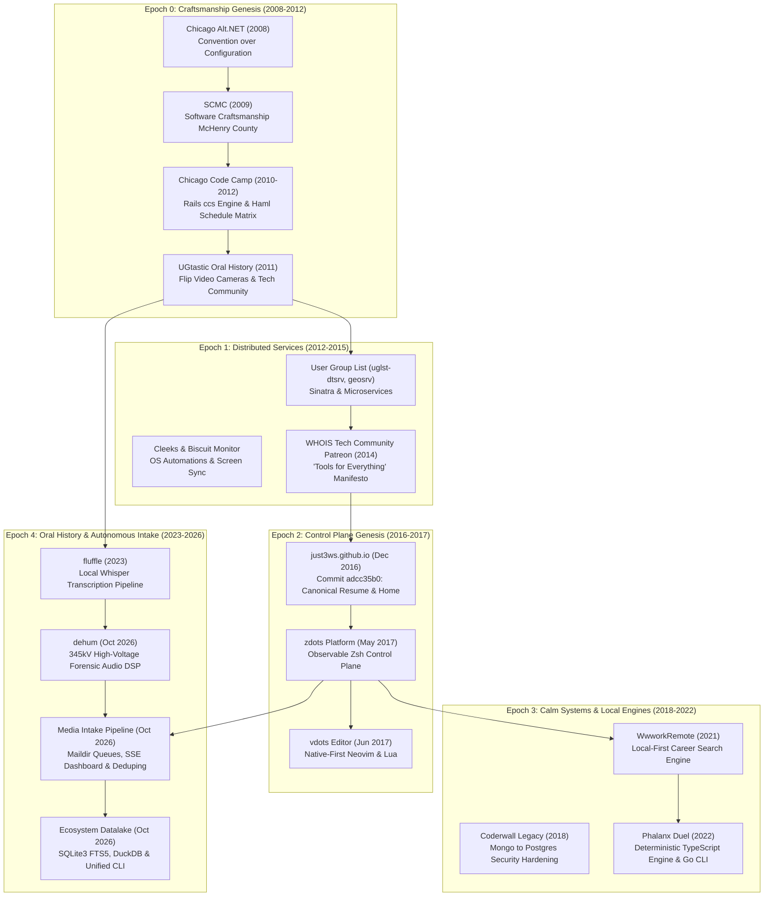
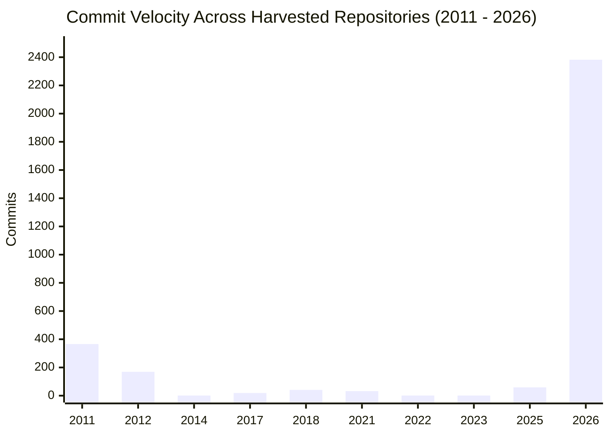
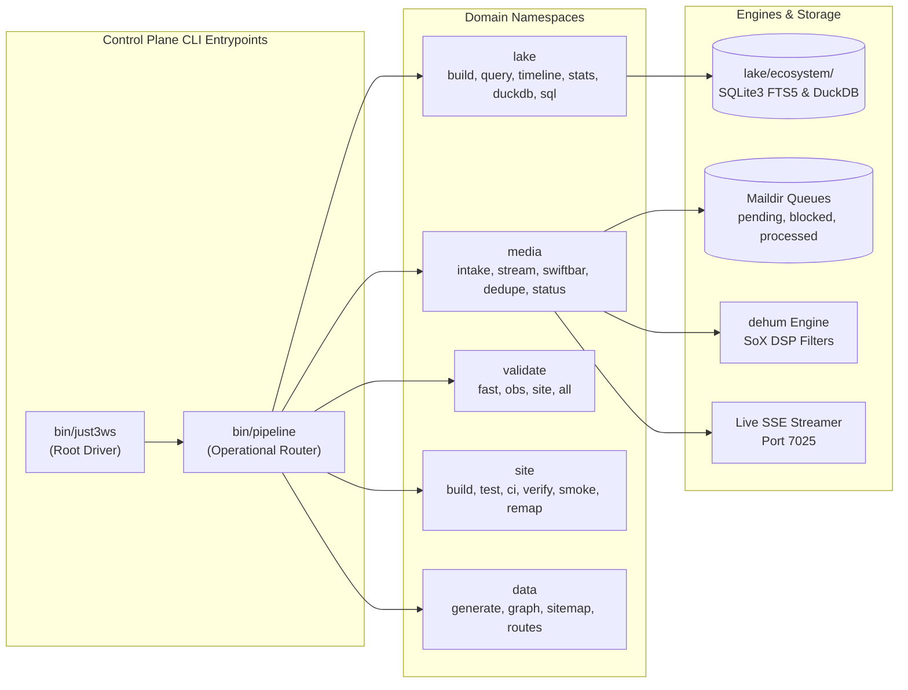

# The Living Ecosystem: Story, Evolution & Datalake Chronology (2008 - 2026)

This document synthesizes eighteen years of engineering history across the repositories of Mike Hall and the four interconnected GitHub organizations: **@just3ws**, **@ugtastic**, **@wwworkremote**, and **@phalanxduel**. Grounded in 3,071 harvested git commits, 66 indexed repositories, and authentic physical and code artifacts, this is the story of how an early software craftsmanship movement in Chicago evolved into an autonomous, observable personal platform and oral history datalake.

---

## 1. Architectural Lineage & Ecosystem Map



---

## 2. Commit Activity Over Time Across Working Repositories



---

## 3. The Five Epochs of Evolution

### Epoch 0: The Alt.NET & Software Craftsmanship Era (2008 - 2012)
The root philosophy began in August 2008 when Mike Hall delivered his first user group presentation at **Chicago Alt.NET**. The topic was the Castle Project stack: Castle MonoRail, Windsor Inversion of Control, and ActiveRecord. It was a pivotal moment in Midwestern developer culture, arguing that convention over configuration, test-driven design, and lightweight routing (pioneered in Ruby on Rails) were fundamentally superior to Microsoft's monolithic WebForms model.

In January 2009, Mike founded **Software Craftsmanship McHenry County (SCMC)**, bringing coding katas, deliberate practice, and journeyman pair programming to the northwest suburbs. From 2010 to 2012, Mike co-organized **Chicago Code Camp** and engineered its open-source Rails platform (`just3ws/ccs`). On May 13, 2011, Mike authored commit `9a7d7035` (`app/views/schedules/printable.html.haml`), generating the 9-track conference grid across 5 session blocks.

Simultaneously in June 2011, Mike carried a Flip video camera into conference hallways to launch **UGtastic**, filming conversations with community organizers, open-source maintainers, and working programmers. Over the next decade, this grew into an irreplaceable 218-interview oral history archive.

### Epoch 1: Distributed Services & Micro-App Experiments (2012 - 2015)
As the user group movement grew, Mike explored microservices to map and connect communities. In 2012, `uglst-dtsrv` and `uglst-geosrv` were built to calculate geospatial proximity between developer meetups. Command-line utilities like `biscuit-monitor` (monitoring Clear Spot 4G mobile devices) and `Cleeks` (capturing automated desktop screenshots to Dropbox via `launchctl`) established an early pattern: treating the local operating system as a programmable platform.

In April 2014, Mike launched the **WHOIS Tech Community Patreon** under the motto *"Tools for everything"*. The goal was deliberate: keep technical oral history 100% independent of corporate sponsors and vendor influence while funding better field audio and video equipment.

### Epoch 2: The Canonical GitHub Pages Genesis & Personal Control Plane (2016 - 2017)
On **December 5, 2016**, commit `adcc35b0` established `just3ws.github.io`. Starting with a minimal HTML resume and structured schema microdata, the repository was designed to be a permanent, indexable engineering home.

In May 2017, Mike formalized his personal operating system with **zdots** (`~/.config/zsh`), followed a week later by **vdots** (`~/.config/nvim`). Rather than relying on fragile dotfile symlinks, `zdots` was engineered as an observable control plane with health checks, local background services, and strict isolation.

### Epoch 3: Calm Systems, Local-First Platforms & Game Engines (2018 - 2022)
From 2018 to 2020, Mike led open-source migrations such as `coderwall-legacy` (hardening security and migrating MongoDB to PostgreSQL) and built algorithmic aids like `nerd-font-cheatsheets`, `biscotti`, and `slowa`.

In September 2021, Mike founded **WwworkRemote** (`@wwworkremote`), building a calm, local-first search system to triage, rank, and track engineering opportunities without algorithmic feed manipulation or engagement traps.

In July 2022, Mike engineered **Phalanx Duel** (`@phalanxduel`), a tactical 1v1 card game powered by a deterministic, server-authoritative TypeScript engine, complete with replay verification, automated balance simulation, and a native Go command-line client (`duel-cli`).

### Epoch 4: Oral History, DSP Forensic Audio & Ecosystem Datalake Renaissance (2023 - 2026)
Between 2023 and 2026, the various historical threads converged:
- **April 2023 (`fluffle`)**: Local Whisper speech-to-text models were deployed to transcribe long-form recordings.
- **February 2026**: Complete consolidation on `just3ws.github.io`, promoting the minimal resume to index and archiving 211+ UGtastic and SCMC video interviews.
- **October 12, 2026 (`dehum`)**: Engineered forensic audio filters to eliminate 345,000-volt high-voltage transmission line hum, corona decrackle, and clock drift from field recordings.
- **October 15, 2026**: Autonomous media intake pipeline with Maildir queue architecture (`incoming/`, `pending/`, `processing/`, `blocked/`, `processed/`, `quarantine/`), BPMN state machines, resumable 8MB chunked YouTube uploads, and real-time SSE telemetry streaming.
- **October 17, 2026**: Smart legacy route remapping engine in `404.html` recovering historical links for `ugtastic.com`, `whoistechcmty.com`, and `chicagocodecamp.com`.
- **October 18, 2026**: The Unified Ecosystem Datalake (`lake/ecosystem/`), synthesizing 66 repositories, 3,071 commits, and timeline events into SQLite3 FTS5, DuckDB, and a unified control plane CLI (`bin/just3ws`).

---

## 4. Chronological Turning Points & Milestones Table

| Date | Epoch / Era | Initiative | Repo / Reference | Event Type | Milestone & Turning Point |
|:---|:---|:---|:---|:---|:---|
| **2008-08-01** | Craftsmanship Genesis | Chicago Alt.NET | `just3ws.github.io` | `community_milestone` | First user group presentation on Castle MonoRail, IoC, and ActiveRecord |
| **2009-01-15** | Craftsmanship Genesis | SCMC | `just3ws.github.io` | `community_milestone` | Founding of Software Craftsmanship McHenry County |
| **2010-05-15** | Craftsmanship Genesis | Chicago Code Camp | `just3ws/ccs` | `community_milestone` | Co-organizer and web lead for the zero-dollar community conference |
| **2011-05-13** | Craftsmanship Genesis | Chicago Code Camp | `just3ws/ccs` (`9a7d7035`) | `turning_point` | Added print-friendly Haml schedule generator for 9-track matrix |
| **2011-06-01** | Craftsmanship Genesis | UGtastic | `ugtastic/.github` | `community_milestone` | Launch of UGtastic oral history interviews with Flip video cameras |
| **2012-06-12** | Distributed Services | uglst | `just3ws/uglst-geosrv` | `repo_creation` | Geospatial microservice for user group mapping |
| **2014-04-01** | Distributed Services | WHOIS Tech Cmty | `just3ws.github.io` | `community_milestone` | Launch of Patreon campaign under the 'Tools for everything' vision |
| **2016-12-05** | Control Plane Genesis | just3ws | `just3ws.github.io` (`adcc35b0`) | `turning_point` | Initial commit of canonical engineering web presence and resume |
| **2017-05-26** | Control Plane Genesis | zdots | `just3ws/zdots` | `turning_point` | Founding of the observable Zsh personal control plane |
| **2017-06-02** | Control Plane Genesis | vdots | `just3ws/vdots` | `turning_point` | Founding of native-first Neovim configuration in Lua |
| **2018-07-17** | Calm Systems | Chicago Code Camp | `just3ws/ccs` | `repo_creation` | Historical Rails conference platform archived open source |
| **2018-12-26** | Calm Systems | Coderwall | `just3ws/coderwall-legacy`| `repo_creation` | Coderwall open-source transition, security hardening, and database migration |
| **2021-09-25** | Calm Systems | WwworkRemote | `wwworkremote/wwworkremote`| `turning_point` | Genesis of calm, local-first career search and triage platform |
| **2022-07-10** | Calm Systems | Phalanx Duel | `phalanxduel/phalanxduel` | `turning_point` | Genesis of deterministic tactical card game engine and Go CLI |
| **2023-04-06** | Oral History Renaissance | fluffle | `just3ws/fluffle` | `turning_point` | Local Whisper transcription pipeline for oral history archives |
| **2026-02-01** | Autonomous Intake | just3ws | `just3ws.github.io` (`10499a2c`) | `turning_point` | Ingestion of 211+ UGtastic and SCMC interviews into site archive |
| **2026-10-12** | Autonomous Intake | dehum | `just3ws/dehum` | `turning_point` | Creation of 345kV EMI dehumming and forensic restoration engine |
| **2026-10-15** | Autonomous Intake | just3ws | `just3ws.github.io` (`ad3348ae`) | `turning_point` | Autonomous media intake pipeline, Maildir queues, and live SSE streamer |
| **2026-10-17** | Autonomous Intake | just3ws | `just3ws.github.io` (`723b5969`) | `turning_point` | Smart legacy route remapping and in-browser 404 recovery card |
| **2026-10-18** | Autonomous Intake | just3ws | `just3ws.github.io` (`05ecb376`) | `turning_point` | Unified Ecosystem Datalake in SQLite3 FTS5, DuckDB, and just3ws CLI |

---

## 5. Control Plane Architecture: Inspired by kubectl & zdots

To avoid ad-hoc tool fragmentation, the platform uses a unified, hierarchical command structure modeled after `kubectl` and `zdots-*`:



### Command Usage Examples:
```bash
# Query the timeline across 18 years
./bin/just3ws lake timeline --limit 10

# Search the full-text datalake (repositories, commits, artifacts)
./bin/just3ws lake query "Alt.NET"

# Execute analytical DuckDB queries
./bin/just3ws lake duckdb "SELECT era, count(*) FROM v_timeline GROUP BY 1;"

# Check live media ingestion queues and YouTube status
./bin/just3ws media status

# Run fast pre-commit validation gates
./bin/just3ws validate fast
```
