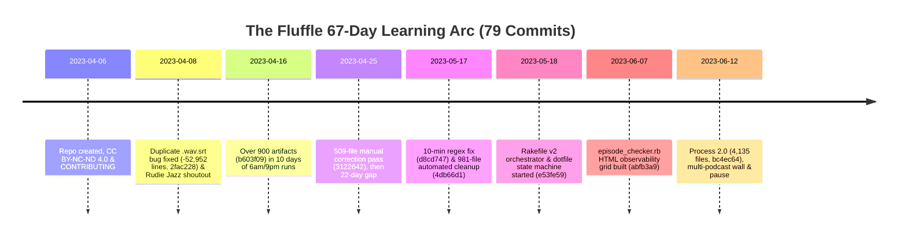
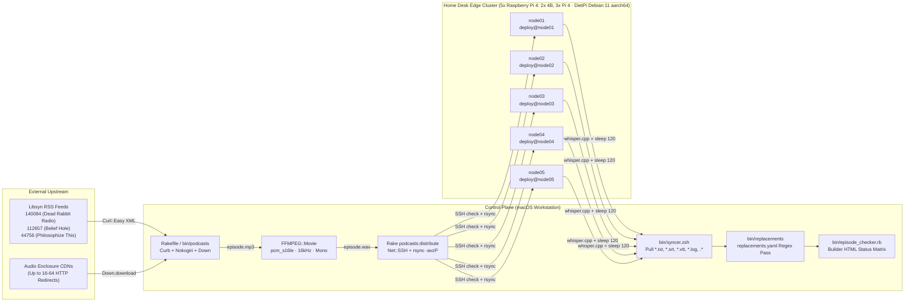
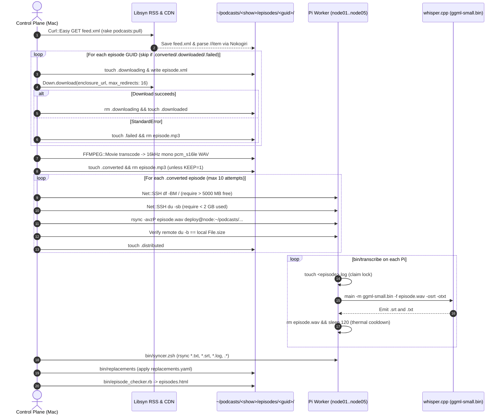
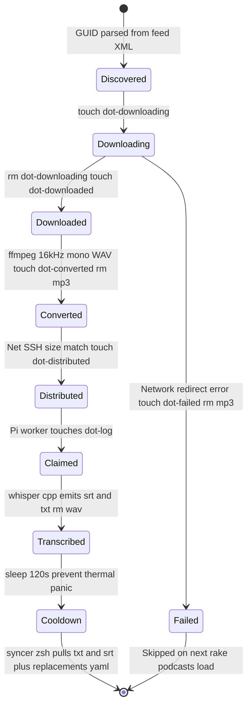
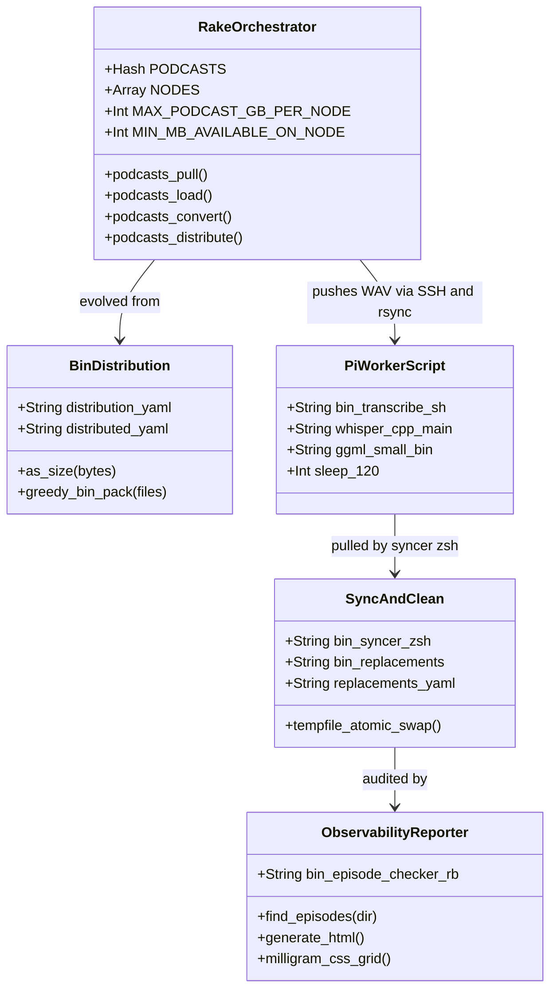
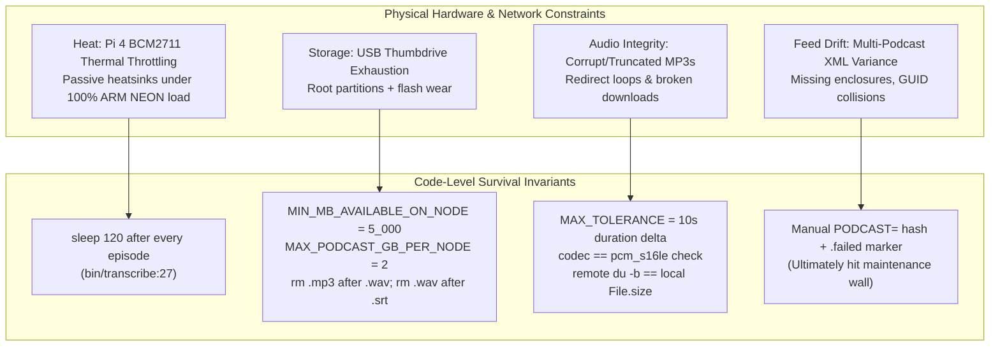
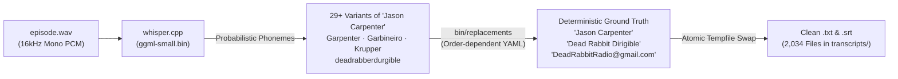

# Studio Workbench Briefing: The Fluffle & The Ship of Theseus

**Series Context:** The Sound Above (Precursor) & Studio Workbench (Episode 02 Follow-Up)  
**Predecessor Episode:** *The Ship of Theseus: From Wooden Boat to Space Station* (Recorded 2026-11-10, YouTube `R_WagKejbtw`)  
**Subject:** *The Fluffle* (`just3ws/fluffle`, April to June 2023)  
**Host:** Mike Hall  
**Date:** 2026-11-15  

---

## 1. Narrative Bridge: From The Ship of Theseus to The Fluffle

In *The Ship of Theseus: From Wooden Boat to Space Station* (`R_WagKejbtw`), you established the central thesis of this entire arc:

1. **Identity lives in invariants, not silicon or syntax.** Zero bytes of 2009 C# or 2017 Bash survive in `media-pipeline`, yet it is the same vessel because **Theseus himself carved and tested every replacement plank**.
2. **The Physical Mast Survived.** The camera used for the final 2014 UGtastic interviews is the exact camera on the Studio Workbench desk today.
3. **Peter Watts' *Blindsight* & Cunningham's Honeycomb.** Bees extrude circular wax cylinders; environmental physics compresses them into hexagons. Language models extrude tokens; **the engineer supplies the operating system physics** that keep the structure from collapsing under load.
4. **The System as a Rorschach Test.** Observers project either *"AI built this in a weekend"* or *"15 years of yak shaving."* In truth, every guardrail in `media-pipeline` was forged by pre-AI production wounds.

**Where this next episode picks up:**  
If *The Ship of Theseus* was the 18-year aerial view of the vessel, **The Fluffle is the zoom-in on the single most important plank replacement in the ship's history**. On April 6, 2023, the wooden boat (pre-AI shell scripts and abandoned 2014 crowdsourcing) first bolted on local neural inference (`whisper.cpp` on five Raspberry Pi 4s). Every survival mechanic in your 2026 Apple Silicon space station was discovered on that hot, noisy desk cluster in Crystal Lake.

> **Companion Visual Map:** Open [fluffle-architecture-walkthrough.canvas](file:///Users/mike/github.com/just3ws/just3ws.github.io/docs/fluffle-architecture-walkthrough.canvas) in Obsidian or a JSON Canvas v1.0 viewer for a spatial pan-and-zoom walkthrough of the cluster, state machine, timeline, and 6-act episode structure.

---

## 2. Verifiable Timeline & Citations

Every date, commit hash, and artifact count below is verified directly against local git repositories, `_data/` records, and podcast transcripts.

| Date | Milestone / Artifact | Verifiable Citation | Role in the Ship of Theseus Arc |
| :--- | :--- | :--- | :--- |
| **2009 to 2014** | 200+ UGtastic interviews recorded across Chicago conferences | `_data/episodes/workbench-ship-of-theseus.yml`, `just3ws.github.io/interviews/` | The raw cargo that needed searchable transcripts. |
| **2014-04-04** | `just3ws/many-hands-make-light-work` created | `docs/studio-workbench-ship-of-theseus-briefing.md` | First attempt: community crowdsourcing. Cloud APIs cost thousands; solo manual labor was impossible. |
| **2016-12-05** | `just3ws/just3ws.github.io` founded (commit `adcc35b0`) | Git history, `just3ws.github.io` | Self-hosted public archive established. |
| **2017-05-26** | `just3ws/zdots` founded (commit `e25021c7`) | Git history, `zdots` | Local-first workstation control plane established. |
| **2021-11-08** | **Dead Rabbit Radio EP 769**: Mike Hall welcomed as Patreon supporter | `fluffle/transcripts/ep_0769_travis_scott_comp.srt` (`00:00:49`, `00:14:53`) & `fluffle/feed.xml` | Verifiable on-air link to Jason Carpenter's show, 17 months before Fluffle began. |
| **2023-04-06** | `just3ws/fluffle` repository initialized | `workbench-ship-of-theseus.yml`, `errata-fluffle-precursor.yml` | Pivot plank: local `whisper.cpp` makes $0 marginal-cost transcription possible. |
| **2023-04-12** | First tracked commits in `fluffle` (`cf9b777` at `06:20:10 -0500`) | `git -C ~/github.com/just3ws/fluffle log` | `Transcribers, scroll out` begins rapid batch commits of `.txt`/`.srt` transcripts. |
| **2023-04-16** | Commit `b603f09`: *"Over 900"* | `git -C ~/github.com/just3ws/fluffle log` | Cluster crosses 900+ processed artifacts in 4 days. |
| **2023-05-17** | Dictionary cleanup & cluster helpers (`749b604`, `9116e1c`) | `fluffle/bin/replacements`, `fluffle/replacements.yaml` | Order-dependent YAML regexes patch 29+ Whisper misspellings of "Jason Carpenter". |
| **2023-05-18** | `Rakefile` v2 orchestrator started (`e53fe59`) | `fluffle/Rakefile` | Formalizes `podcasts:pull`, `podcasts:load`, `podcasts:convert`, `podcasts:distribute`. |
| **2023-05-21 to 06-12** | Multi-podcast expansion & `Process 2.0` (`bc4ec64`) | `fluffle/Rakefile`, `fluffle/bin/episode_checker.rb` | Attempts `belief-hole` and `philosophize-this`; hits XML/feed fragility and pauses after 79 commits. |
| **2026-10-16** | Retrospective & Errata dossier authored | `_posts/2026-10-16-the-fluffle-precursor-distributed-whisper-and-the-dead-rabbit-cluster.md` | Documents the 1,017 `.txt`/`.srt` pairs (2,034 files across 1,073 episode dirs) and imposter syndrome lessons. |
| **2026-11-10** | *The Ship of Theseus* recorded (`R_WagKejbtw`) | `_data/episodes/workbench-ship-of-theseus.yml` | Connects Fluffle's 5-state dotfile queue to `media-pipeline` on Apple Silicon M4 (103s Whisper Metal). |

---

## 3. Dead Rabbit Radio Research: Was Fluffle Ever Discussed On-Air?

This question has three distinct, verifiable answers based on the local `fluffle` archive (`feed.xml` + 2,034 transcript files) and public podcast indices (`deadrabbitradio.com`, `libsyn.com`, `spoken.md`):

### A. What IS Verifiably On-Air: EP 769 (November 8, 2021)
In `fluffle/transcripts/ep_0769_travis_scott_comp.srt` (corresponding to **EP 769 - Was Travis Scott's Astroworld A Satanic Sacrifice?**, published `Mon, 08 Nov 2021 04:08:32 +0000` in `fluffle/feed.xml`), Jason Carpenter welcomes Mike Hall as a new Patreon supporter at two timestamps:
- **`00:00:49,640 --> 00:00:54,120`**: *"First off, coming into Dead Rabbit Command right now is one of our newest patron supporters. He's running in, he's super excited to get this episode started. Give it up for Mike Hall. Give a round of applause to Mike."*
- **`00:14:53,320 --> 00:14:55,600`**: *"Mike Hall is flying us around the carbon helicopter."* (Jason's signature Patreon-pilot bit).

### B. Why the Project Was Named "The Fluffle"
In Dead Rabbit Radio's own show lore, Jason Carpenter refers to his Patreon supporters and dedicated listener community as **"The Fluffle"** (or **"Forever Fluffle"**), because a group of wild rabbits is called a fluffle. Mike named the 2023 repository `just3ws/fluffle` (*"The Fluffle Transcribes Dead Rabbit Radio"*) as a direct nod to that community, and licensed the outputs under **CC BY-NC-ND 4.0** with explicit attribution to Jason Carpenter (`fluffle/README.md`).

### C. Was the 2023 `just3ws/fluffle` Transcription Project Discussed On-Air?
**No verifiable on-air episode was found.** Searching public Dead Rabbit Radio indices (`deadrabbitradio.com`, `libsyn.com`, `spoken.md` with 1,400+ indexed episodes) and the local `fluffle` transcript corpus returns zero episodes where Jason Carpenter discussed Mike Hall's Raspberry Pi transcription cluster on-air.  
Per Mike's own episode dossier (`_data/episodes/errata-fluffle-precursor.yml`) and 2023 vault logs (`2023-04-06-github-folder-sharing.md`, `2023-04-07-mmv-rename-wav-srt.md`), the interaction happened **off-air**: after Jason mentioned transcripts on an episode, Mike drafted a private DM on April 6 explaining GitHub (`LICENSE` CC BY-NC-ND 4.0, `CONTRIBUTING`, `README`) and offering write access. By April 7 Jason was aware and open/undecided; they chatted on Discord, and Mike later felt too overwhelmed to follow up when day-job incidents and broken XML feeds stalled `Process 2.0`.

> **Broadcast Tip:** That contrast is gold for the episode. You were literally in Dead Rabbit Command in November 2021 (*"flying the carbon helicopter"*), built a 5-node cluster for the show in April 2023, got Jason's private blessing, and yet the project lived quietly in GitHub commits rather than on the airwaves.

---

## 4. Git Archaeology: What the 79 Commits Reveal

Auditing all 79 commits in `~/github.com/just3ws/fluffle` (`2023-04-06` to `2023-06-12`) exposes the human rhythm, live discoveries, and scaling walls behind the code:

### A. Three Distinct Phases Across 67 Days (Plus Pre-Repo Prep)
0. **Pre-Repo Preparation (Mar 25 to Apr 5, 2023):** Personal vault logs document `Net::SSH` orchestration across `node01..node05`, Ruby 2.7 Raft prototyping (`2023-03-25`), Libsyn XML parsing (`2023-04-01`), a failed PyTorch/CUDA test on Intel macOS Radeon GPU (`2023-04-02`), `.srt` Word2Vec/LangChain experiments (`2023-04-03`), and Pi `lm-sensors` thermal checks (`2023-04-05`).
1. **Phase 1: Pure Discovery & Joy (Apr 6 to Apr 17, 51 commits in 12 days):**
   - **Before-and-After-Work Cadence:** Commits cluster at `06:04` to `08:01`, `12:21`, and `16:38` to `21:27`, showing a working engineer feeding the 5-Pi cluster before work, at lunch, and after dinner.
   - **Community Spirit:** On Day 1 (`2023-04-06`), you added `LICENSE` (CC BY-NC-ND 4.0) and `CONTRIBUTING`, opened PR `#1` (`e50da66`) on your own repo to model the workflow, and dedicated `abc718c` (*"This one's for Rudie Jazz"*, `ep_0381_hans_wormhat_comp.srt`) to a fellow listener.
   - **Playful Commit Voice:** `Welcome to The Fluffle` (`b841c92`), `Transcribers, scroll out` (`cf9b777`), `Trancriberingring banana phone` (`321d5e4`), `Over 900` (`b603f09`), and `On this transcription of Dead Rabbit Radio` (`5d347f8`).
   - **First File-Naming Scar (`2fac228`, Apr 8):** `whisper.cpp` emits `<file>.wav.srt` by default. After deleting 26 duplicate `.wav.srt` files (`-52,952` lines), `bin/transcribe` explicitly renames `${file}.srt` to `${episode}.srt`.
2. **Phase 2: The Quality Awakening & Quiet Gap (Apr 17 to May 17):**
   - After an 8-day pause, `3122642` (`A whole mess of corrections`, Apr 25) touched **509 files** (`+540 / -528` lines) by hand, proving manual cleanup of Whisper errors (`Jason isn't Asa` in `a9ec62f`, plus 30 variants in `README.md` / `replacements.yaml`) could not scale. A 22-day silence followed.
3. **Phase 3: The Systems-Engineering Pivot (May 17 to Jun 12, 27 commits):**
   - **10-Minute Live Regex Discovery (May 17, 07:03 to 07:13 AM):** `749b604` (`Added script to bulk replace words`) -> `d8cd747` (`Order matters in replacements.yml`) -> `936b4bf` (`Replace word suffixes last`) -> `4db66d1` (`First pass word cleanup`, **981 files changed, +3,107 / -3,107 lines**).
   - **Formal Orchestration (May 18 to May 21):** `Rakefile` replaces ad-hoc shell loops with `podcasts:pull`, `podcasts:load`, `podcasts:convert`, and `podcasts:distribute`.
   - **Scaling Pain & Observability (May 26 to Jun 12):** `4a264e9` (`Only attempt fail to attempt up to 10 times`), `3233e36` (`Fixed distribution counter`), `abfb3a9` (`Tool to view progress report` via `bin/episode_checker.rb` producing `episodes.html` with 1,175 episode rows), and finally `bc4ec64` (`Process 2.0`, **4,135 files changed, +760,831 lines**), where generalizing across multiple RSS feeds (`dead-rabbit-radio`, `belief-hole`, `philosophize-this`) hit the solo-maintenance ceiling.

### B. Verified Hardware, Runtime & Artifact Ledger

| Dimension | Verified Ground Truth | Source / Status |
| :--- | :--- | :--- |
| **Raspberry Pi Nodes** | 5 Pi 4 boards (`node01..node05`): **two Raspberry Pi 4B, three plain Raspberry Pi 4** (`node01` confirmed 8GB RAM). Stock heatsinks, official cases, USB thumbdrives, WiFi off, wired local hub router. | Vault `2023-05-01` & handoff `2026-10-20-5.md`; exact `4B`/RAM map for `node02..node05` is unrecorded. |
| **Node OS & Kernel** | **DietPi on Debian 11 (Bullseye) `aarch64`**: `Linux node01 6.1.21-v8+ #1642 SMP PREEMPT Mon Apr 3 17:24:16 BST 2023 aarch64 GNU/Linux` (`deb.debian.org`, `dietpi.com/apt`, `archive.raspberrypi.com` bullseye). | Vault `2024-07-08` `node01` `uname -a` & `apt` sources. |
| **Control Plane & Ruby** | Intel macOS 13 Ventura (`x86_64-darwin-22`), Bundler `2.4.13`, Ruby `3.1+` hash-shorthand syntax in `Rakefile` / `bin/distribution` / `bin/episode_checker.rb` (no `.ruby-version` pin; Mar 25 Raft tests started on Ruby `2.7`). | `fluffle/Gemfile.lock`, `Rakefile`, vault `2023-03-25`. |
| **Transcription Engine** | `~/whisper.cpp/main` with `~/whisper.cpp/models/ggml-small.bin` (Whisper `small` 244M GGML). Exact 2023 build commit and model byte size are unlogged. | `fluffle/bin/transcribe:20`, vault `2023-04-08`. |
| **Repo vs. Disk vs. Published** | `just3ws/fluffle` holds `2,034` files in `transcripts/` (`1,017` `.txt`/`.srt` pairs), `1,073` UUID dirs in `episodes/` (`1,175` `episode.xml`, `1,170` `.downloaded`, `1,062` `.converted`, `171` `.distributed`, `139` `.transcribed`, `138` `episode.{srt,txt,vtt}`), `episodes.html` (`1,175` rows), `feed.xml` (`12.6 MB`). `~/podcasts/` is no longer on this M4 Mac. | Direct file audit of `~/github.com/just3ws/fluffle`. |

---

## 5. Multi-Perspective Architectural Observatory ("Sight Beyond Sight")

Use these seven Mermaid perspectives to walk viewers through the *actual* 2023 codebase (`~/github.com/just3ws/fluffle/`) and show how every mechanical constraint survived into 2026.

### Perspective 1: Network & Cluster Topology (Control Plane to 5-Node Pi LAN)
How the MacBook control plane coordinated five headless Raspberry Pi 4 Model B nodes over SSH and `rsync` without a message broker or shared NFS mount.

---

### Perspective 2: End-to-End Pipeline Sequence Diagram
The exact temporal choreography across control plane, worker nodes, and post-processing.

---

### Perspective 3: Filesystem State Machine (Dotfile Precursor to Maildir)
Why `media-pipeline` in 2026 uses a 5-state Maildir directory queue instead of Redis: **Fluffle invented dotfile state markers so a rebooting Raspberry Pi would never lose track of a job**.

**The Plank-to-Plank Mapping:**
- Fluffle 2023 Dotfiles: `.downloading` / `.downloaded` -> `.converted` -> `.distributed` -> `.log` (in-flight) -> `.srt` + `.txt` | `.failed`
- `media-pipeline` 2026 Maildir: `staged/` -> `pending/` -> `processing/` -> `processed/` | `failed/`

---

### Perspective 4: UML Component & Dependency Architecture
A structural view of the Ruby gems, shell scripts, C++ binary, and data artifacts that composed `just3ws/fluffle`.

---

### Perspective 5: Thermal, Storage & Integrity Equilibrium Topography
Fluffle was shaped by physical hardware limits. Every constant in `Rakefile` and `bin/podcasts` is a scar from a real failure mode:

---

### Perspective 6: The Ship of Theseus Plank-by-Plank Evolution (2014 to 2026)
How each architectural layer evolved across four generations without losing the core domain invariants.

---

### Perspective 7: Whisper Hallucination & Post-Processing Forensics
In `fluffle/README.md` and `fluffle/replacements.yaml`, you documented **30+ distinct Whisper misspellings of "Jason Carpenter"** (`Garpenter`, `Garbineiro`, `Krupper`, `Carmoner`, `Garbender`, etc.) plus `deadrabberdurgible` ("Dead Rabbit Dirigible") and `DeadRabbitRadio at gmail.com`.  
This is a concrete, humorous demonstration of *Blindsight* in action: the neural model hears phonemes without knowing who Jason Carpenter is, so **deterministic domain dictionaries (`replacements.yaml`, order-dependent regexes) must sit downstream of probabilistic inference**.

---

## 6. Episode Rundown: 6-Act Structure (Studio Workbench / The Sound Above)

This rundown directly follows up *The Ship of Theseus* (`R_WagKejbtw`) while honoring the `technical-scriptwriter` 6-act arc and zero em-dash standard.

### Act 1: The Sticker, The Helicopter & The Pivot Plank (00:00 to 03:00)
- **Visual:** MacBook Air lid showing the Dead Rabbit Radio sticker; cut to `workbench-ship-of-theseus` thumbnail or clip callback.
- **Spoken Hook:** Last episode, we looked at the whole 18-year Ship of Theseus, from wooden boat to Apple Silicon space station. Today we zoom in on the single plank that changed everything: **The Fluffle**, April 2023.
- **Verifiable Easter Egg:** Pull up `fluffle/transcripts/ep_0769_travis_scott_comp.srt` (Nov 8, 2021). *"In November 2021, 17 months before I wrote a line of Fluffle code, Jason Carpenter welcomed me into Dead Rabbit Command and had me flying the carbon helicopter. That is why I named the cluster after his community."*

### Act 2: Why Not Start on UGtastic? (03:00 to 07:00)
- **Visual:** `just3ws/many-hands-make-light-work` (2014) vs `just3ws/fluffle` (2023).
- **Beat:** Explain why you refused to beta-test an unverified AI pipeline on 200+ irreplaceable Chicago community interviews. Dead Rabbit Radio gave you a consistent solo voice, 1,000+ episodes, and a safe proving ground.

### Act 3: Walking the Original Fluffle Architecture (07:00 to 16:00)
- **Visual:** Pan through `fluffle-architecture-walkthrough.canvas` and the Mermaid diagrams (Topology -> Sequence -> State Machine -> Equilibrium).
- **Beat:** Walk through the real code in `~/github.com/just3ws/fluffle/`:
  - `bin/podcasts` (`44.1kHz` stereo -> `Rakefile` `16kHz` mono `pcm_s16le`, `MAX_TOLERANCE = 10`s check).
  - `distribution` greedy bin-packing & `Rakefile` `Net::SSH` checks (`MIN_MB_AVAILABLE_ON_NODE = 5_000`, `MAX_PODCAST_GB_PER_NODE = 2`).
  - `bin/transcribe` running `ggml-small.bin` with `sleep 120` thermal cooldowns.
  - Dotfile state markers (`.downloading`, `.downloaded`, `.converted`, `.distributed`, `.log`, `.failed`) as the direct ancestor of `media-pipeline`'s 5-state Maildir queue.

### Act 4: The *Blindsight* Moment: 29 Ways to Misspell "Jason Carpenter" (16:00 to 21:00)
- **Visual:** Show `fluffle/README.md` and `fluffle/replacements.yaml`.
- **Beat:** Connect directly back to Peter Watts' *Blindsight* from the Ship of Theseus episode. `whisper.cpp` had zero semantic concept of Jason Carpenter, producing `Garpenter`, `Garbineiro`, and `Krupper`. Commit `d8cd747` (*"Order matters in replacements.yml"*) proves that deterministic, order-aware post-processing is what turns raw neural output into usable archives.

### Act 5: Where It Stopped & What Survived (21:00 to 26:00)
- **Visual:** `Rakefile` lines 27-31 (`dead-rabbit-radio`, `belief-hole`, `philosophize-this`) and `git log` ending June 12, 2023 (`bc4ec64 Process 2.0`).
- **Beat:** Be honest about the wall: expanding to arbitrary podcast RSS feeds meant dealing with inconsistent XML, redirects, and maintenance overhead while working a demanding day job. Mention the off-air Discord exchange with Jason Carpenter (kind response, then imposter syndrome / overwhelm pausing the follow-up), and clarify that no on-air episode discussed the repo.
- **The Bridge:** The repo paused at 79 commits and 1,017 `.txt`/`.srt` pairs, **but the invariants walked straight into 2026 `media-pipeline`**.

### Act 6: Coda & Next on The Sound Above (26:00 to 29:00)
- **Visual:** Side-by-side of `fluffle/episodes.html` (Milligram CSS table) vs `media-pipeline` live cockpit / Apple Silicon M4 103-second run.
- **Takeaway:** *"Every constraint you see in our space station today was earned on five hot Raspberry Pis in 2023. You do not need permission to build a prototype that stops at commit 79, as long as you keep the invariants it taught you."*
- **Patreon & Sign-Off:** Independent compute callout (`patreon.com/whoistechcmty`), preview of the next *The Sound Above* rewatch, and sign-off: *"Keep your feedback loops fast, and your code humane."*
