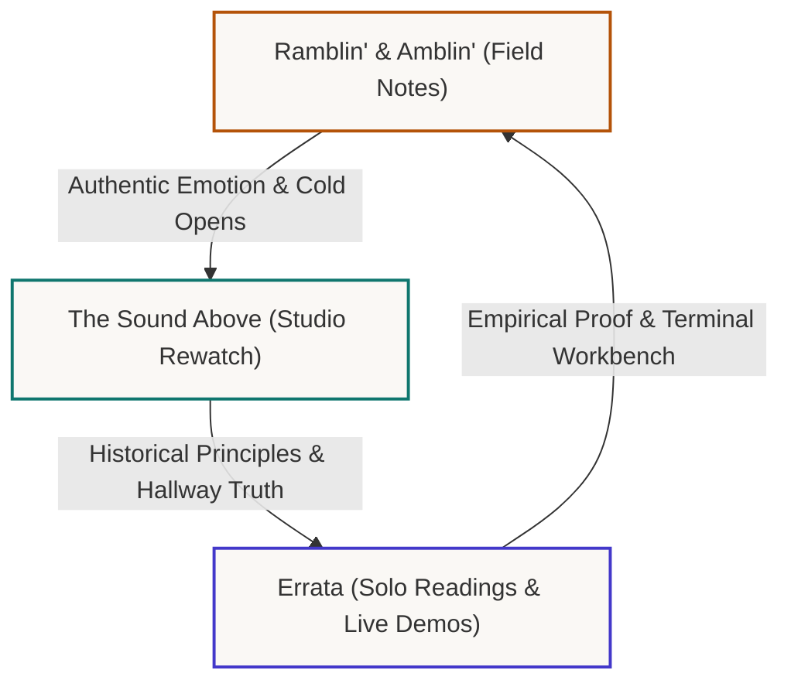
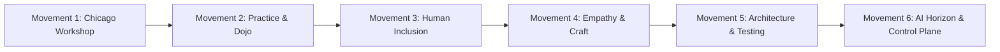

# The Sound Above: Audience Building, Narrative Sequence & Funding Strategy

Curated and hosted by Mike Hall (Staff Software Engineer, SCMC Co-Founder, Signatory #106).

This document details the operational strategy for publishing **The Sound Above**, integrating the **Ramblin' & Amblin'** field notes pipeline, sequencing the narrative to build a loyal practitioner audience, and establishing sustainable funding for long-term production.

---

## 1. The Core Narrative Flywheel: Tri-Format Architecture

Rather than treating video production as isolated livestreams, the channel operates as a self-reinforcing tri-format flywheel:



### Format 1: Ramblin' & Amblin' (Field Notes & Dispatches)
- **Nature**: Raw, mobile, outdoor, unscripted walking reflections (e.g. Veteran Acres Park, Crystal Lake Public Library, Shift Co-working).
- **Narrative Role**: The human hook and personal vulnerability. Grounding software engineering in trade identity, blue-collar roots (diesel mechanic trade union buyout parallel), and the real-world friction of corporate transitions.
- **Production Pipeline**: Autonomous intake daemon (`bin/pipeline_ramblin_amblin.rb`), background Whisper transcription, WebVTT human-verified captions, and promotion from unlisted to public in playlist `PLNtb969T2-l0`.
- **Audience Function**: Establishes relatable humanity. It serves as the cold open and B-roll dispatch for studio episodes.

### Format 2: The Sound Above (Forensic Oral History Rewatch)
- **Nature**: Structured, 45-minute studio broadcast across 35 curated interview episodes (plus 2 codas) spanning 6 historical movements.
- **Narrative Role**: The authoritative archival center. Unpacking what developers were actually doing between 2009 and 2015 when the Software Craftsmanship movement formed in Chicago.
- **Core Inquiry**: "Who inspired the speaker before they stepped onto the keynote stage? What records were playing in their room?"
- **AI-Era Parallel**: Directly connecting historical disciplines (sub-second feedback loops, deliberate practice, simple design) to modern AI agent orchestration and prompt-driven systems.
- **Audience Function**: Establishes peer authority, deep technical heritage, and educational depth for senior and staff practitioners.

### Format 3: Errata (Marginalia, Readings & Demonstrations)
- **Nature**: High-focus solo broadcasts: book readings (Hunt & Thomas, Beck, Hoover & Oshineye, Hickey), concept breakdowns (The Blink Test, Value vs Identity, The Mirage of Competence), physical artifact showcases, and live terminal demonstrations.
- **Narrative Role**: Empirical proof of craft. Demonstrating sub-second feedback loops and testing AI outputs against physical reality.
- **Audience Function**: Proves active technical competence and intellectual rigor on the live terminal workbench.

---

## 2. Audience Sequencing: The Six-Movement Narrative Arc

To build an audience over time, the release sequence follows a deliberate emotional and intellectual progression rather than chronological upload dates:



### Movement 1: The Chicago Workshop (Episodes 1 to 5)
- **Theme**: Practical engineering autonomy in enterprise ecosystems and founding grassroots developer rooms.
- **Featured Voices**: Sergio Pereira (Chicago Alt.NET), Ray Hightower (ChicagoRuby), Micah Martin & Mike Jansen (8th Light), Dave Hoover (Obtiva), Ryan Gerry & Jim Suchy (SCMC).
- **Audience Target**: Community organizers, senior engineers who remember early meetups, and practitioners seeking authentic origin stories.
- **Core Hook**: How developers met in the Sears Tower, suburban diners, and libraries before commercial developer relations or cloud platforms existed.

### Movement 2: The Practice and the Dojo (Episodes 6 to 11)
- **Theme**: Deliberate practice, code katas, and sub-second feedback loops.
- **Featured Voices**: Corey Haines (Coderetreat), Charley Baker (Watir/browser automation), Tim Ottinger (Clean Code), Andrea Magnorsky (Alt.NET/game jams), Gary Bernhardt (Destroy All Software), Justin Searls (TestDouble).
- **Audience Target**: Hands-on coders frustrated by sluggish CI pipelines and shallow LLM copy-paste culture.
- **Core Hook**: Why sub-second feedback loops create joy, and how to practice programming as a martial art.

### Movement 3: The Human Communication Layer and Inclusion (Episodes 12 to 17)
- **Theme**: Overcoming developer shame, radical hospitality, and building career pipelines.
- **Featured Voices**: Ginny Hendry (In Memoriam), Leon Gersing (Overcoming Shame), Sarah Allen & Desi McAdam (RailsBridge), Jen Myers (Girl Develop It), Dan North (BDD & Deliberate Discovery), Dave Thomas (Agile Manifesto & Elixir).
- **Audience Target**: Career changers, engineering managers, mentors, and developers seeking humane team cultures.
- **Core Hook**: Software development is fundamentally a human coordination problem.

### Movement 4: Philosophy, Empathy and Craftsmanship (Episodes 18 to 23)
- **Theme**: Humility, mental health in the hallway track, and social contracts.
- **Featured Voices**: Hadi Hariri, Sarah Gray, Katrina Owen (Exercism), Greg Baugues (Developers & Depression), Coraline Ada Ehmke, Adewale Oshineye.
- **Audience Target**: Senior engineers dealing with burnout, tech ethics readers, and systems thinkers.
- **Core Hook**: Technical mastery without human empathy is brittle and destructive.

### Movement 5: The Architecture and Testing Reckoning (Episodes 24 to 29)
- **Theme**: The "TDD is Dead" corridor debates, client-side frameworks, and deconstructing complexity.
- **Featured Voices**: David Heinemeier Hansson (DHH), Aaron Patterson, Yehuda Katz & Tom Dale (Ember), Rich Hickey (Simple Made Easy), Camille Fournier, Jason Cranford Teague.
- **Audience Target**: Software architects, framework maintainers, and technical leaders debating modularity.
- **Core Hook**: The timeless battle between simplicity and ease: unbraiding state in complex systems.

### Movement 6: The AI Horizon and The Observable Control Plane (Episodes 30 to 35, Codas 36 & 37)
- **Theme**: Applying seventeen years of craftsmanship disciplines to multi-agent fleets, sovereign local inference, and deterministic cartography.
- **Featured Voices**: Adam Lear, Robert "Uncle Bob" Martin, Chet Hendrickson & Ron Jeffries, Stuart Halloway, Sandro Mancuso, Amitai Schlair.
- **Audience Target**: AI engineers, engineering directors, CTOs, and modern developers navigating the transition to agentic workflows.
- **Core Hook**: AI agents do not replace craftsmanship: they require more discipline, clearer contracts, and faster verification loops than ever before.

---

## 3. Production Pipeline Tooling: Teleprompter & Rundown System

To ensure smooth, consistent execution during live recording, the project provides dedicated orchestration tooling:

### A. Teleprompter Rundown Generator (`bin/generate_sound_above_teleprompter.rb`)
Generates a structured 6-act teleprompter script for any episode, aligned directly with the 8 OBS production scenes:
- **Act 1: Cold Open & Personal Grounding** (`01. Starting Soon` -> `02. Monologue / Full Camera`): Connects the episode to current reality and Ramblin' & Amblin' themes.
- **Act 2: Setting the Historical Scene** (`02. Monologue / Full Camera`): Historical venue, year, and pre-conference hallway context.
- **Act 3: The Core Inquiry: The Sound Above** (`02. Monologue` -> `04. Split Screen`): "Who inspired the speaker before they arrived here?"
- **Act 4: Hallway Rewatch & Video Reaction** (`03. Reaction - Video Focus`): Interactive rewatch of archival video asset with live commentary.
- **Act 5: The AI-Era Parallel & Terminal Workbench** (`05. Workbench - Code & Terminal`): Live code, terminal demonstration, or architectural diff.
- **Act 6: Community Coda, Outro & Next Stream** (`08. Outro & Next Stream`): Cross-links to just3ws.com transcripts, audience questions, and next episode teaser.

```bash
# Generate terminal teleprompter cards:
ruby bin/generate_sound_above_teleprompter.rb --episode 1

# Generate markdown script for teleprompter apps:
ruby bin/generate_sound_above_teleprompter.rb --episode 1 --markdown

# Generate JSON payload for live dashboard integration:
ruby bin/generate_sound_above_teleprompter.rb --episode 1 --json
```

### B. YouTube Operations Cockpit (`/youtube/dashboard/`)
The interactive web dashboard at `https://www.just3ws.localhost/youtube/dashboard/` provides:
1. **Asset Matrix & Publication Funnel**: Searchable status tracking across all 215 assets.
2. **Best Practices Auditor**: Real-time compliance checking for zero em dashes, title lengths, and WebVTT caption parity.
3. **Livestream Cockpit & Script Viewer**: Live read-along teleprompter cards with auto-scroll and scene-change cues.
4. **Interactive Quota Calculator**: Safe simulation of Google Cloud API quota consumption.

---

## 4. Sustainable Funding & Monetization Architecture

To fund ongoing research, compute tokens, audio instrumentation, and archival preservation, the project leverages four complementary revenue streams suited to independent engineering craft:

### Stream 1: Patreon Membership & Community Underwriting
- **Primary Membership Hub**: [patreon.com/whoistechcmty](https://patreon.com/whoistechcmty) (WHOIS Tech Community)
- **Secondary Developer Portal**: [github.com/sponsors/just3ws](https://github.com/sponsors/just3ws)
- **The Historical Provenance & Root Identity Consolidation**:
  The archive originated in 2011 as UGtastic, documenting grassroots leaders across Chicago Alt.NET, SCNA, GOTO, and RailsConf. It later evolved into WHOIS Tech Community (`@whoistechcmty`), where dedicated community backers stepped forward to fund video cameras, microphones, and travel. That history is honored as an essential chapter of the story: real people providing real support during a complex era of independent production.
  
  Today, all secondary channels, including the legacy `@whoistechcmty` Patreon campaign and YouTube channel, consolidate under Mike's permanent root identity: **just3ws** (`just3ws.com`, continuously registered since October 4, 2000, from the dawn of the web when Mike coined the phrase "just three 'W's changed the world"). While platform handles like Patreon and YouTube retain `@whoistechcmty` for subscriber continuity, all engineering writing, case studies, and primary profiles resolve back to the sovereign `just3ws.com` core.

  

- **Audience Reality & Demographics**:
  The audience for The Sound Above and Errata is not comprised of junior bootcamp learners looking for interview hacks. It is composed of Staff+ software engineers, systems architects, and community organizers. These engineers do not purchase merch or subscription badges; they invest in preserving unvarnished engineering history and independent forensic AI research that resists vendor marketing.

- **Economic Reality of Sovereign Production**:
  Maintaining sovereign audio transcription (Whisper), AI model tokens for spectral diffing and verification, high-availability Jekyll hosting, and professional recording gear requires real cash flow. Setting transparent patron tiers establishes a sustainable foundation without creating unsustainable content treadmill pressure.

- **Calibrated Patron Tiers**:
  1. **Archive Preservationist ($7/month)**
     - *Purpose*: Directly underwrites raw compute costs, API token consumption, Whisper transcription runs, and static site hosting.
     - *Deliverables*: Closing credits on broadcast outro cards; access to uncompressed WebVTT files, raw transcript JSONL datasets, and semantic YAML dossiers before YouTube staging.
  2. **Workbench Craftsman ($19/month)**
     - *Purpose*: Funds physical audio instrumentation, experimental audio DSP filters, and sovereign workstation tooling.
     - *Deliverables*: Behind-the-scenes engineering marginalia (OBS RNNoise configurations, Python DSP notch filter scripts, spectral waterfalls); downloadable teleprompter rundowns; quarterly technical salon on system cartography and unbraiding legacy monoliths.
  3. **Engineering Patron / Institutional Underwriter ($97/month)**
     - *Purpose*: Underwrites complete 6-movement broadcast arcs and long-term digital humanities preservation.
     - *Deliverables*: Named broadcast sponsorship credit in Act 6 ("Broadcast underwritten by the patrons of WHOIS Tech Community"); quarterly 45-minute 1-on-1 advisory session on system cartography, legacy modernization, or Staff+ career architecture; corporate learning budget reimbursement documentation.

### Stream 2: Developer Tool & Infrastructure Underwriting
- **Target Partners**: Developer-focused companies whose products align with craft, local-first computing, developer ergonomics, and observability (e.g. OpenObserve, Sentry, Tailscale, Zed, JetBrains, local AI workstation providers).
- **Format**:
  * Pre-roll attribution in YouTube descriptions and canonical transcript pages.
  * Authentic, host-read 30-second broadcast segment in Act 6: "The Sound Above is supported by..."
  * Lower-third overlay sponsorship card during outro scene.
- **Unit Economics**: $500 to $1,500 per episode underwriting, sold in 4-episode thematic movement blocks.

### Stream 3: High-Leverage Staff+ Advisory & System Cartography Workshops
- **Nature**: Using the YouTube broadcast series as top-of-funnel inbound authority.
- **Offerings**:
  * **System Cartography Audits**: 2-week deep forensic mapping of legacy codebases, unbraiding technical debt, and defining bounded contexts.
  * **AI Orchestration & Verification Governance**: Helping engineering organizations implement deterministic verification gates to prevent synthetic code degradation.
  * **Apprenticeship & Senior Engineering Culture Advisory**: Modernizing internal developer practices based on the 17-year craftsmanship lineage.

### Stream 4: Digital Humanities & Open-Source Grants
- **Target Foundations**:
  * **Sloan Foundation (Technology & Digital Infrastructure)**: Funding historical preservation of early web, open-source, and craftsmanship movements.
  * **Ruby Central / Python Software Foundation Community Grants**: Preserving early conference oral history recordings (RailsConf, SCNA, GOTO).
  * **Open Technology Fund & NLnet**: Supporting sovereign local developer tooling and deterministic verification pipelines.

---

## 5. Media Release Cadence & Publication Schedule

To maintain consistency without burnout, production runs on a deterministic 2-release weekly cadence:

| Day | Slot | Archetype | Purpose |
| :--- | :--- | :--- | :--- |
| **Tuesday 11:00 AM CST** | Primary Broadcast | **The Sound Above** (Oral History Rewatch) | Main tentpole episode: 45-minute live stream or premiere with live chat. |
| **Friday 09:00 AM CST** | Field Dispatch | **Ramblin' & Amblin'** (Outdoor Field Notes) | 15 to 20 minute raw dispatch connecting weekly theme to physical surroundings. |
| **Alternate Weekends** | Deep Workbench | **Errata** (Solo Reading or Live Terminal Demo) | Technical deep-dive demonstrating concepts or testing AI outputs live. |

This schedule ensures continuous audience engagement across multiple modalities: the structured archive, the personal outdoor walking notes, and the hands-on code workbench.
